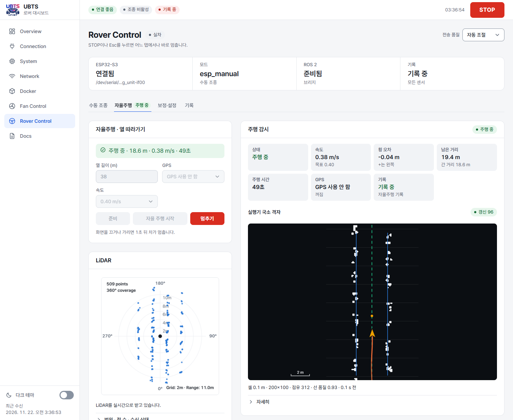
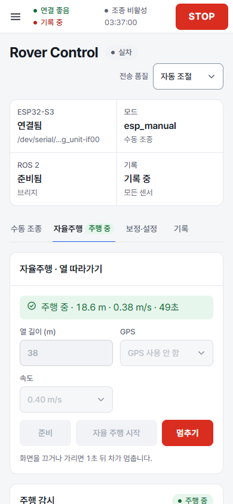
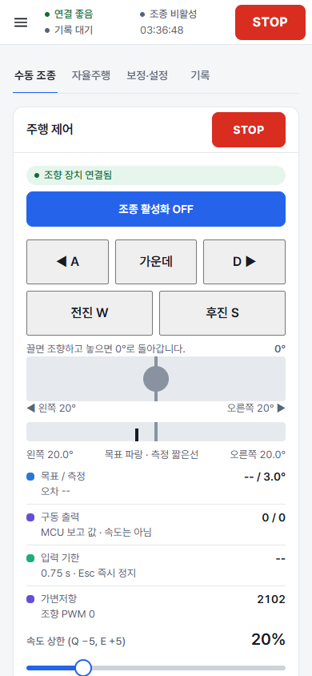
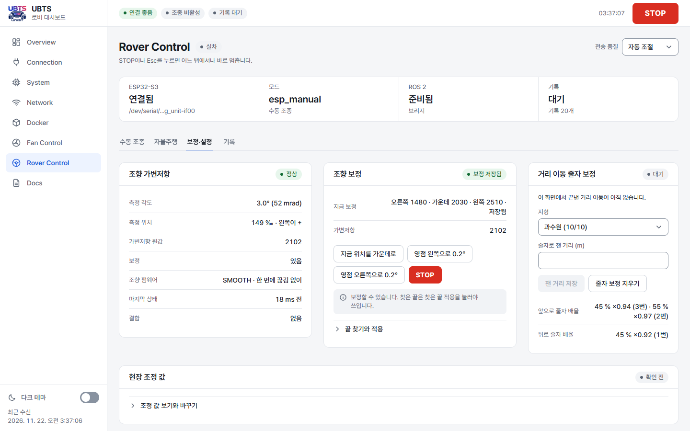
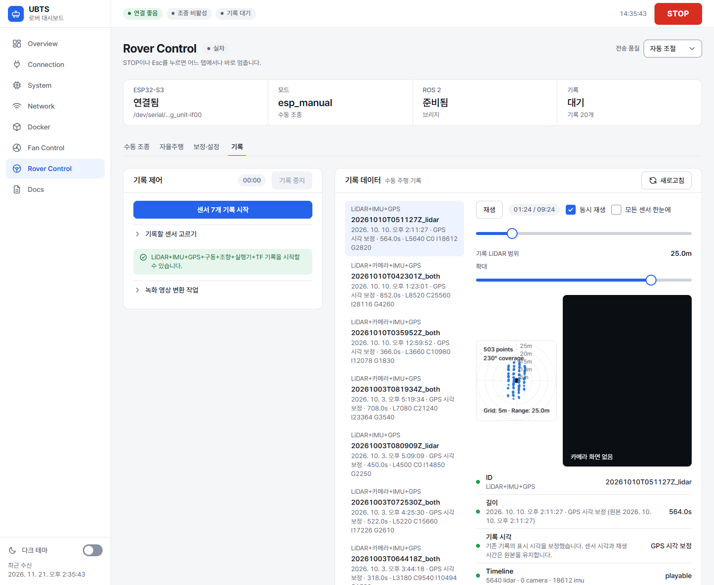
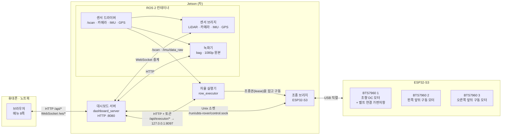

# unist_orachard_dashboard

UNIST BTS 과수원 로버의 웹 대시보드입니다. 차에 실린 Jetson에서 돌고, 휴대폰이나 노트북 브라우저로 접속해
센서를 실시간으로 보고, 차를 조종하고, 자율주행을 시작·정지하고, 주행 기록을 남기고 다시 봅니다.
차의 2.4 GHz 무선 AP처럼 느리고 끊기는 연결에서도 조종 명령과 STOP이 먼저 지나가도록 만들었습니다.

| Rover Control (노트북 1440 px) | 휴대폰 (390 px) |
|---|---|
|  |  |

[화면 · 모의 자료] 2026-11-21 판의 Rover Control 첫 화면(상태 띠, 탭 네 개, 수동 조종 탭). 화면 점검 도구의 모의 서버(`tools/ui_check`)가 내는 예시 자료로 찍었고 실제 센서 값이 아니다.

## 목차

1. [한눈에](#1-한눈에)
2. [화면 구성](#2-화면-구성)
3. [주요 기능](#3-주요-기능)
4. [시스템 구성](#4-시스템-구성)
5. [실행과 설치](#5-실행과-설치)
6. [시험](#6-시험)
7. [현재 한계](#7-현재-한계)
8. [저장소 구조와 문서](#8-저장소-구조와-문서)
9. [변경 이력](#9-변경-이력)
10. [라이선스](#10-라이선스)

## 1. 한눈에

| 항목 | 내용 |
| --- | --- |
| 하는 일 | 센서 실시간 보기, 수동 조종과 STOP, 자율주행(한 열 따라가기) 시작·정지와 감시, 주행 기록과 동기 재생, 격자 지도, Jetson 관리(자원·네트워크·Docker·팬) |
| 돌아가는 곳 | 차의 Jetson Orin Nano. 접속은 차의 무선 AP(`http://10.77.0.1`) 또는 같은 Wi-Fi |
| 서버 | Python 표준 라이브러리 HTTP 서버(웹 프레임워크 없음). 센서는 ROS 2 브리지 컨테이너에서 WebSocket으로, 수동 조종은 조종 브리지에 Unix 소켓으로, 자율주행은 실행기 운영자 API로 간다 |
| 차량 | 어린이용 4륜 전동차 개조. 앞바퀴 조향(조향 DC 모터 + 벨트로 이은 가변저항), 4륜 구동(한쪽 앞뒤 모터가 드라이버 하나를 나눠 씀). ESP32-S3 한 장이 모터 드라이버 BTS7960 세 개(조향, 왼쪽 구동, 오른쪽 구동)를 돌린다 |
| 센서 | 2D LiDAR RPLIDAR S2, UVC 카메라, IMU BNO085, GNSS u-blox ZED-F9P. 휠 엔코더는 없다 |
| 지금 상태 (2026-11-21) | Jetson에 설치돼 있다. 2026-11-18·19 실내 복도 시험과 2026-11-20 과수원 첫 자율주행(자율주행 탭에서 18번 출발, 약 772 m)에 썼다 |
| 실차 결과 | 시뮬레이션 저장소의 [과수원 결과 문서](https://github.com/2026-BTS-UNI-Car/unist_orchard_simulation/blob/main/docs/steering/ORCHARD_1120_RESULT_KO.md)(팀 비공개) |

## 2. 화면 구성

### 메뉴 8쪽

메뉴와 쪽 구성은 화면 개편 전과 같다(2026-11-14 사용자 지시로 되돌림). 새 기능은 모두 Rover Control 안에 있다.

| 메뉴 | 주소 | 하는 일 |
| --- | --- | --- |
| Overview | `/` | CPU·메모리·외부 IP·Docker 요약, CPU·메모리와 네트워크 그래프, ROS2·로버 연결, Jetson 정보 |
| Connection | `/connection` | LiDAR·카메라 연결 상태, RPLIDAR 상태 확인, 2D LiDAR 지도(내려받기), 카메라 실시간 화면, 서비스·ROS2 센서 연결 |
| System | `/system` | Jetson CPU(코어별)·메모리·Swap·네트워크·전력 그래프, 디스크 |
| Network | `/network` | 외부·내부 주소, 오프라인 AP와 저장된 Wi-Fi 전환, Wi-Fi 관리, 연결 정보 |
| Docker | `/docker` | 컨테이너 CPU·메모리, 목록, 상세·로그, 시작·중지·재시작(확인 창) |
| Fan Control | `/fan` | 온도, 팬 PWM(자동·수동) |
| Rover Control | `/rover-control` | 쪽 안의 탭 네 개(아래 표) |
| Docs | `/docs` | 운영 문서 |

화면 6개 판의 옛 주소(`/map`, `/records`, `/tuning`, `/sensors`, `/system/*` 등)는 별칭으로 남아 그 기능이 있는 쪽으로 간다.
자세한 화면 규칙: [`docs/SCREENS_KO.md`](docs/SCREENS_KO.md).

### Rover Control의 탭 네 개

| 탭 | 들어 있는 것 |
| --- | --- |
| 수동 조종 | LiDAR, 실시간 점유 격자 지도, 카메라, GPS 위치(오프라인 지도), IMU, 주행 제어(조향 조종, 거리 이동) |
| 자율주행 | 열 길이·GPS 사용·속도 고르기, 버튼 셋(준비 / 자율 주행 시작 / 멈추기), 주행 감시, 실시간 LiDAR, 자율주행 기록 |
| 보정·설정 | 조향 가변저항, 조향 보정, 거리 이동 줄자 보정, 실행기의 현장 조정 값, 연동 상태 |
| 기록 | 기록 제어(센서마다 고르기), 수동 주행 기록의 재생·기록 지도·내려받기 |

- STOP은 모든 쪽의 상태 막대와 각 탭에 있고, Esc도 어느 탭에서나 멈춘다.
- 조종 활성화를 쥔 채 수동 조종 탭을 떠나면 STOP을 보낸다. 고른 탭은 그 브라우저에 남는다.

| 자율주행 탭 (노트북, 주행 중) | 자율주행 탭 (휴대폰) |
|---|---|
|  |  |

| 조향 패널 (휴대폰) | 보정·설정 탭 | 기록 탭 |
|---|---|---|
|  |  |  |

[화면 · 모의 자료] 2026-11-21, 조향 차량(`front_steer`) 화면. 주행 상태, 실행기 격자, 조향 각, 보정 값, 기록 목록은 모두 지어낸 값이다.
조정 묶음의 이름·범위·단위는 실행기가 알려 준 것을 그대로 보인다.

## 3. 주요 기능

### 3.1 수동 조종과 STOP

- 조종 활성화 뒤 키보드(W/S 구동, A/D 조향, Q/E 속도)나 화면 버튼으로 몬다. 손을 떼면 감속하고, 입력이 0.75초 끊기면 차가 스스로 선다.
- STOP·Esc·창 이탈은 즉시 정지와 조종 해제다. 조종 요청은 다른 요청과 따로, 가장 먼저 보낸다.
- 조향: A/D를 누르는 동안 왼쪽·오른쪽 끝(±20 명령 도)까지 가고 놓으면 가운데로 온다. 막대를 끌면 그 각으로 가고(0.25° 단위), 놓으면 0°로 돌아온다. 키와 막대는 먼저 잡은 쪽만 듣고 STOP이 언제나 이긴다.
- 구동 속도 상한은 0~100 %에서 고르고, 브리지의 구동 상한(설치 값)을 함께 보인다.
- 거리 이동: 거리(앞·뒤)와 속도를 고르고 누르고 있는 동안 그만큼 간다. 시간은 2026-10 기록의 duty-속도 표로 정하고, 줄자로 잰 값으로 속도별 배율을 고친다.
- 화면의 PWM·duty는 요청한 출력이고 실제 바퀴 속도가 아니다(휠 엔코더가 없다).
- 브리지와 구동 안전: [`docs/esp_rover_control.md`](docs/esp_rover_control.md).

### 3.2 자율주행 (한 열 따라가기)

1. **준비**: 실행기 상태를 새로 읽고 필요한 것(멈춤 확인, 열린 주행 끝내기, 시작, Arm)을 차례로 한다.
2. **자율 주행 시작**: 통로를 잡아 출발할 수 있게 되면 켜진다. 누르면 모든 센서 기록을 먼저 켠 뒤 출발한다(기록을 못 켜면 출발하지 않는다).
3. **멈추기**: 늘 켜져 있다.

- 상태 한 줄이 지금 상태와 다음 할 일을 문장으로 알린다(예: '주행 중 · 12.3 m · 0.38 m/s · 35초').
- 주행 감시: 타일 일곱 개(상태, 속도, 횡 오차, 남은 거리, 주행 시간, GPS, 기록)와 실행기 국소 격자의 움직이는 그림(차는 제자리, 바닥이 흐른다).
- 화면은 0.1초마다 운영자 연결 신호를 보낸다. Rover Control을 떠나거나 브라우저 탭을 숨기면 신호가 멈추고, 실행기의 운영자 연결 기한(기본 1.0초)이 지나면 차가 선다. 다시 출발은 사람이 누른다.
- 실행기가 SHADOW(연습 모드)면 상태 줄이 차가 움직이지 않는다고 알린다.
- 서버 사양: [`docs/STEERING_SERVER_KO.md`](docs/STEERING_SERVER_KO.md), 현장 절차: [`docs/ORCHARD_DAY_20261120_KO.md`](docs/ORCHARD_DAY_20261120_KO.md).
- 실행기(통로 추정, 조향·속도 제어, 정지 규칙)는 시뮬레이션 저장소에 있다. 수식과 기술 이름은 그 저장소의 [자율주행 알고리즘 기술 문서](https://github.com/2026-BTS-UNI-Car/unist_orchard_simulation/blob/main/docs/AUTONOMY_ALGORITHM_KO.md).

### 3.3 기록과 재생

- 녹화: ROS bag(LiDAR, 원본 IMU, GPS, 조종 요청·보드가 알린 PWM, 조향 상태, 실행기 상태)과 원본 1080p 카메라.
- 자율주행은 달린 구간마다 기록이 하나씩 자동으로 생기고(출발·다시 출발마다 새 기록), 주행 시간·거리·끝난 이유가 남는다. 기록 목록은 수동 주행(기록 탭)과 자율주행(자율주행 탭)으로 나뉜다.
- 재생: 센서와 영상을 같은 시각으로 되감아 보여 준다. 자율주행 기록에서는 기록된 실행기 상태를 주행 감시와 같은 그림으로 그린다. 영상과 센서는 바로 재생되고 기록 지도가 뒤따른다.
- 재생용 영상(HLS, 1080~240p)은 녹화기가 한 번에 기록 하나씩 만든다. 1080p 한 장에 약 0.73초, 기록 길이의 11~12배가 걸리고, 기다리는 줄은 32개까지다(환경 변수로 최대 64).
- 주행 중 Jetson이 꺼져 끝맺지 못한 기록은 녹화기 컨테이너 안에서 `scripts/recover_interrupted_recording.py`로 마무리한다(bag 색인을 다시 만들고 녹화기 코드로 다시 흘려 타임라인·미리보기·지도 원본을 만든다. 원본 bag은 바꾸지 않는다).
- 자세히: [`docs/motor_pwm_recording.md`](docs/motor_pwm_recording.md), [`docs/imu_ros2_recording.md`](docs/imu_ros2_recording.md), [`docs/SCREENS_KO.md`](docs/SCREENS_KO.md) 2-0절.

### 3.4 격자 지도

- 실시간 지도와 기록 지도는 같은 위치 추정기를 쓴다. LiDAR 스캔을 앞 스캔(또는 1.25 m마다 잡는 기준 스캔)에 맞춰 움직임을 재고, 방향 변화는 IMU 방향에서 먼저 읽는다. GNSS는 속도와 큰 어긋남을 거르는 데만 쓴다.
- 조향 각, 구동 PWM, 카메라는 쓰지 않는다. 조향 각으로 방향을 계산해 보니 주행 한 번에 9~807° 틀렸다.
- 2026-11-20 과수원 기록으로 재 보니 고치기 전에는 100 m 열을 7~18° 휘게 그렸고, 방향을 IMU로 읽게 고친 뒤에는 18번 모두 1° 안이다(측량 기준은 없음).
- 방법, 측정, 한계: [`docs/GRID_MAP_KO.md`](docs/GRID_MAP_KO.md).

### 3.5 느린 연결 대응

PC에서 2.4 GHz 연결을 흉내 내는 시험대(`tools/slow_link`)로 재며 고쳤다. 정한 목표 32개 중 20개를 만족한다(고치기 전 5개).
못 미친 것의 대부분은 조종 꼬리 지연으로, 잰 PC가 자주 잠깐씩 멈춘 탓으로 판정했다. 모두 PC 한 대에서 흉내 낸 값이고 차의 실제 무선 연결 값이 아니다.

<!-- slow-link-summary:begin -->
| 수치 | 연결 | 기준 d962013 (2026-11-12) | 최종 90094fd (2026-11-13) |
| --- | --- | --- | --- |
| 조종 명령 왕복 p50 | 보통 2 Mbit/s | 382 ms | 82.7 ms |
| STOP이 조종 끝점에 닿기까지 p50 | 나쁨 500 kbit/s | 252 ms | 102 ms |
| 카메라 지연 p95 | 나쁨 500 kbit/s | 8295 ms | 691 ms |
| LiDAR 다시 그리는 수 | 나쁨 500 kbit/s | 0.98 Hz | 4.68 Hz |
| 연결 사용률(받는 양 ÷ 속도) | 나쁨 500 kbit/s | 88.3 % | 44.7 % |
| 2분 동안 닫힌 스트림 | 나쁨 500 kbit/s | 6개 | 1개 |
| 처음 열기에 받는 양 | 보통 2 Mbit/s | 1501 kB | 297 kB |
| 다시 열기에서 연결에 나간 페이지 파일 요청 | 보통 2 Mbit/s | 49개 | 1개 |
| 숨긴 탭이 받는 스트림 | 보통 2 Mbit/s | 250 kB/s | 0 kB/s |
| 지도 응답 크기 10분째 ÷ 첫 1분 | 나쁨, 10분 | 8.65배 | 0.16배 |
<!-- slow-link-summary:end -->

- 고친 방식: 조종·STOP 요청을 따로 가장 먼저 보냄, 화면이 받은 것을 확인한 뒤에만 다음 센서 자료를 보냄, 화면에 보이지 않는 패널과 숨긴 탭은 받지 않음, LiDAR 이진 형식, 정적 파일 캐시, 글꼴 나누기, 지도는 늘어난 만큼만 전송.
- 메뉴를 되돌린 뒤(2026-11-14) Rover Control을 다시 쟀다: 첫 화면에 LiDAR가 다시 있어 나쁨 연결 사용률이 65.3 %(목표 60 %)이고, 조종·STOP·카메라는 같았다.
- 목표표, 못 미친 것과 까닭: [`docs/slow_link.md`](docs/slow_link.md) 12·13절.

### 3.6 Wi-Fi 관리 (Network 쪽)

- 주변 Wi-Fi 검색(신호, 대역·채널, 보안), 비밀번호로 연결, 자동 연결 여부와 우선순위 바꾸기, 오프라인 AP 전환.
- 모든 연결 변경은 시험 연결이다: 새 연결이 45초 안에 주소를 못 받거나 실패하면 곧바로, 연결된 뒤 150초 안에 '이 연결 유지'를 누르지 않으면 이전 연결로 스스로 돌아간다(원격에서 바꾸다 끊겨도 돌아오게).
- 비밀번호는 Jetson의 root 전용 NetworkManager 파일에만 들어가고 명령행·로그·응답에 나오지 않는다. 권한이 필요한 일은 정해진 명령만 받는 호스트 도우미(`deploy/offline_ap/ubts_network_mode.py`)가 한다.
- 가짜 nmcli 시험과 모의 서버로 확인했다. 화면의 시험 연결 흐름은 차에서 아직 눌러 보지 않았다.
- 계약과 한계: [`docs/jetson_offline_access.md`](docs/jetson_offline_access.md) "Wi-Fi 관리", 도우미 교체: [`deploy/network_helper_update/README_KO.md`](deploy/network_helper_update/README_KO.md).

| 노트북: 주변 Wi-Fi에서 고르고 비밀번호 넣기 | 휴대폰: 시험 연결 중 남은 시간과 확인 |
|---|---|
|  |  |

[화면 · 모의 자료] 2026-11-21. 지어낸 SSID·주소(문서 예시 대역)로 찍었고 실제 Jetson의 Wi-Fi 목록이 아니다.

## 4. 시스템 구성



[도식] 화면은 상태를 짧은 HTTP 요청으로, 센서는 WebSocket으로 받는다.

| 구성요소 | 맡은 일 |
| --- | --- |
| 대시보드 서버 | 화면·정적 파일, 상태 API, 센서 WebSocket 중계, 조종 요청 중계, 실행기 API 중계(토큰은 화면에 내보내지 않음), 기록 목록·재생·기록 지도 |
| 센서 드라이버·브리지 | ROS 2 컨테이너. LiDAR·카메라·IMU·GPS를 토픽으로 내고 화면용 WebSocket으로 보낸다 |
| 녹화기 | rosbag2와 원본 영상 기록, 재생용 영상 만들기 |
| 조종 브리지 | 직렬 장치를 여는 유일한 프로그램. 화면·실행기 요청(구동, 조향 각)을 보드 명령으로 바꾸고, 입력 기한·구동 램프·상한을 지킨다 |
| 자율 실행기 | 한 열 따라가기의 추정·제어. 시뮬레이션 저장소([`unist_orchard_simulation`](https://github.com/2026-BTS-UNI-Car/unist_orchard_simulation), 팀 비공개)에서 만들어 Jetson에 설치한다 |
| ESP32-S3 보드 | 조향 위치 루프(가변저항 값이 목표에 오도록 조향 모터를 돌림)와 구동 PWM, 명령이 300 ms 끊기면 구동을 멈추는 감시 |

보드 배선(펌웨어 소스 `BTS7960_Serial_Control.ino`에 적힌 것. 차에서 따로 확인하지 않았다):

| BTS7960 | 맡은 일 | R_EN | RPWM | L_EN | LPWM |
| --- | --- | --- | --- | --- | --- |
| 1 | 조향 DC 모터(F = 오른쪽) | 16 | 17 | 18 | 8 |
| 2 | 왼쪽 구동 | 46 | 3 | 9 | 10 |
| 3 | 오른쪽 구동 | 12 | 11 | 13 | 14 |

- 가변저항은 바깥 단자를 3.3 V·GND에, 가운데 단자를 GPIO6에 잇는다. PWM은 20 kHz, 8비트(0~255).
- GPIO3·GPIO46은 부팅 설정 핀이라 외부 배선이 부팅에 영향을 줄 수 있다(소스 주석). 명령과 보정 값: [`docs/esp_rover_control.md`](docs/esp_rover_control.md) 1절.

## 5. 실행과 설치

### 5.1 화면만 보기 (모의 서버, 표준 라이브러리만)

```
python tools/ui_check/mock_server.py --static static --dataset stress --port 8099
# 브라우저: http://127.0.0.1:8099/rover-control
# 조향 차량 화면: --vehicle front_steer 를 붙인다
```

Windows·Linux 어디서나 된다. 센서·조종 값은 지어낸 예시이고 버튼은 읽기 전용 답만 받는다.

### 5.2 개발 실행 (Linux 또는 WSL)

```
python3 -m pip install -r requirements.txt
scripts/run_local.sh            # = python3 -m dashboard_server --host 127.0.0.1 --port 8080
# 브라우저: http://127.0.0.1:8080
```

센서 브리지가 없으면 센서 칸은 "연결 전"으로 보인다. 자주 쓰는 환경 변수:

| 변수 | 뜻 |
| --- | --- |
| `DASHBOARD_VEHICLE` | `differential`(기본, 옛 차동 차) / `front_steer`(조향 차량 화면). 조종 브리지가 `vehicle_profile: front_steer`를 내면 이 값과 상관없이 조향 화면이 된다 |
| `UBTS_EXECUTOR_URL`, `UBTS_EXECUTOR_TOKEN_FILE` | 자율 실행기 운영자 API 주소와 토큰 파일 |
| `UBTS_EXECUTOR_LINK_FILE` | 위 둘이 없을 때 읽는 실행기 연결 파일(기본 `runtime/row_executor/dashboard_link.json`). 셋 다 없으면 자율·조정 칸은 "설정 없음" |
| `LIDAR_WS_UPSTREAM`, `CAMERA_WS_UPSTREAM`, `IMU_WS_UPSTREAM`, `GPS_WS_UPSTREAM` | 센서 브리지 WebSocket 주소 |
| `DASHBOARD_MODE` | `live`(기본) / `simulation`(시뮬레이션 확장을 꽂을 때, [`docs/STEERING_SERVER_KO.md`](docs/STEERING_SERVER_KO.md) 2절) |
| `RECORDER_MEDIA_QUEUE_MAX_JOBS` | 녹화기의 재생용 영상 대기 줄 길이(기본 32, 최대 64) |

Gazebo 시뮬레이션 스택(가상 센서, 조향 브리지, 실행기)과 함께 보려면 시뮬레이션 저장소의 안내를 따른다. 그 저장소는 이 저장소의 한 커밋을 사본으로 가져가 쓴다.

### 5.3 차(Jetson)에 설치

> **주의: 차의 대시보드를 `docker compose`로 다시 만들지 않는다.** Jetson의 compose 파일은 옛 이미지(10월 7일)를 가리켜서,
> `docker compose up`(`--build`, `down` 포함)을 하면 옛 대시보드로 돌아간다.

| 무엇 | 방법 |
| --- | --- |
| 대시보드 | 설치 묶음 [`deploy/jetson_dashboard/README_KO.md`](deploy/jetson_dashboard/README_KO.md): 점검 → `--apply` → 확인. 지금 컨테이너를 보존한 뒤 바뀐 파일만 겹치고, 실패하면 자동으로 되돌린다 |
| ESP32-S3 조종 브리지 | [`deploy/jetson_esp32_bridge/README_KO.md`](deploy/jetson_esp32_bridge/README_KO.md)(현장 첫 시험 순서 포함) |
| 자율 실행기 | [`deploy/jetson_row_executor/README_KO.md`](deploy/jetson_row_executor/README_KO.md) |
| 무선 AP와 접속 | [`docs/jetson_offline_access.md`](docs/jetson_offline_access.md), 현장 점검표 [`docs/WIFI_AP_CHECKLIST_KO.md`](docs/WIFI_AP_CHECKLIST_KO.md) |

`docker-compose.yml`은 서비스 구성(대시보드, 센서 드라이버와 브리지, 조종 브리지, 녹화기)을 적은 것이다. 빈 PC에서 전체를 처음 띄울 때의 참고로만 쓴다.

## 6. 시험

```
# 화면 시험 (Node 22 이상)
for f in tests/test_*.js tests/test_*.mjs; do node "$f" >/dev/null 2>&1 || echo "FAIL $f"; done

# Python 시험 (Linux. Windows 에서는 fcntl 을 쓰는 시험이 모이지 않는다)
python3 -m unittest discover -s tests

# ESP32-S3 브리지 (가짜 보드. pty 끝단 시험은 Linux)
python3 -m unittest tests.test_esp32_bridge tests.test_esp32_bridge_linux tests.test_jetson_esp32_bridge_kit tests.test_esp32_smooth
python3 -m unittest tests.test_drive_distance tests.test_drive_distance_route
node --test tests/test_drive_distance.mjs
node --test tests/test_steer_drag.mjs

# Wi-Fi 관리 (가짜 nmcli)
python3 -m unittest tests.test_network_wifi_api tests.test_network_wifi_helper tests.test_network_helper_update tests.test_network_mode
node --test tests/test_network_wifi_ui.mjs

# 조종 회귀 (조종·STOP 경로를 바꿨을 때 꼭)
node tests/test_control_path_regression.js && node tests/test_rover_browser.js && node tests/test_rover_pad_touch.js
python3 -m unittest tests.test_control_deadman_regression

# 화면 점검: 메뉴 8쪽 × 5화면 크기 × 자료 2종 = 80쪽, 받아들인 기록과 비교 (Playwright, 깔린 Chrome)
python tools/ui_check/run_checks.py --static static --out <결과 폴더>
python tools/ui_check/compare.py --run <결과 폴더>/ui_check.json --baseline tools/ui_check/accepted/ui_check.json

# 느린 연결 시험대: 받아들인 값과 견주기 (사용법 tools/slow_link/README_KO.md)
python -B tools/slow_link/compare.py --run <결과 폴더>
```

CI(`.github/workflows/smoke.yml`)는 컴파일과 Python 시험을 돌린다. ROS가 있어야 하는 시험은 ROS 없이 건너뛴다.

## 7. 현재 한계

| 영역 | 한계 |
| --- | --- |
| 차에서 쓴 범위 | 2026-11-18·19 실내 복도와 2026-11-20 과수원 하루뿐이다. 2026-11-21에 고친 것(기록 재생, 격자 지도 방향)은 Jetson에서 그날 기록으로 확인했고 차를 몰면서는 아직 써 보지 않았다 |
| 조종 브리지 | 2026-11-20 주행 중 브리지 오류가 7번 났다(Jetson에서 보드로 가는 명령이 잠깐 끊김). 일곱 번 모두 차는 섰고 원인은 가르지 못했다. 그날 밤 원인 기록(`link_diag`, `slow_step`)을 넣었다. 명령 눈금과 실제 바퀴 각도의 관계는 재지 않았다. 물리 비상정지가 마지막 수단이다 |
| 자율 실행기 | 과수원에서 끝까지 간 10번은 모두 운영자가 넣은 열 길이의 거리 한도에서 섰고 LiDAR로 열 끝을 보고 선 적은 없다. 횡 오차와 거리는 실행기의 자체 추정이고 줄자로 대조하지 않았다 |
| Jetson | 2026-11-20 주행 중 한 번 재시작했다(원인 미확정). 인터넷 없이 켜면 시계가 틀릴 수 있어, 화면은 상태의 나이를 화면 쪽 시계로 잰다 |
| 기록 | 모든 센서 기록은 5.6분에 약 4.8 GB다. 영상 변환은 한 번에 하나씩이고, 기록 지도도 한 번에 하나만 만든다 |
| 격자 지도 | LiDAR·IMU(와 품질이 맞는 GNSS)로만 위치를 추정한다. 방향은 IMU가 흐르는 만큼(5~8분에 1.5° 안) 흐르고, 같은 곳을 다시 지날 때 맞추는 보정(loop closure)은 없다. 측량 기준과 견준 정확도는 없다 |
| 느린 연결 | 연결 프로필과 연결 등급 경계(25 / 90 / 220 ms)는 가정이다. 현장에서 `?link_log=1`로 기록을 받아 고친다 |
| 브리지 이미지 | LiDAR 이진 형식, IMU 흐름, GPS 응답 기한, 녹화기는 ROS 브리지 이미지 안에 있어 대시보드 설치 묶음만으로는 바뀌지 않는다([설치 문서 4-1절](deploy/jetson_dashboard/README_KO.md)) |
| 화면 그림 | 모의 자료로 찍었다. 실차 화면 캡처는 아직 없다 |

## 8. 저장소 구조와 문서

| 위치 | 내용 |
| --- | --- |
| `dashboard_server/` | 대시보드 서버: 화면·정적 파일, 상태 API, WebSocket 중계, 조종 중계(`rover_api.py`), 실행기 중계(`executor_proxy.py`), 조정(`steer_tuning.py`), Wi-Fi 관리 중계(`wifi_manager.py`), 기록·격자 지도(`raw_mapping/`), 확장 지점(`extensions.py`) |
| `static/` | 화면: `index.html`, `app/`(화면 스크립트), `steer/`(Rover Control의 조향·자율·조정 값·국소 격자), `network/`(Wi-Fi 관리), `css/`, `vendor/`(지도·영상 라이브러리, 글꼴) |
| `scripts/` | Jetson에서 도는 ROS 2 드라이버·브리지, 조종 브리지(ESP32-S3 `esp32_steer_bridge.py`·`esp32_abs_hold.py`, 고르기 `esp_rover_bridge.py`, 옛 차동·조향 V3 판), 녹화기, 기록 후처리, 끊긴 기록 마무리 |
| `deploy/` | Jetson 설치 묶음(`jetson_dashboard/`, `jetson_esp32_bridge/`, `jetson_row_executor/`), 무선 AP·Wi-Fi 호스트 도우미(`offline_ap/`, `network_helper_update/`), `systemd/`, 차동 시절 관찰 서비스(`native_sensor_*`) |
| `tools/` | `ui_check/`(화면 점검), `slow_link/`(느린 통신 시험대), `map_check/`(격자 지도 확인), `fonts/`(글꼴 분할), 차동 시절 관찰 도구 |
| `tests/` | Python 시험(`test_*.py`)과 화면 시험(`test_*.js`, `test_*.mjs`) |
| `docs/` | 문서([색인](docs/README_KO.md)), `assets/`(README 그림) |
| `Dockerfile*`, `docker-compose.yml` | 대시보드 이미지, ROS 2 드라이버·브리지 이미지, 서비스 구성 |

자주 보는 문서(전체 목록과 각 문서가 지금 코드와 맞는지는 [`docs/README_KO.md`](docs/README_KO.md)):

| 문서 | 내용 |
| --- | --- |
| [`docs/SCREENS_KO.md`](docs/SCREENS_KO.md) | 메뉴 8쪽, Rover Control 탭과 새 기능의 자리, 옛 주소의 별칭 |
| [`docs/STEERING_SERVER_KO.md`](docs/STEERING_SERVER_KO.md) | 조향 차량 서버 사양: 조종 API, 조향 상태, 자율 시작·정지 중계, 조정 값, 정지 규칙 |
| [`docs/ORCHARD_DAY_20261120_KO.md`](docs/ORCHARD_DAY_20261120_KO.md) | 과수원 자율주행 날의 현장 절차(준비, 버튼 셋, 기록, 멈췄을 때) |
| [`docs/GRID_MAP_KO.md`](docs/GRID_MAP_KO.md) | 격자 지도를 그리는 법(센서, 위치 추정), 과수원 기록으로 잰 결과, 한계 |
| [`docs/esp_rover_control.md`](docs/esp_rover_control.md) | ESP32-S3 조종 브리지(부호, 구동 안전, 남는 위험), 옛 ESP8266 조종 |
| [`docs/slow_link.md`](docs/slow_link.md) | 느린 연결 시험대, 목표 32개, 측정 |
| [`docs/stream_latency.md`](docs/stream_latency.md) | 센서 실시간 전송과 확인 방식 |
| [`docs/HISTORY.md`](docs/HISTORY.md) | 지난 보고 문서와 검증 기록이 있는 곳 |

## 9. 변경 이력

| 날짜 | 바뀐 것 |
| --- | --- |
| 2026-11-12~13 | 새 디자인, 느린 연결 최적화(목표 32개 중 20개) |
| 2026-11-14 | 메뉴를 개편 전 8쪽으로 되돌림, 새 기능은 Rover Control 안으로. Jetson 첫 설치 |
| 2026-11-16 | ESP32-S3 조종 브리지(BTS7960 3개), 끌어서 조향, Wi-Fi 관리 |
| 2026-11-17~19 | 거리 이동, Rover Control 탭 네 개, 자율주행 감시와 자동 기록, 기록 센서 고르기, 화면 위 '연결 끊김'이 남던 결함 고침 |
| 2026-11-20 | 과수원 첫 자율주행(18번 출발). 현장에서 Jetson 시계 결함 고침, 밤에 브리지 연결 진단 기록 |
| 2026-11-21 | 기록 재생이 지도를 기다리지 않게 고침, 격자 지도의 방향을 IMU로, 재생용 영상 줄 32, 끊긴 기록 마무리 도구 |

## 10. 라이선스

이 저장소의 코드에는 아직 라이선스 파일이 없다(팀이 정한다). 함께 들어 있는 제3자 구성요소는 각자의 라이선스를 따른다.

| 구성요소 | 위치 | 라이선스 |
| --- | --- | --- |
| hls.js | `static/vendor/hls/` | Apache-2.0 (`LICENSE`) |
| MapLibre GL JS | `static/vendor/maplibre-gl/` | BSD-3-Clause (`LICENSE.txt`) |
| PMTiles | `static/vendor/pmtiles/` | BSD-3-Clause (`LICENSE.txt`) |
| Protomaps basemaps | `static/vendor/protomaps_basemaps/` | BSD-3-Clause, 지도 모양 CC0 (`LICENSE.txt`) |
| Pretendard(화면 글꼴 UBTS Sans의 원본) | `static/vendor/ubts-sans/` | SIL Open Font License 1.1 (`PRETENDARD-OFL.txt`) |
| 본고딕(Source Han Sans) 계열 한글 글꼴 | `static/vendor/korean-font/` | SIL Open Font License 1.1 (`KOREAN-OFL.txt`) |
| 관찰 도구 두 개 | `tools/cartographer_incremental_capture/`, `tools/gnss_receiver_utc/` | Apache-2.0 (`LICENSE`) |

제3자 파일의 판과 출처 해시는 `static/vendor/gps-map-vendors.json`, `static/vendor/hls/provenance.json`에 있다.
