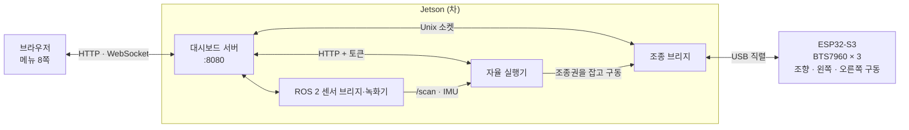

# unist_orachard_dashboard

과수원 로버(어린이용 4륜 전동차를 앞바퀴 조향으로 개조한 차)의 웹 대시보드입니다.
차의 Jetson Orin Nano에서 돌고, 휴대폰이나 노트북 브라우저로 센서를 보고, 차를 조종하고, 자율주행을 시작·정지하고, 주행 기록을 다시 봅니다.
느리고 끊기는 무선 연결에서도 조종 명령과 STOP이 먼저 지나가도록 만들었습니다.

| Rover Control (노트북) | 휴대폰 |
|---|---|
|  |  |

[화면 · 모의 자료] 화면 점검 도구의 모의 서버로 찍은 Rover Control. 실제 센서 값이 아니다. 다른 화면: [`docs/SCREENS_KO.md`](docs/SCREENS_KO.md) 4절.

## 차에서 쓴 결과

표지: **[현장 기록]** 실제 차의 기록(거리·횡 오차는 자율 실행기가 LiDAR로 스스로 잰 값, 참값 없음), **[PC 측정]** PC에서 기록을 다시 돌리거나 연결을 흉내 내 잰 값.

| 무엇 | 결과 | 표지 |
|---|---|---|
| 과수원 자율주행 (2026-11-20) | 자율주행 탭에서 18번 준비·출발·감시·정지, 약 772 m. 10번이 열 끝까지 갔다(사과 2행 100 m, 배 1행 40 m 각 다섯 번). 조향 가운데를 옮긴 뒤 끝까지 간 9번의 횡 오차 RMS 2.6~6.4 cm | 현장 기록 |
| 실내 복도 (2026-11-19) | 자율 run 15번, 약 186 m. 화면의 준비 → 자율 주행 시작 경로를 이 시험에서 처음 확인했다 | 현장 기록 |
| 기록과 재생 | 자율 출발 전에 모든 센서 기록(LiDAR, IMU, GPS, 조종·조향, 실행기 상태, 1080p 카메라)을 켠다. 과수원 18번이 run마다 기록으로 남아 모두 다시 볼 수 있다. Jetson 재시작으로 끝맺지 못한 1번은 마무리 도구로 살렸다(앞 33.8 s) | 현장 기록 |
| 재생 끊김 고침 | 재생이 기록 지도를 기다리지 않게 고친 뒤, 원격 터널에서 45초 동안 43.4~45.8초가 재생됐다(고치기 전 25.9초) | PC 측정, 2026-11-21 |
| 격자 지도 방향 고침 | 2026-11-20 기록으로 재 보니 사과 2행 다섯 번에서 지도의 열 방향이 7.1~18.4° 돌았다. 방향을 IMU에서 읽게 고친 뒤 −0.8~+0.2°, 18번 모두 0.8° 안(측량 기준은 없음) | PC 측정, 현장 기록 사용 |
| 느린 연결 | 흉내 낸 2.4 GHz 연결에서 목표 32개 중 20개(고치기 전 5개). 500 kbit/s에서 STOP 도달 p50 252 → 102 ms, 카메라 지연 p95 8.3 → 0.69 s | PC 측정(실제 무선 아님) |
| 정지 | 2026-11-20 브리지 오류 7번(보드로 가는 명령이 잠깐 끊김) 모두 차가 섰다(보드 구동 감시 300 ms와 브리지 정지) | 현장 기록 |

자율주행 결과의 자세한 값과 한계는 시뮬레이션 저장소의 [과수원 결과](https://github.com/2026-BTS-UNI-Car/unist_orchard_simulation/blob/main/docs/steering/ORCHARD_1120_RESULT_KO.md), [자율주행 33번 통합 분석](https://github.com/2026-BTS-UNI-Car/unist_orchard_simulation/blob/main/docs/steering/AUTONOMY_RUNS_ANALYSIS_KO.md), [줄자 대조](https://github.com/2026-BTS-UNI-Car/unist_orchard_simulation/blob/main/docs/steering/ORCHARD_MEASURED_KO.md)에 있다.

## 화면

메뉴는 8쪽이다: Overview, Connection, System, Network, Docker, Fan Control, Rover Control, Docs. 차를 다루는 기능은 모두 Rover Control 안의 탭 네 개에 있다.

| 탭 | 들어 있는 것 |
| --- | --- |
| 수동 조종 | LiDAR, 실시간 점유 격자 지도, 카메라, GPS 위치(오프라인 지도), IMU, 조향 조종, 거리 이동 |
| 자율주행 | 열 길이·GPS 사용·속도 고르기, 버튼 셋(준비 / 자율 주행 시작 / 멈추기), 주행 감시, 자율주행 기록 |
| 보정·설정 | 조향 가변저항과 보정, 거리 이동 보정, 실행기의 현장 조정 값 |
| 기록 | 기록 제어(센서 고르기), 수동 주행 기록의 재생·기록 지도·내려받기 |

- STOP은 모든 쪽의 상태 막대에 있고 Esc도 멈춘다. 조종 중에 수동 조종 탭을 떠나면 STOP을 보낸다.
- 자율주행 중 화면은 0.1초마다 운영자 신호를 보낸다. 탭을 떠나거나 숨기면 신호가 멈추고, 실행기의 기한(1.0초)이 지나면 차가 선다. 다시 출발은 사람이 누른다.
- 화면 규칙과 그림: [`docs/SCREENS_KO.md`](docs/SCREENS_KO.md).

## 구성



[도식] 화면은 상태를 짧은 HTTP 요청으로, 센서는 WebSocket으로 받는다.

- **대시보드 서버**: Python 표준 라이브러리 HTTP 서버. 화면, 상태 API, 센서 중계, 조종 요청 중계, 실행기 API 중계(토큰은 화면에 내보내지 않음), 기록 재생과 기록 지도.
- **조종 브리지**: 직렬 장치를 여는 유일한 프로그램. 화면·실행기의 구동·조향 요청을 보드 명령으로 바꾸고 입력 기한·구동 상한을 지킨다.
- **자율 실행기**: 한 열 따라가기의 추정·제어. [시뮬레이션 저장소](https://github.com/2026-BTS-UNI-Car/unist_orchard_simulation)에서 만들어 Jetson에 설치한다.
- **ESP32-S3**: 조향 DC 모터와 벨트로 이은 가변저항으로 조향 위치 루프를 닫고, 구동 PWM을 낸다. 명령이 300 ms 끊기면 구동을 멈춘다. 배선: [`docs/esp_rover_control.md`](docs/esp_rover_control.md) 1절.
- **격자 지도**: LiDAR 스캔 맞추기 + IMU 방향(+ 품질이 맞는 GNSS). 조향 각과 구동 PWM은 쓰지 않는다([`docs/GRID_MAP_KO.md`](docs/GRID_MAP_KO.md)).

## 실행

```bash
# 화면만 보기: 모의 서버 (표준 라이브러리만, Windows·Linux)
python tools/ui_check/mock_server.py --static static --dataset stress --port 8099 --vehicle front_steer
# 브라우저: http://127.0.0.1:8099/rover-control

# 개발 실행 (Linux 또는 WSL)
python3 -m pip install -r requirements.txt
scripts/run_local.sh            # = python3 -m dashboard_server --host 127.0.0.1 --port 8080

# 시험
python3 -m unittest discover -s tests
for f in tests/test_*.js tests/test_*.mjs; do node "$f" >/dev/null 2>&1 || echo "FAIL $f"; done
```

센서 브리지가 없으면 센서 칸은 "연결 전"으로 보인다. 환경 변수와 시험 목록은 [`docs/README_KO.md`](docs/README_KO.md)에서 찾는다.

**차(Jetson)에 설치할 때는 `docker compose`로 다시 만들지 않는다.** Jetson의 compose 파일은 옛 이미지를 가리켜 옛 대시보드로 돌아간다. 설치 묶음을 쓴다:
[대시보드](deploy/jetson_dashboard/README_KO.md), [ESP32-S3 조종 브리지](deploy/jetson_esp32_bridge/README_KO.md), [자율 실행기](deploy/jetson_row_executor/README_KO.md), [무선 AP와 접속](docs/jetson_offline_access.md).

## 저장소 구조

| 위치 | 내용 |
| --- | --- |
| `dashboard_server/` | 대시보드 서버(상태 API, 중계, 조정, Wi-Fi 관리, 기록·격자 지도 `raw_mapping/`) |
| `static/` | 화면(스크립트, 조향·자율 화면 `steer/`, CSS, 지도·영상 라이브러리와 글꼴) |
| `scripts/` | Jetson의 ROS 2 드라이버·브리지, 조종 브리지, 녹화기, 끊긴 기록 마무리 |
| `deploy/` | Jetson 설치 묶음, 무선 AP·Wi-Fi 도우미 |
| `tools/` | 화면 점검(`ui_check/`), 느린 연결 시험대(`slow_link/`), 격자 지도 확인(`map_check/`) |
| `tests/` | Python 시험과 화면 시험 |
| `docs/` | 문서([색인](docs/README_KO.md)) |

자주 보는 문서: [화면 구성](docs/SCREENS_KO.md), [조향 차량 서버 사양](docs/STEERING_SERVER_KO.md), [ESP32-S3 조종 브리지](docs/esp_rover_control.md), [격자 지도](docs/GRID_MAP_KO.md), [느린 연결 측정](docs/slow_link.md), [과수원 날 현장 절차](docs/ORCHARD_DAY_20261120_KO.md).

## 한계

- 차에서 쓴 것은 2026-11-19 실내 복도와 2026-11-20 과수원 하루뿐이다. 2026-11-21의 고침(기록 재생, 지도 방향)은 그날 기록으로 확인했고 차를 몰면서 쓴 적은 없다.
- 2026-11-20의 브리지 오류 7번과 Jetson 재시작 1번은 원인을 가르지 못했다. 물리 비상정지가 마지막 수단이다.
- 자율주행은 LiDAR로 열 끝을 보고 선 적이 없다(끝까지 간 주행은 모두 입력한 열 길이에서 섰다). 횡 오차와 거리는 실행기의 자체 추정이다.
- 화면의 PWM·duty는 요청한 출력이고 바퀴 속도가 아니다(휠 엔코더 없음). 조향 명령 눈금과 실제 바퀴 각의 관계는 재지 않았다.
- 격자 지도는 지나간 곳을 다시 알아보고 고치는 보정(loop closure)이 없고, 측량 기준과 견준 정확도가 없다.
- 느린 연결 수치는 PC 한 대에서 흉내 낸 값이다. 모든 센서 기록은 5.6분에 약 4.8 GB이고 영상 변환은 한 번에 하나씩이다.

## 라이선스

이 저장소의 코드에는 아직 라이선스 파일이 없다(팀이 정한다). 함께 들어 있는 제3자 구성요소는 각자의 라이선스를 따른다.

| 구성요소 | 위치 | 라이선스 |
| --- | --- | --- |
| hls.js | `static/vendor/hls/` | Apache-2.0 |
| MapLibre GL JS, PMTiles, Protomaps basemaps | `static/vendor/` | BSD-3-Clause (지도 모양 CC0) |
| Pretendard, 본고딕(Source Han Sans) 계열 글꼴 | `static/vendor/ubts-sans/`, `static/vendor/korean-font/` | SIL Open Font License 1.1 |

제3자 파일의 판과 출처 해시는 `static/vendor/gps-map-vendors.json`, `static/vendor/hls/provenance.json`에 있다.
