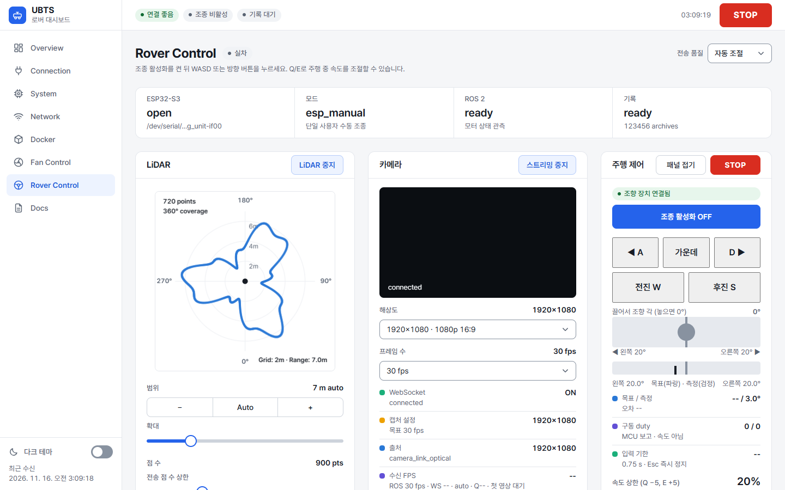
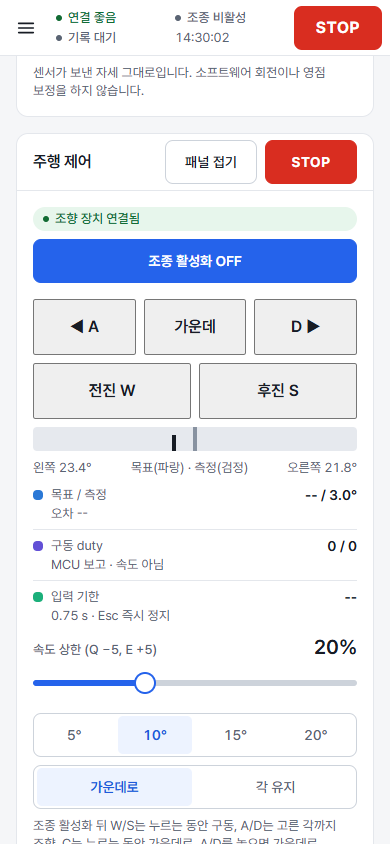
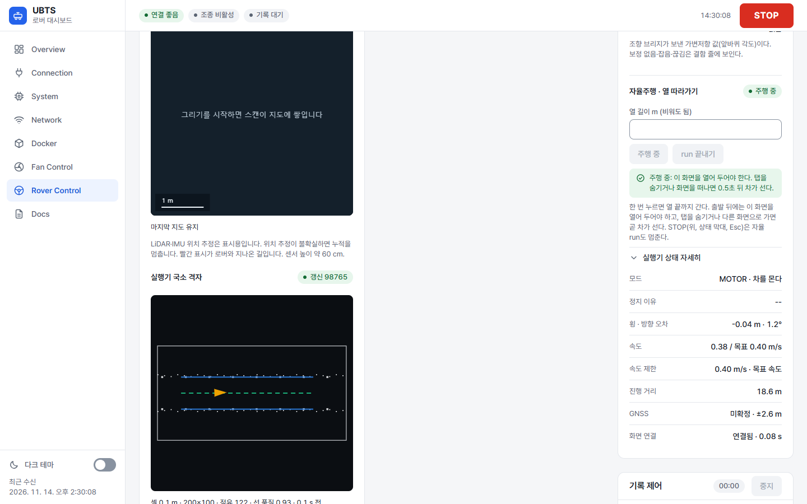
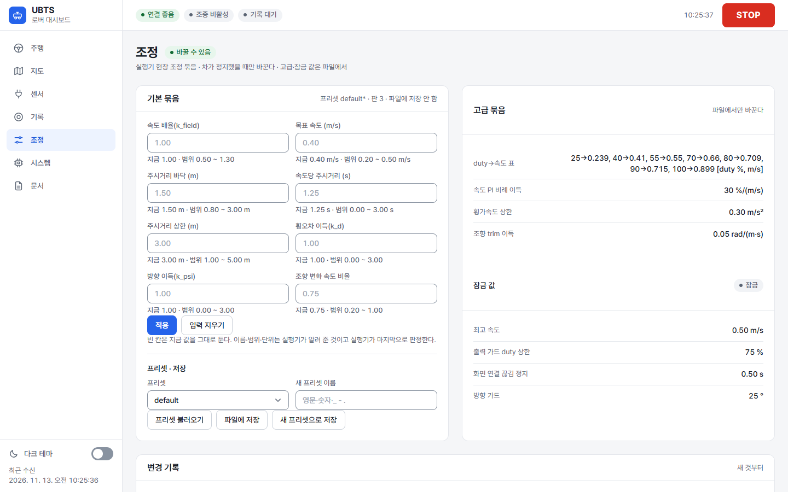
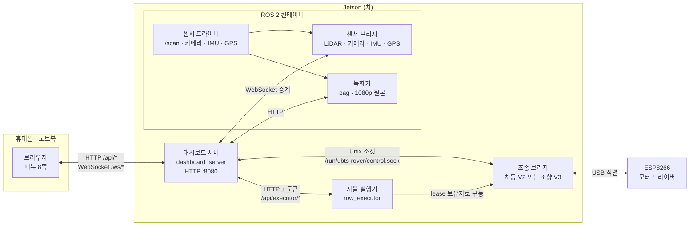

# unist_orachard_dashboard

UNIST BTS 과수원 로버의 웹 대시보드입니다. 차에 실린 Jetson에서 돌며, 휴대폰이나 노트북 브라우저로 센서를 실시간으로 보고,
차를 조종하고 STOP을 누르고, 자율주행을 시작·정지하고, 주행 기록을 남기고 다시 봅니다. 차의 2.4 GHz 무선 AP처럼 느리고 끊기는 연결에서도
조종과 STOP이 먼저 지나가게 만들었습니다.

> **English summary.** Web dashboard of a small orchard rover (a converted ride-on toy car). It runs on the rover's
> Jetson Orin Nano and is opened from a phone or laptop over the rover's own 2.4 GHz Wi-Fi access point. Eight menu
> pages, as before the redesign: Overview, Connection (2D LiDAR RPLIDAR S2, USB camera, link status), System (Jetson
> resources), Network, Docker, Fan Control, Rover Control (LiDAR with the live occupancy grid map, camera, GNSS position,
> BNO085 IMU, manual control with a STOP that always goes first, autonomy start/stop, the row executor's field tuning
> set, recording and synchronized playback) and Docs. A STOP is in the status bar of every page. The server is plain Python
> (standard library HTTP server, no web framework); sensors come from ROS 2 bridge containers over WebSocket, manual
> control goes to the motor bridge over a Unix socket, autonomy goes through the row executor's operator API. The vehicle
> is being refitted from differential (left/right PWM) to front-wheel steering; both control panels exist. The slow-link
> work was measured on a PC link emulator, not yet on the rover's real Wi-Fi. The documents are in Korean.

| Rover Control (노트북 1440 px) | 휴대폰 (390 px) |
|---|---|
|  |  |

[화면 · 모의 자료] 2026-11-14 판(메뉴를 수정 전 구성으로 되돌림). 화면 점검 도구의 모의 서버(`tools/ui_check`)가 내는 예시 자료로 찍었다(실제 센서 값이 아니다).
왼쪽은 Rover Control의 첫 화면(LiDAR, 카메라, 차동 차량의 주행 제어), 오른쪽은 같은 페이지의 휴대폰 첫 화면이다. STOP은 모든 페이지의 상태 막대와 주행 제어에 있다.

> **지금 상태.** 화면과 서버는 가짜 센서·가짜 MCU·가짜 실행기와 느린 연결 시험대로 확인했다. 조향 차량(앞바퀴 조향, 조향 펌웨어 V3)은
> 아직 차에 없어서 조향 화면은 실차에서 확인하지 않았다. 이 판은 Jetson에 아직 설치하지 않았다(설치 묶음은 준비됨). 자세한 것은 [현재 한계](#현재-한계).

## 주요 기능

**메뉴 8쪽.** 메뉴와 페이지 구성은 화면 개편 전과 같다(2026-11-14 사용자 지시로 되돌림, [`docs/SCREENS_KO.md`](docs/SCREENS_KO.md)).
디자인(색·글꼴·부품)과 상태 막대의 STOP, 느린 연결 최적화는 새 판 그대로다. 그때 없던 기능은 Rover Control 안에 있다.

| 메뉴 | 주소 | 하는 일 |
| --- | --- | --- |
| Overview | `/` | CPU·메모리·외부 IP·Docker 요약, CPU / Memory와 Network RX / TX 그래프, ROS2 / Rover 연결, Jetson 정보 |
| Connection | `/connection` | LiDAR·카메라 연결 상태, RPLIDAR 상태 확인, 2D LiDAR 지도(내려받기), 카메라 실시간 화면, 서비스 연결, ROS2 센서 링크 |
| System | `/system` | Jetson CPU(코어별)·메모리·Swap·네트워크·전력 그래프, 디스크 |
| Network | `/network` | 외부·내부 주소, 오프라인 AP / 저장된 Wi-Fi 전환, Wi-Fi 관리(주변 검색, 비밀번호로 연결, 자동 연결·우선순위, 자동 되돌림), RX / TX, 연결 정보 |
| Docker | `/docker` | 컨테이너 CPU·메모리, 목록, 상세·로그, 시작·중지·재시작(확인 창) |
| Fan Control | `/fan` | 온도, 팬 PWM(자동·수동) |
| Rover Control | `/rover-control` | LiDAR(안에 실시간 점유 격자 지도와 실행기 국소 격자), 카메라, GPS 위치(오프라인 지도), IMU, 주행 제어(차동 패드 또는 조향 패널, 조향 가변저항, 자율 시작·정지), 현장 조정 값(접힘), 기록 제어, 연동 상태, 기록 데이터(동기 재생, 기록 지도, 내려받기) |
| Docs | `/docs` | 운영 문서 |

화면 6개 판의 주소(`/map`, `/records`, `/tuning`, `/sensors`, `/system/*` 등)는 별칭으로 남아 그 기능이 있는 페이지로 간다.

**센서 실시간.** LiDAR(RPLIDAR S2 `/scan`), 카메라(UVC, 녹화는 원본 1080p), IMU(BNO085 원본, 소프트웨어 보정 없음), GPS(ZED-F9P)를
ROS 2 브리지 컨테이너가 WebSocket으로 보내고 대시보드 서버가 중계한다. 화면이 받은 것을 확인한 뒤에만 다음 것을 보내서 느린 연결에서 밀리지 않는다.
화면에 보이지 않는 패널과 숨긴 탭은 받지 않는다(Rover Control처럼 패널이 많은 페이지에서도 화면에 들어온 패널의 스트림만 연다).

**조종과 STOP.** 조종 활성화 뒤 키보드(W/A/S/D, Q/E로 속도)나 화면 버튼으로 몬다. 손을 떼면 감속하고, 입력이 0.75초 끊기면 차가 스스로 선다.
STOP·Esc·창 이탈은 즉시 정지와 조종 해제다. 조종 요청은 다른 요청과 따로, 가장 먼저 보낸다(`controlRequest`, NET-05).
PWM 값은 요청한 출력이지 실제 바퀴 속도가 아니다(차에 휠 엔코더가 없다).

**조향 차량(수동·자율·조정).** 차가 앞바퀴 조향으로 바뀌는 중이다. `DASHBOARD_VEHICLE=front_steer`면 Rover Control의 주행 제어 패널에
조향 패널(구동 W/S, 조향 A/D·가운데, 목표·측정 조향각)과 조향 가변저항 값이 보이고, 그 아래 자율 칸에서 "준비 → Arm → 자율 주행 시작"을 누르면
실행기가 열 끝까지 간다(시뮬레이션에서 확인, 실차 전). Rover Control을 떠나거나 탭을 숨기면 0.5초 뒤 차가 서고(페이지 안에서 스크롤하는 것은 괜찮다),
다시 출발은 사람이 누른다. 현장 조정 값은 같은 페이지의 접힌 칸에 있다. 서버 사양: [`docs/STEERING_SERVER_KO.md`](docs/STEERING_SERVER_KO.md).

| 조향 수동 조종 (휴대폰) | 자율 주행 칸 (실행기 상태 자세히) |
|---|---|
|  |  |

| 현장 조정 값(펼친 칸) | 실시간 지도 아래 실행기 국소 격자 |
|---|---|
|  |  |

[화면 · 모의 자료] 위 네 장은 `front_steer`(조향 차량)의 Rover Control을 모의 서버의 예시 자료로 찍은 것이다(그 부분으로 스크롤한 화면). 실행기 상태·조정 값·격자는 가짜 실행기의 값이고
현장 값이 아니다. 조정 묶음의 이름·범위·단위는 실행기가 알려 준 것을 그대로 보인다.

**느린 연결 최적화.** PC에서 2.4 GHz 연결을 흉내 내는 시험대(`tools/slow_link`)로 재며 고쳤다. 아래는 그 측정의 일부다(주행 화면 2분, LiDAR는 주행 화면의
LiDAR 큰 보기, 지도는 지도 화면 10분. 기준은 화면 개편 전의 한 화면에서 잰 값). 정한 목표 32개 중 20개를 만족한다(기준 5개). 못 미친 것의 대부분은 조종 꼬리 지연으로,
잰 PC가 자주 잠깐씩 멈춘 탓으로 판정했다(같은 PC에서 화면 개편 전 판도 같았다). 모두 PC 한 대에서 연결을 흉내 낸 값이고, 차의 실제 무선 연결 값이 아니다. 목표표, 못 미친 것과 까닭, 한계: [`docs/slow_link.md`](docs/slow_link.md) 12절.
메뉴를 수정 전 구성으로 되돌린 뒤(2026-11-14) Rover Control을 다시 쟀다: 첫 화면에 LiDAR가 다시 있어 나쁨 연결 사용이 같은 때의 화면 6개 판보다 7.9 %p 높고(65.3 %, 목표 60 %),
조종·STOP·카메라는 같았다([`docs/slow_link.md`](docs/slow_link.md) 13절).

<!-- slow-link-summary:begin -->
| 수치 | 연결 | 기준 d962013 (2026-11-12) | 최종 90094fd (2026-11-13) |
| --- | --- | --- | --- |
| 조종 명령 왕복 p50 | 보통 2 Mbit/s | 382 ms | 82.7 ms |
| STOP이 조종 끝점에 닿기까지 p50 | 나쁨 500 kbit/s | 252 ms | 102 ms |
| 카메라 지연 p95 | 나쁨 500 kbit/s | 8295 ms | 691 ms |
| LiDAR 다시 그리는 수 | 나쁨 500 kbit/s | 0.98 Hz | 4.68 Hz |
| 연결 사용률(받는 양 ÷ 속도) | 나쁨 500 kbit/s | 88.3 % | 44.7 % |
| 2분 동안 닫힌 스트림 | 나쁨 500 kbit/s | 6개 | 1개 |
| 처음 열기에 받는 양 | 보통 2 Mbit/s | 1501 kB | 297 kB |
| 다시 열기에서 연결에 나간 페이지 파일 요청 | 보통 2 Mbit/s | 49개 | 1개 |
| 숨긴 탭이 받는 스트림 | 보통 2 Mbit/s | 250 kB/s | 0 kB/s |
| 지도 응답 크기 10분째 ÷ 첫 1분 | 나쁨, 10분 | 8.65배 | 0.16배 |
<!-- slow-link-summary:end -->

**기록·재생.** 녹화는 ROS bag(LiDAR, 원본 IMU, GPS, 조종 요청·MCU 보고 PWM)과 원본 1080p 카메라를 함께 남긴다. 기록 화면에서 센서와 영상을 같은 시각으로
되감아 보고, 기록으로 지도를 다시 만들고, 느린 연결용 영상 화질(HLS)을 고른다([`docs/motor_pwm_recording.md`](docs/motor_pwm_recording.md), [`docs/imu_ros2_recording.md`](docs/imu_ros2_recording.md)).

**Wi-Fi 관리 (Network).** Network 쪽의 "오프라인 AP / 저장된 Wi-Fi" 패널에서 AP 전환(이전과 같음)과 함께 Jetson의 Wi-Fi를 고른다.
주변 검색 목록(신호 dBm·%, 대역·채널, 보안), 비밀번호로 연결, 자동 연결 여부와 우선순위, 저장된 Wi-Fi의 자동 연결·우선순위 바꾸기.
원격에서 연결을 바꾸면 조작자가 끊길 수 있어서 모든 연결 변경은 시험 연결이다: 새 연결이 45초 안에 주소를 못 받거나 실패하면 곧바로,
연결된 뒤 150초 안에 화면의 '이 연결 유지'를 누르지 않으면 Jetson이 이전 연결(Wi-Fi 또는 AP)로 스스로 돌아간다. 비밀번호는 Jetson의 root 전용
NetworkManager 파일에만 들어가고 명령행·로그·응답에는 나오지 않는다. 바꾸는 요청은 세션과 같은 Origin이 있어야 받는다. 권한이 필요한 일은 대시보드가 아니라
호스트 도우미(`deploy/offline_ap/ubts_network_mode.py`, 정해진 명령만)가 한다. 계약과 한계: [`docs/jetson_offline_access.md`](docs/jetson_offline_access.md) "Wi-Fi 관리",
도우미 교체: [`deploy/network_helper_update/README_KO.md`](deploy/network_helper_update/README_KO.md).

| 노트북 1440 px: 주변 Wi-Fi에서 고르고 비밀번호 넣기 | 휴대폰 390 px: 시험 연결 중 남은 시간과 확인 |
|---|---|
|  |  |

[화면 · 모의 자료] 2026-11-16. 화면 점검 도구의 모의 서버에 지어낸 SSID·주소(문서 예시 대역)를 넣어 찍었다. 실제 Jetson의 Wi-Fi 목록이 아니다.
이 기능은 가짜 nmcli 시험과 모의 서버로만 확인했고 Jetson에는 아직 설치하지 않았다.

## 구성



[도식] 화면은 상태를 짧은 HTTP 요청으로, 센서는 WebSocket으로 받는다. 조종 요청은 대시보드 서버가 조종 브리지 하나에 전한다(브리지만 직렬 장치를 연다).
자율주행은 실행기가 브리지 조종권(lease)을 잡고 몰며, 대시보드는 실행기 운영자 API를 대신 부르고 토큰은 화면에 내보내지 않는다.
실행기와 조향 브리지 V3는 시뮬레이션 저장소(`unist_orchard_simulation`)에서 만들었고, 조향 브리지는 이 레포로 옮겨 왔다([`docs/STEERING_HOST_PORT_KO.md`](docs/STEERING_HOST_PORT_KO.md)).

## 빠른 시작

### 1. 화면만 보기 (모의 서버, 표준 라이브러리만)

```
python tools/ui_check/mock_server.py --static static --dataset stress --port 8099
# 브라우저: http://127.0.0.1:8099/rover-control
# 조향 차량 화면: --vehicle front_steer 를 붙인다
```

Windows·Linux 어디서나 된다. 센서·조종 값은 지어낸 예시이고 버튼은 읽기 전용 답만 받는다.

### 2. 개발 실행 (Linux 또는 WSL)

```
python3 -m pip install -r requirements.txt
scripts/run_local.sh            # = python3 -m dashboard_server --host 127.0.0.1 --port 8080
# 브라우저: http://127.0.0.1:8080
```

센서 브리지가 없으면 센서 칸은 "연결 전"으로 보인다. 자주 쓰는 환경 변수:

| 변수 | 뜻 |
| --- | --- |
| `DASHBOARD_VEHICLE` | `differential`(기본, 지금 차) / `front_steer`(조향 차량 화면) |
| `UBTS_EXECUTOR_URL`, `UBTS_EXECUTOR_TOKEN_FILE` | 자율 실행기 운영자 API 주소와 토큰 파일. 없으면 자율·조정 칸은 "설정 없음" |
| `LIDAR_WS_UPSTREAM`, `CAMERA_WS_UPSTREAM`, `IMU_WS_UPSTREAM`, `GPS_WS_UPSTREAM` | 센서 브리지 WebSocket 주소 |
| `DASHBOARD_MODE` | `live`(기본) / `simulation`(시뮬레이션 확장을 꽂을 때, [`docs/STEERING_SERVER_KO.md`](docs/STEERING_SERVER_KO.md) 2절) |

시뮬레이션 스택(Gazebo, 가상 센서, 조향 브리지, 실행기)과 함께 보려면 시뮬레이션 저장소 `unist_orchard_simulation`의 안내를 따른다.
그 저장소는 이 레포의 한 커밋을 사본으로 가져가 쓴다.

### 3. 차(Jetson)에 설치

> **주의: 차의 대시보드를 `docker compose`로 다시 만들지 않는다.** Jetson의 compose 파일은 옛 이미지(10월 7일)를 가리켜서,
> `docker compose up`(`--build`, `down` 포함)을 하면 옛 대시보드로 돌아간다. 설치는 아래 설치 묶음으로 한다.

설치 묶음은 지금 컨테이너를 보존한 뒤 바뀐 파일만 겹치고, 실패하면 자동으로 되돌린다:
[`deploy/jetson_dashboard/README_KO.md`](deploy/jetson_dashboard/README_KO.md) (점검 → 설치 → 확인 → 되돌리기. 4-1절: 이 묶음만으로 현장에 가는 변경과 브리지를 바꿔야 하는 변경).
차의 무선 AP와 접속 주소(`http://10.77.0.1`)는 [`docs/jetson_offline_access.md`](docs/jetson_offline_access.md), 현장 연결 점검은
[`docs/WIFI_AP_CHECKLIST_KO.md`](docs/WIFI_AP_CHECKLIST_KO.md).

`docker-compose.yml`은 서비스 구성(대시보드, LiDAR·카메라·IMU·GPS 드라이버와 브리지, ESP 조종 브리지, 녹화기, 프로필 `steer`의 조향 브리지)을 적은 것이다.
빈 PC에서 전체를 처음 띄울 때의 참고로 쓰고, 이미 돌고 있는 차에서는 위 주의를 따른다.

## 레포 구조

| 위치 | 내용 |
| --- | --- |
| `dashboard_server/` | 대시보드 서버(Python 표준 라이브러리 HTTP 서버): 화면·정적 파일, 상태 API, WebSocket 중계, 조종 중계(`rover_api.py`), 실행기 중계(`executor_proxy.py`), 조정(`steer_tuning.py`), 기록·지도, 확장 지점(`extensions.py`) |
| `static/` | 화면: `index.html`, `app/`(화면 스크립트 17개), `steer/`(Rover Control의 조향·자율·조정 값·국소 격자), `css/`, `vendor/`(지도·영상 라이브러리, 글꼴) |
| `scripts/` | Jetson에서 도는 ROS 2 드라이버·브리지(`*_ros2_driver.py`, `*_ws_bridge.py`), 조종 브리지(차동 `rover_control_bridge.py`, 조향 V3 `steer_rover_bridge.py`), 녹화기, 기록 후처리 |
| `deploy/` | `jetson_dashboard/`(설치 묶음), `offline_ap/`(무선 AP 전환), `systemd/`, `native_sensor_stream/`·`native_sensor_shadow/`(차동 시절 관찰 서비스) |
| `tools/` | `ui_check/`(화면 점검), `slow_link/`(느린 통신 시험대, 현장 연결 기록 보고), `fonts/`(화면 글꼴 분할), 차동 시절 관찰 도구 |
| `tests/` | Python 시험(`test_*.py`)과 화면 시험(`test_*.js`, `test_*.mjs`) |
| `config/` | 대시보드 설정 |
| `docs/` | 문서([색인](docs/README_KO.md)), `assets/`(README 그림) |
| `Dockerfile`, `Dockerfile.ros2`, `Dockerfile.lidar_driver`, `docker-compose.yml` | 대시보드 이미지, ROS 2 드라이버·브리지 이미지, 서비스 구성 |

## 문서

전체 목록과 각 문서가 지금 코드와 맞는지는 [`docs/README_KO.md`](docs/README_KO.md)에 있다. 자주 보는 것:

| 문서 | 내용 |
| --- | --- |
| [`docs/SCREENS_KO.md`](docs/SCREENS_KO.md) | 메뉴 8쪽(수정 전 구성), Rover Control 안의 새 기능 자리, 화면 6개 주소의 별칭 |
| [`docs/STEERING_SERVER_KO.md`](docs/STEERING_SERVER_KO.md) | 조향 차량 서버 사양: 조종 API, 조향 상태, 자율 시작·정지 중계, 조정 값, 정지 규칙, 차동 판과의 공존 |
| [`docs/slow_link.md`](docs/slow_link.md) | 느린 연결: 시험대, 기준 측정, 목표 32개, 고친 뒤와 최종 측정 |
| [`docs/WIFI_AP_CHECKLIST_KO.md`](docs/WIFI_AP_CHECKLIST_KO.md) | 차의 무선 AP 현장 점검표, 연결 기록(`?link_log=1`) |
| [`deploy/jetson_dashboard/README_KO.md`](deploy/jetson_dashboard/README_KO.md) | Jetson 설치·되돌리기 |
| [`docs/esp_rover_control.md`](docs/esp_rover_control.md) | ESP8266 조종(차동 V2): 조종권, 정지, 저속 통신 |
| [`docs/stream_latency.md`](docs/stream_latency.md) | 센서 실시간 전송과 확인 방식 |
| [`docs/HISTORY.md`](docs/HISTORY.md) | 지난 보고 문서와 검증 기록이 있는 곳(보존 태그) |

## 시험

```
# 화면 시험 (Node 22 이상)
for f in tests/test_*.js tests/test_*.mjs; do node "$f" >/dev/null 2>&1 || echo "FAIL $f"; done

# Python 시험 (Linux. Windows 에서는 fcntl 을 쓰는 시험이 모이지 않는다)
python3 -m unittest discover -s tests

# 조종 회귀 (조종·STOP 경로를 바꿨을 때 꼭)
node tests/test_control_path_regression.js && node tests/test_rover_browser.js && node tests/test_rover_pad_touch.js
python3 -m unittest tests.test_control_deadman_regression

# 화면 점검: 메뉴 8쪽 × 5화면 크기 × 자료 2종 = 80쪽, 받아들인 기록과 비교 (Playwright, 깔린 Chrome)
python tools/ui_check/run_checks.py --static static --out <결과 폴더>
python tools/ui_check/compare.py --run <결과 폴더>/ui_check.json --baseline tools/ui_check/accepted/ui_check.json

# 느린 연결 시험대: 받아들인 값과 견주기 (사용법 tools/slow_link/README_KO.md)
python -B tools/slow_link/compare.py --run <결과 폴더>
```

CI(`.github/workflows/smoke.yml`)는 컴파일과 Python 시험을 돌린다. ROS가 있어야 하는 시험은 ROS 없이 건너뛴다.

## 현재 한계

- **실차 확인 전.** 이 판(메뉴 8쪽, 느린 연결 최적화, 조향 칸)은 PC에서 가짜 센서·MCU·실행기로만 확인했고 Jetson에 아직 설치하지 않았다.
- **조향 차량은 아직 없다.** 조향 펌웨어 V3·조향 브리지·실행기가 차에 올라가기 전까지 실제 차는 차동(좌우 PWM) 펌웨어 V2로 수동 주행한다.
  그래서 차동 시절 자율·관찰 코드는 조향 실행기로 바뀔 때까지 남겨 둔다(결정 나5, [`docs/STEERING_SERVER_KO.md`](docs/STEERING_SERVER_KO.md) 9절).
- **느린 연결 값은 흉내 낸 값.** 연결 프로필(좋음 10 Mbit/s ~ 아주 나쁨 150 kbit/s)과 연결 등급 경계(25 / 90 / 220 ms)는 가정이다.
  현장에서 `?link_log=1`로 기록을 받아 고친다. 목표 32개 중 못 미친 것과 까닭은 [`docs/slow_link.md`](docs/slow_link.md) 12절.
- **브리지 쪽 변경은 이 설치 묶음에 없다.** LiDAR 이진 형식, IMU 흐름, GPS 응답 기한은 ROS 브리지 이미지를 다시 만들어야 차에 간다
  ([설치 문서 4-1절](deploy/jetson_dashboard/README_KO.md)). 대시보드만 바꿔도 옛 브리지와 함께 동작한다.
- **휠 엔코더가 없다.** 화면의 PWM·duty는 요청한 출력이고 속도가 아니다. 위치·지도는 LiDAR·IMU(와 품질이 맞는 GNSS)로만 만든다.
- 화면 그림은 모의 자료로 찍었다. 실차 화면과 실물 사진은 아직 없다.

## 라이선스

이 레포의 코드에는 아직 라이선스 파일이 없다(팀이 정한다). 함께 들어 있는 제3자 구성요소는 각자의 라이선스를 따른다.

| 구성요소 | 위치 | 라이선스 |
| --- | --- | --- |
| hls.js | `static/vendor/hls/` | Apache-2.0 (`LICENSE`) |
| MapLibre GL JS | `static/vendor/maplibre-gl/` | BSD-3-Clause (`LICENSE.txt`) |
| PMTiles | `static/vendor/pmtiles/` | BSD-3-Clause (`LICENSE.txt`) |
| Protomaps basemaps | `static/vendor/protomaps_basemaps/` | BSD-3-Clause, 지도 모양 CC0 (`LICENSE.txt`) |
| Pretendard(화면 글꼴 UBTS Sans의 원본) | `static/vendor/ubts-sans/` | SIL Open Font License 1.1 (`PRETENDARD-OFL.txt`) |
| 본고딕(Source Han Sans) 계열 한글 글꼴 | `static/vendor/korean-font/` | SIL Open Font License 1.1 (`KOREAN-OFL.txt`) |
| 관찰 도구 두 개 | `tools/cartographer_incremental_capture/`, `tools/gnss_receiver_utc/` | Apache-2.0 (`LICENSE`) |

제3자 파일의 판과 출처 해시는 `static/vendor/gps-map-vendors.json`, `static/vendor/hls/provenance.json`에 있다.
