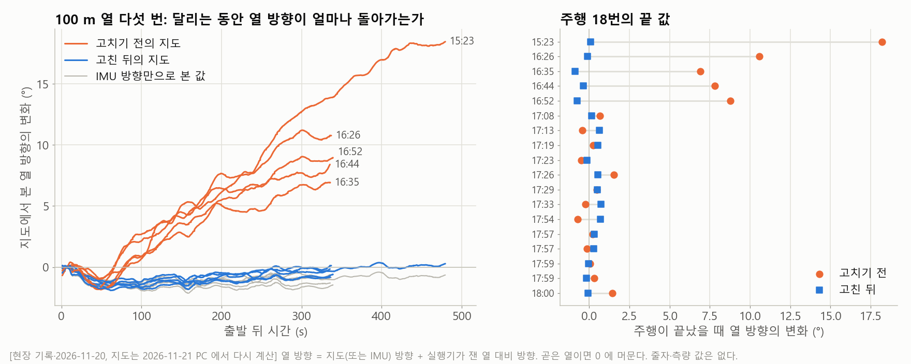

# 격자 지도: 무엇으로 어떻게 그리나

Rover Control의 실시간 점유 격자 지도와 기록 재생의 기록 지도가 어떤 센서로 어떻게 만들어지는지, 2026-11-21에 방향 추정을 왜 어떻게 바꿨는지,
과수원 기록으로 잰 결과와 한계를 적는다. 수치는 현장 기록(2026-11-20, 2026-10-03)을 PC에서 같은 코드로 다시 돌려 잰 것이고, 측량 기준과 견준 값은 없다.

- 코드: `dashboard_server/raw_mapping/continuous_localization.py`(위치 추정), `raw_localization.py`(스캔 맞추기), `playback_mapping.py`(센서를 차례로 넣는 곳),
  `continuous_mapping.py`·`source_live_mapping.py`(실시간), `resumable_playback.py`·`replay_state.py`(기록 지도와 이어 만들기), `tile_transport.py`(점유 칸).
- 확인 도구: [`tools/map_check/`](../tools/map_check/README_KO.md).

## 1. 한눈에

- 지도는 **LiDAR 스캔 맞추기 + IMU + GNSS(보조)**로 만든다. 휠 엔코더는 없고, **조향 각·구동 PWM·카메라는 쓰지 않는다.**
- 2026-11-21 전에는 스캔 맞추기가 방향(yaw)을 사실상 혼자 정했고 IMU는 느슨한 참고였다. 2026-11-20 과수원 기록으로 재 보니 100 m 열을 달리는 동안
  지도의 방향이 7~18° 돌아가 열이 휘어 그려졌다. 같은 구간에서 IMU 방향은 열 방향과 1.5° 안에서 맞았다.
- 지금은 스캔 사이의 방향 변화를 **IMU 방향(orientation)의 변화**에서 먼저 읽고, 스캔 맞추기는 주로 이동(앞뒤·좌우)을 정한다.
  같은 기록에서 지도의 열 방향 변화는 1° 안으로 줄었다(5절).
- 조향 각을 방향 추정에 넣는 것은 재 본 뒤 하지 않기로 했다. 조향 각과 속도로 계산한 방향은 주행 한 번에 9~800° 틀린다(6절).

## 2. 쓰는 센서와 쓰지 않는 것

| 입력 | 주제 | 쓰임 |
|---|---|---|
| 2D LiDAR (RPLIDAR S2, 10 Hz, 3240 빔) | `/scan` | 앞 스캔 또는 기준 스캔에 맞춰 이동과 회전을 잰다. 지도 칸을 채운다 |
| IMU 방향 (BNO085, 약 33 Hz) | `/imu/data_raw` 의 orientation | 두 스캔 사이에 차가 수직축으로 돈 각. 스캔 맞추기의 방향 사전값(2026-11-21부터 가장 먼저 쓰는 값) |
| IMU 자이로 | `/imu/data_raw` 의 angular_velocity | 중력 방향으로 투영해 적분한 회전. IMU 방향 쌍을 쓸 수 없을 때의 느슨한 사전값(예전 방식) |
| IMU 가속도 | `/imu/data_raw` 의 linear_acceleration | 충격이 큰 순간의 스캔을 거른다 |
| GNSS (F9P) | `/gps/data` | 스캔 맞추기가 잠깐(1.5 s 안) 안 될 때 속도로 이어 가기, 추정 위치가 GNSS에서 크게(5 m 또는 정확도의 4배) 벗어나면 그 스캔을 받지 않기. 지도 모양을 고치는 데는 쓰지 않는다 |

| 쓰지 않는 것 | 까닭 |
|---|---|
| 휠 엔코더 | 차에 없다 |
| 조향 각(가변저항) | 영점이 주행마다 달라 방향으로 적분하면 크게 틀린다(6절) |
| 구동 PWM | 요청한 출력이지 속도가 아니다. 지면에 따라 표 속도의 76~85 %만 나왔다(2026-11-20) |
| IMU의 절대 방위(자북 기준 yaw) | 방향의 변화만 쓴다. 지도의 0° 는 지도를 시작할 때 LiDAR 가 보던 방향이다 |
| 카메라 | 위치 추정에 쓰지 않는다 |

## 3. 위치 추정 순서 (스캔 하나마다)

1. 스캔에서 0.05~20 m 반사를 점으로 바꾸고, 이웃 점으로 면(법선)을 잡는다. 반사가 120개보다 적으면 받지 않는다.
2. 이 스캔의 IMU 방향을 읽는다. 읽는 시각은 스캔 시각표(첫 빔)에서 한 바퀴의 절반 + 0.017 s 뒤다(4절). 그 시각 앞뒤의 IMU 표본 사이를 곧게 잇는다.
3. 기준 스캔(1.25 m 또는 15° 움직일 때마다 새로 잡음)에 맞춘다. 잘 맞으면(겹침 80 % 이상, 잔차 3.5 cm 이하) 그 결과를 쓴다.
   아니면 바로 앞 스캔에 맞춘다. 맞출 때 IMU가 본 회전을 사전값으로 넣는다(4절의 표준편차).
4. 그래도 안 되면 차례로: 사전값 없는 맞추기(IMU 회전과 2° 넘게 다르면 버림), 점 밀도 기반 맞추기, 겹침이 적을 때의 부분 맞추기, 넓게 찾는 다시 찾기,
   GNSS 속도와 IMU 회전으로 1.5 s까지 이어 가기(이때의 스캔은 지도에 그리지 않는다).
5. 모두 실패하면 그 스캔은 버리고 마지막 위치와 지도를 그대로 둔다(모르는 위치로 그리지 않는다).
6. 받은 스캔은 그 위치에서 점유 칸(0.1 m)에 반영한다: 맞은 칸은 점유 쪽으로, 빔이 지나간 칸은 빈 쪽으로.

실시간 지도와 기록 지도는 같은 추정기를 쓴다. 기록 지도는 녹화 때 따로 뽑아 둔 센서 파일(`mapping_source/sensors.jsonl.gz`: `/scan`, `/imu/data_raw`, `/gps/data`)을
받은 순서대로 넣는다.

## 4. 2026-11-21 변경: 방향은 IMU 방향의 변화를 따른다

**전.** 스캔 맞추기에 자이로 적분값을 사전값으로 넣되 표준편차를 0.35° + 0.3°/s × 경과 시간으로 두었다. 스캔 한 장(0.1 s)에 0.38° 다.
스캔 맞추기가 스스로 매기는 방향 정밀도가 이보다 훨씬 좋아서 사전값의 무게는 2 % 쯤이었고, 방향은 스캔이 정했다.
과수원 열처럼 비슷한 모양이 이어지는 곳에서는 앞 스캔과의 맞추기가 스캔마다 0.003~0.004° 씩 한쪽으로 치우쳤고(잰 값), 3,400~4,800 스캔 동안 쌓여 7~18° 가 됐다.

**뒤.**

- 방향 사전값을 IMU 방향(orientation)에서 읽는다: 두 스캔 각각의 읽는 시각에서의 IMU 방향 사이에, 수직축으로 돈 각. IMU 방향은 센서 안에서 높은 빈도로 적분된 값이라
  표본이 0.2 s 넘게 비어도(2026-11-20 기록에서 최대 0.27 s) 회전을 잃지 않는다.
- 표준편차를 IMU의 실제 정밀도에 맞췄다: 0.005° + 0.01°/s × 경과 시간 + 돈 각의 2 %. 스캔 한 장 사이에서는 약 0.01° 로, 전보다 수십 배 좁다.
  바닥값 0.01° 로는 스캔 맞추기가 100 m 열의 방향을 2.5° 까지 끌었고 0.005° 로는 1° 까지였다(겹쳐 본 관측의 어긋남은 같았다).
  예전 값(0.35° + 0.3°/s)보다 넓어지지는 않게 했다(오래 서 있을 때는 예전처럼 기준 스캔이 방향을 잡는다).
- 읽는 시각: 스캔 시각표에서 한 바퀴의 절반(약 0.049 s) + 0.017 s 뒤. 스캔 맞추기의 회전과 IMU 회전이 가장 잘 맞는 시각을 2026-11-20 주행 14번에서 재니
  0.062~0.075 s 였다(시각표 그대로 읽으면 스캔 한 장의 어긋남 표준편차 0.055°, 이 시각에서 0.042°).
- IMU 표본이 1 s 넘게 끊기거나 방향이 갑자기 뛰면(IMU 재시작) 그 사이의 회전은 쓰지 않고, 그 스캔 쌍은 예전처럼 자이로 적분값(느슨한 표준편차)으로 맞춘다.
- IMU 방향은 센서 안에서 자력계와 융합된 값(BNO085 rotation vector)이라 자기장이 흐트러진 곳에서 뛸 수 있다. 자이로는 그렇지 않다. 그래서 같은 구간에서 IMU 방향이 본 회전과
  자이로 적분이 본 회전을 견줘, 1° + 0.05°/s × 경과 시간 + 회전의 25 % 넘게 다르면 그 스캔 쌍은 예전처럼 자이로(느슨한 표준편차)로 맞추고 방향은 스캔이 정한다.
  2026-11-20 기록에서 두 값의 차는 0.1 s 구간 최대 0.54°, 4 s 구간 최대 0.77° 였고 이 견주기는 한 번도 걸리지 않았다.
  2026-10-03 기록(IMU 20 Hz, 제자리 회전이 많음)에서는 스캔 32,047장 가운데 668장(2.1 %)에서 걸렸다.
- 기록 지도를 이어 만들 때 쓰는 저장 상태(`replay_state.py`)에 IMU 방향 값과 자이로 적분의 정수 시각을 넣었다. 전에는 이어 만든 직후 몇 스캔이 사전값 없이 맞춰져
  끊지 않고 만든 지도와 끝자리가 달랐다(시험 `tests/test_replay_state.py`가 그 때문에 실패하고 있었다).

조향 장치, 구동 값, GNSS 위치는 여전히 방향 추정에 쓰지 않는다.

## 5. 잰 결과

방법. 기록마다 센서 파일을 예전 코드와 새 코드에 똑같이 넣어 스캔마다의 위치를 얻고 세 가지로 견줬다.

- **열 방향의 변화**: 지도의 방향 + 실행기가 LiDAR로 잰 "열 대비 차의 방향". 곧은 열을 따라가는 동안 이 값은 일정해야 한다. 열이 곧다는 것은 GNSS 궤적과
  IMU 방향이 따로 뒷받침한다(둘 다 2° 안).
- **GNSS 궤적과의 차**: 지도가 추정한 길을 회전과 평행 이동만으로 GNSS 궤적에 겹쳤을 때 남는 거리. GNSS가 단독 측위(정확도 4~8 m)라 수 m 보다 작은 차이는 가리지 못한다.
- **겹쳐 본 관측의 어긋남**: 스캔의 점을 4~12 s 앞선 스캔들의 점 위에 놓았을 때 가장 가까운 점까지의 거리, 그리고 모든 점이 차지한 5 cm 칸 수(같은 스캔이면 적을수록 또렷한 지도).



[현장 기록 · 2026-11-20, 지도는 2026-11-21 PC에서 다시 계산] 왼쪽: 100 m 열 다섯 번에서 달리는 동안의 열 방향 변화. 오른쪽: 주행 18번의 끝 값.

### 열 방향의 변화 (2026-11-20 주행 18번)

| 출발 | 실행기 거리 m | 고치기 전 ° | 고친 뒤 ° | IMU 방향만 ° | 길의 휨, 전 m | 길의 휨, 뒤 m | 지도 길 길이, 뒤 m |
|---|---|---|---|---|---|---|---|
| 15:23 | 97.4 | +18.4 | +0.2 | -0.7 | -5.24 | -0.60 | 96.2 |
| 16:26 | 98.0 | +10.7 | +0.0 | -0.9 | -2.98 | -0.40 | 97.1 |
| 16:35 | 97.9 | +7.1 | -0.8 | -1.3 | -2.09 | +0.27 | 96.8 |
| 16:44 | 98.0 | +7.8 | -0.3 | -0.8 | -2.34 | -0.24 | 96.9 |
| 16:52 | 98.0 | +9.0 | -0.6 | -1.5 | -2.72 | -0.33 | 96.9 |
| 17:08 | 38.0 | +0.7 | +0.2 | +0.2 | +0.13 | +0.17 | 38.3 |
| 17:13 | 38.2 | -0.7 | +0.5 | +0.4 | +0.13 | -0.19 | 38.4 |
| 17:19 | 33.3 | +0.1 | +0.6 | +0.5 | -0.10 | -0.11 | 33.3 |
| 17:23 | 38.0 | +0.2 | +0.5 | +0.6 | +0.09 | -0.10 | 38.2 |
| 17:26 | 38.0 | +1.6 | +0.6 | +0.4 | -0.20 | -0.19 | 38.4 |
| 17:29 | 38.0 | +0.6 | +0.5 | +0.4 | +0.19 | +0.18 | 38.2 |
| 17:33 | 9.6 | -0.6 | +0.5 | +0.4 | +0.11 | -0.08 | 9.6 |
| 17:54 | 14.9 | -0.7 | +0.7 | +0.7 | -0.15 | -0.18 | 14.6 |
| 17:57 | 3.0 | +0.0 | +0.1 | +0.1 | +0.03 | -0.02 | 3.2 |
| 17:57 | 3.4 | +0.1 | +0.2 | +0.2 | -0.05 | -0.05 | 3.5 |
| 17:59 | 3.8 | +0.1 | +0.1 | +0.0 | -0.02 | -0.02 | 3.9 |
| 17:59 | 2.3 | +0.5 | +0.1 | +0.1 | +0.06 | +0.06 | 2.4 |
| 18:00 | 9.0 | +1.4 | -0.1 | -0.3 | -0.41 | -0.40 | 9.0 |

- 100 m 열 다섯 번: 고치기 전 +7.1~+18.4°, 고친 뒤 -0.8~+0.2°.
- 18번의 절댓값 최대: 고치기 전 18.4°, 고친 뒤 0.8°, IMU 방향만 1.5°.

### GNSS 궤적과의 차 (2026-11-20 과수원(조향 차, 자율주행))

| 기록 시작 | GNSS 표본 | GNSS 정확도 m | 궤적 크기 m | 고치기 전 RMS m | 고친 뒤 RMS m | 방향을 IMU 로만 했을 때 RMS m |
|---|---|---|---|---|---|---|
| 16:26 | 338 | 3.6 | 95 | 1.49 | 1.13 | 1.12 |
| 16:35 | 335 | 6.9 | 99 | 1.66 | 1.43 | 1.42 |
| 16:44 | 335 | 4.3 | 99 | 1.11 | 1.04 | 1.05 |
| 16:52 | 339 | 4.2 | 97 | 1.26 | 0.76 | 0.74 |
| 17:08 | 117 | 7.8 | 35 | 1.63 | 1.61 | 1.61 |
| 17:13 | 117 | 7.7 | 35 | 0.90 | 0.89 | 0.89 |
| 17:19 | 107 | 7.3 | 28 | 2.14 | 2.13 | 2.14 |
| 17:23 | 116 | 6.9 | 33 | 1.66 | 1.67 | 1.67 |
| 17:26 | 114 | 6.0 | 37 | 0.63 | 0.63 | 0.63 |
| 17:29 | 116 | 6.0 | 33 | 1.62 | 1.61 | 1.61 |
| 17:33 | 62 | 5.8 | 18 | 0.56 | 0.56 | 0.56 |
| 17:54 | 52 | 6.6 | 16 | 0.72 | 0.73 | 0.73 |
| 17:59 | 23 | 6.9 | 4 | 0.52 | 0.52 | 0.52 |
| 18:00 | 56 | 4.9 | 11 | 0.49 | 0.49 | 0.49 |

### 겹쳐 본 관측의 어긋남 (2026-11-20 과수원(조향 차, 자율주행))

| 기록 시작 | 스캔 | 가장 가까운 앞선 점까지 평균 cm, 전 → 뒤 | 5 cm 안 비율 %, 전 → 뒤 | 차지한 5 cm 칸 수(천), 전 → 뒤 |
|---|---|---|---|---|
| 13:26 | 127 | 0.50 → 0.49 | 99.1 → 99.1 | 0.9 → 0.9 |
| 15:23 | 4834 | 4.87 → 4.60 | 73.8 → 76.4 | 115.8 → 103.8 |
| 16:26 | 3408 | 5.18 → 4.95 | 71.4 → 73.7 | 101.2 → 93.6 |
| 16:35 | 3397 | 5.23 → 5.07 | 71.4 → 73.0 | 98.3 → 92.9 |
| 16:44 | 3392 | 5.22 → 5.04 | 71.4 → 73.2 | 99.2 → 93.5 |
| 16:52 | 3429 | 5.15 → 4.97 | 71.9 → 73.7 | 98.6 → 92.4 |
| 17:08 | 1177 | 5.40 → 5.33 | 77.9 → 78.4 | 11.7 → 11.4 |
| 17:13 | 1180 | 5.82 → 5.65 | 74.7 → 76.1 | 13.3 → 12.9 |
| 17:19 | 1075 | 6.01 → 5.95 | 73.2 → 73.9 | 12.5 → 12.4 |
| 17:23 | 1169 | 5.46 → 5.36 | 77.7 → 78.8 | 11.6 → 11.3 |
| 17:26 | 1154 | 4.65 → 4.56 | 81.7 → 83.0 | 9.7 → 9.4 |
| 17:29 | 1176 | 4.80 → 4.75 | 81.8 → 82.4 | 9.9 → 9.7 |
| 17:33 | 627 | 6.77 → 6.58 | 66.5 → 67.4 | 8.9 → 8.8 |
| 17:54 | 528 | 8.24 → 8.02 | 57.4 → 57.3 | 9.5 → 9.3 |
| 17:57 | 168 | 10.53 → 10.43 | 48.3 → 48.6 | 4.3 → 4.3 |
| 17:57 | 195 | 8.30 → 8.24 | 55.1 → 55.8 | 3.9 → 3.9 |
| 17:59 | 193 | 4.42 → 4.40 | 83.2 → 83.1 | 1.3 → 1.3 |
| 17:59 | 224 | 3.43 → 3.08 | 84.2 → 87.8 | 1.7 → 1.5 |
| 18:00 | 574 | 6.29 → 6.07 | 66.2 → 67.4 | 7.0 → 6.9 |

### GNSS 궤적과의 차 (2026-10-03 과수원(차동 구동 차, 사람이 몲))

| 기록 시작 | GNSS 표본 | GNSS 정확도 m | 궤적 크기 m | 고치기 전 RMS m | 고친 뒤 RMS m | 방향을 IMU 로만 했을 때 RMS m |
|---|---|---|---|---|---|---|
| 16:22 | 756 | 5.6 | 582 | 27.85 | 17.99 | 16.62 |
| 16:23 | 89 | 7.6 | 59 | 4.65 | 4.45 | 4.45 |
| 16:25 | 511 | 4.0 | 401 | 22.23 | 19.02 | 19.28 |
| 16:35 | 792 | 4.7 | 529 | 50.45 | 48.12 | 47.05 |
| 17:03 | 242 | 3.9 | 29 | 1.88 | 1.74 | 1.66 |
| 17:09 | 205 | 4.5 | 49 | 1.96 | 1.52 | 1.59 |
| 17:19 | 532 | 5.0 | 376 | 8.31 | 4.93 | 4.49 |

### 겹쳐 본 관측의 어긋남 (2026-10-03 과수원(차동 구동 차, 사람이 몲))

| 기록 시작 | 스캔 | 가장 가까운 앞선 점까지 평균 cm, 전 → 뒤 | 5 cm 안 비율 %, 전 → 뒤 | 차지한 5 cm 칸 수(천), 전 → 뒤 |
|---|---|---|---|---|
| 16:22 | 7799 | 15.82 → 15.73 | 30.4 → 30.6 | 397.6 → 396.7 |
| 16:23 | 913 | 17.21 → 17.12 | 27.7 → 29.3 | 44.7 → 43.9 |
| 16:25 | 5243 | 14.57 → 14.22 | 35.3 → 37.1 | 266.8 → 260.7 |
| 16:35 | 8108 | 18.79 → 18.72 | 23.4 → 22.6 | 542.6 → 543.4 |
| 17:03 | 2459 | 10.86 → 10.64 | 43.3 → 44.5 | 151.8 → 144.9 |
| 17:09 | 2093 | 11.40 → 11.08 | 41.7 → 43.6 | 170.4 → 162.9 |
| 17:19 | 5432 | 12.06 → 11.99 | 40.3 → 40.7 | 321.6 → 321.5 |

처리 시간은 그대로다. 같은 PC에서 3,397 스캔짜리 기록 하나를 차례로 두 번씩 돌렸을 때 스캔 하나의 중앙값이 전 15.6~16.0 ms, 뒤 14.8~15.3 ms 였다.

읽는 법과 남는 것.

- 2026-11-20 의 100 m 열에서 방향이 돌아가던 것이 없어졌다. 40 m 열과 짧은 주행은 전에도 1.6° 안이었고 그대로다.
- 2026-10-03 기록은 조향 장치 전의 차동 구동 차를 사람이 0.9 m/s 안팎으로 몰며 제자리 회전까지 한 것이다(기록 하나에 누적 회전 220~2,400°). 여기서도 GNSS 궤적과의 차가
  일곱 기록 모두에서 줄었고, 겹쳐 본 관측의 어긋남은 여섯 기록에서 조금 줄고 한 기록(16:35)에서 5 cm 안 비율이 0.8 %p 낮아졌다. 다만 300~580 m 를 돈 긴 기록에서는 고친 뒤에도 GNSS와 수 m~수십 m 차이가 남는다. 이 지도는 지나간 곳을 다시 알아보고 고치는 보정(루프 닫기)을 하지 않는다.
- 지도 길의 길이는 실행기가 잰 거리보다 100 m 열에서 약 1 m(1 %) 짧고 40 m 열에서는 0.4 m 안에서 같다. 어느 쪽이 맞는지는 줄자 값이 없어 모른다.

## 6. 조향 장치와 구동 값을 넣지 않은 까닭

"격자 지도에 IMU와 조향 장치 데이터까지 합쳐서 그리는가"라는 물음(2026-11-21)에 재 본 것이다.

- 조향 각으로 방향을 계산하면(자전거 모델: 회전 속도 = 속도 × tan(조향 각) ÷ 휠베이스 0.657 m, 조향 각은 브리지가 잰 값, 속도는 실행기 값) 2026-11-20 주행 18번에서
  주행이 끝났을 때 IMU 방향과의 차가 가운데를 옮기기 전 주행 807°, 그 뒤 100 m 열 51~209°, 40 m 열 9~40° 였다. 조향 영점이 0.3~1.5° 만 어긋나도 그만큼 계속 도는 것으로 계산되기 때문이다.
- 주행마다 평균 치우침을 빼 주어도(그 값은 IMU가 있어야 안다) 주행 중 최대 3.6~13.7° 틀린다. IMU 방향은 같은 주행에서 열 방향과 1.5° 안이다.
- 조향 각과 실제 회전의 2 s 단위 상관은 0.45~0.96 이다. 조향이 회전과 관계는 있지만 IMU보다 두 자릿수 덜 정확하다. 그래서 방향에는 IMU만 쓴다.
- 구동 PWM은 속도가 아니다(휠 엔코더 없음). 2026-11-20 과수원에서는 표 속도의 76~85 % 가 나왔다. 이동 거리는 스캔 맞추기가 재고, 그날 주행 중에 받지 않은 스캔은
  주행마다 0~4장이며 모두 IMU 표본이 0.1 s 넘게 비었던 순간(과 충격 한 번)이다. 스캔 맞추기가 실패한 스캔은 없어서 PWM으로 메울 구간이 없었다.

조향·구동 값이 쓸모 있을 수 있는 곳은 스캔 맞추기가 오래 안 되는 구간(넓은 빈터, 긴 벽 옆)을 이어 가는 것이다. 그런 기록이 생기면 다시 본다.

## 7. 한계

- 측량 기준이 없다. 위 수치는 같은 기록 안에서의 일관성과 정확도 4~8 m 의 GNSS와의 비교다.
- 방향은 IMU가 흐르는 만큼 흐른다(2026-11-20: 5~8분에 1.5° 안). 오래 달리면 쌓이고, 지나간 곳을 다시 알아보고 고치지 않는다.
- IMU 방향이 자기 교란으로 천천히(견주기의 허용 폭 안에서) 돌면 지도도 같이 돈다. 그런 경우는 2026-11-20 기록에서는 보이지 않았다.
- IMU 방향을 읽는 시각(+0.017 s)은 지금 차의 LiDAR·IMU 드라이버 조합에서 잰 값이다. IMU 빈도나 드라이버를 바꾸면 다시 잰다(2026-10 기록, IMU 20 Hz 에서는 +0.025~0.04 s 였다).
- 스캔 한 바퀴(0.1 s) 동안의 움직임으로 스캔이 찌그러지는 것은 펴지 않는다. 도는 동안에는 스캔 맞추기가 재는 회전이 도는 속도에 비례해 치우친다
  (계산값: 초당 36° 로 돌 때 약 1 %. 따로 재지는 않았다). 지금 차의 열 주행(초당 5° 안)에서는 작고, 제자리에서 빠르게 도는 기록에서는 쌓인다.
  2026-10-03 기록에서는 고친 뒤에도 지도의 방향이 IMU 방향에서 기록 하나에 1~18° 벗어난다(스캔 맞추기가 대신 정한 구간들이 쌓인 것).
- 사람이나 차처럼 움직이는 것도 점유 칸으로 남았다가 빈 관측이 쌓여야 지워진다.
- 이 변경 전에 만든 기록 지도는 예전 방식의 것이다. 화면에 "이전 방식의 지도입니다"라고 나오고, '새 지도 만들기'를 누른 뒤 재생하면 새로 만들어진다(예전 지도 파일은 지우지 않는다).
- 지도는 보기 위한 것이다. 자율주행 실행기는 이 지도를 쓰지 않고 매 순간의 스캔으로 열을 따라간다.

## 8. 다시 재는 법

```bash
# 기록 하나에 지금 코드의 위치 추정을 돌린다 (numpy, scipy)
python -B tools/map_check/run_localizer.py <기록 폴더> <결과.npz>
# 겹쳐 본 관측의 어긋남, GNSS 궤적과의 차
python -B tools/map_check/consistency.py <결과.npz> [<다른 판의 결과.npz>]
python -B tools/map_check/gnss_fit.py <기록 폴더> <결과.npz> [<다른 판의 결과.npz>]
```

추정기를 고칠 때는 고치기 전과 뒤의 코드로 같은 기록들을 돌려 견준다. 한 판의 수치만으로는 좋고 나쁨을 말할 수 없다.
시험: `tests/test_continuous_localization.py`(IMU 방향 읽기, 표준편차, 끊김과 뜀), `tests/test_replay_state.py`(이어 만든 지도가 끊지 않고 만든 지도와 같음).
