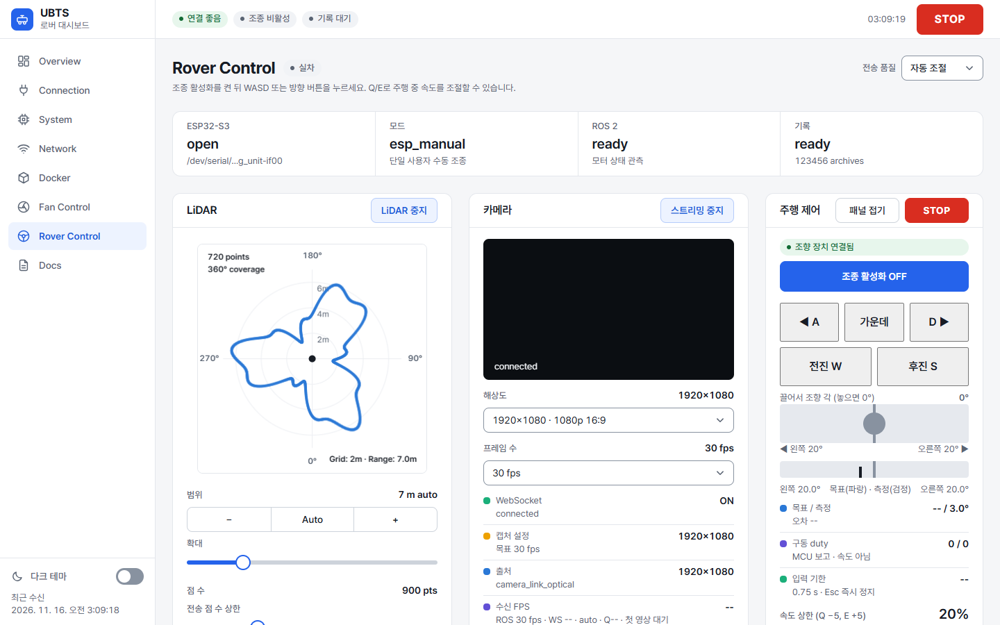
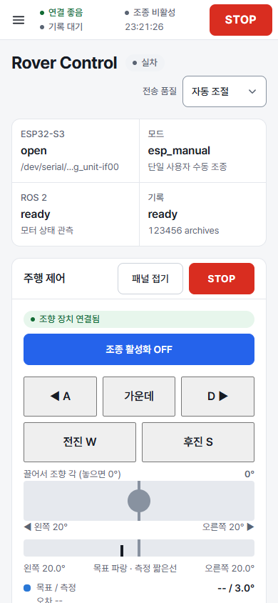
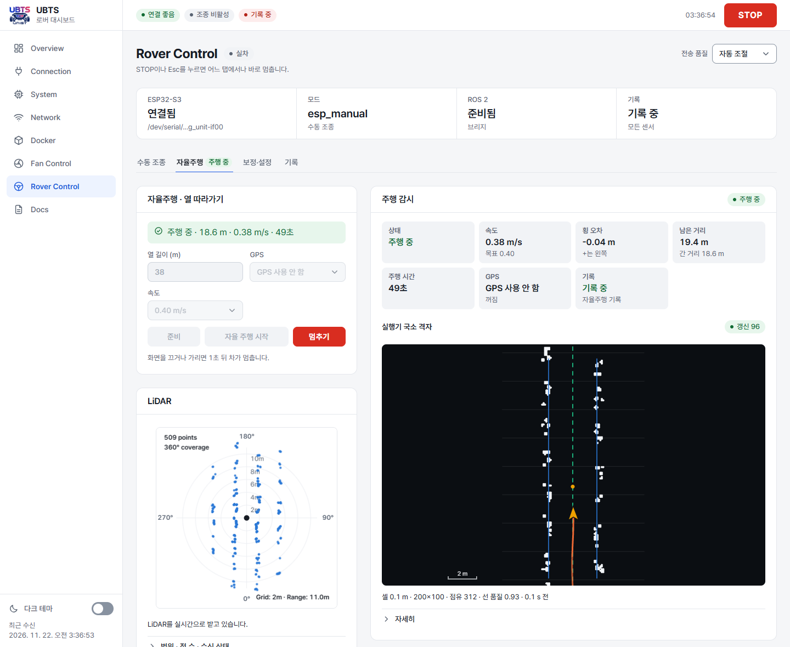
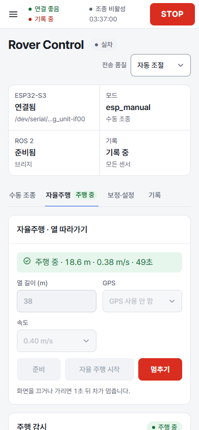
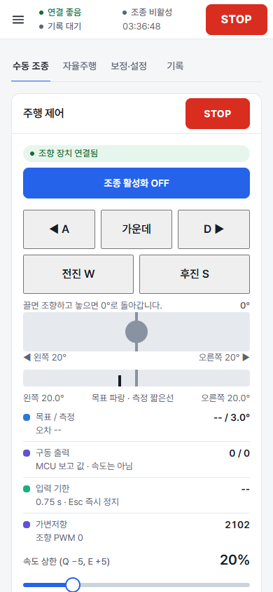
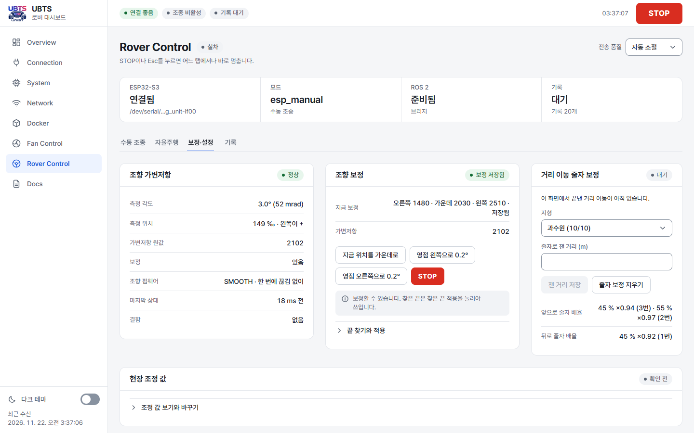
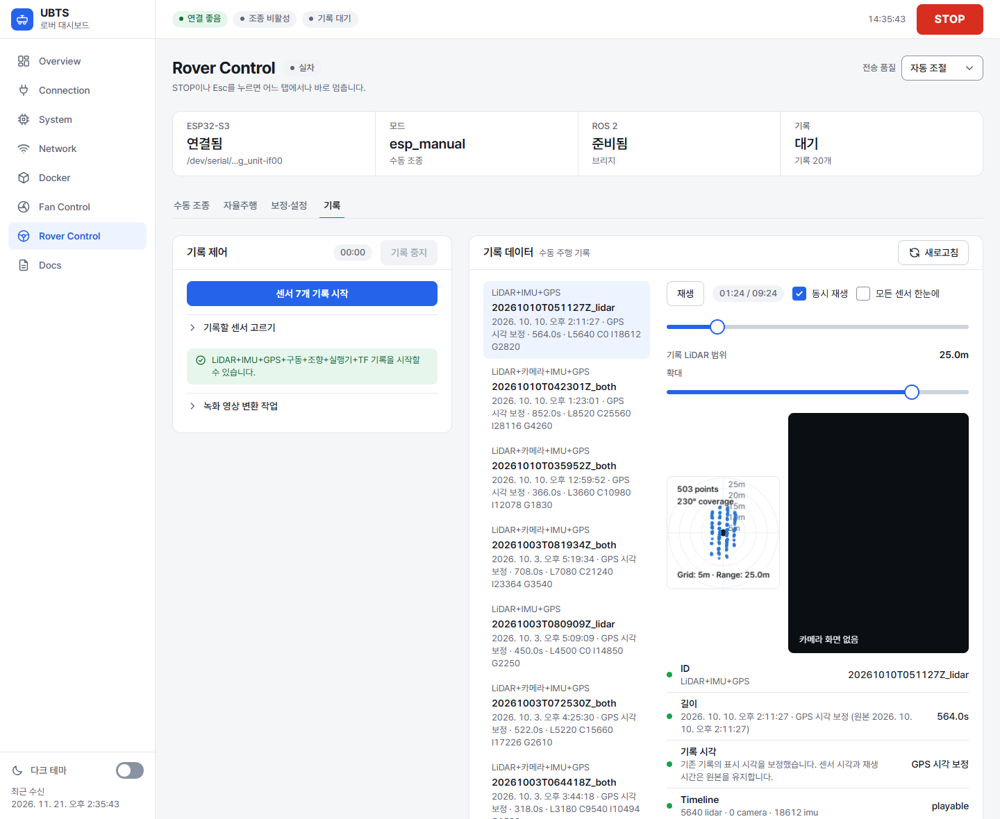
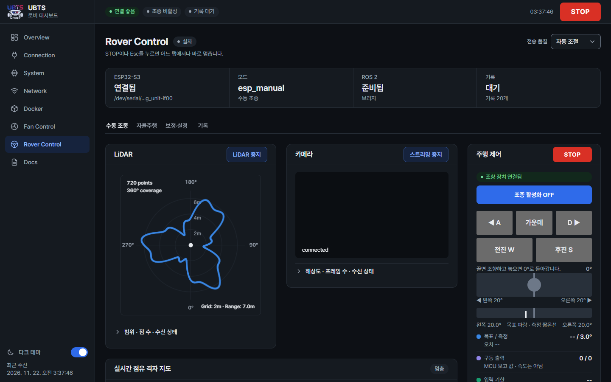
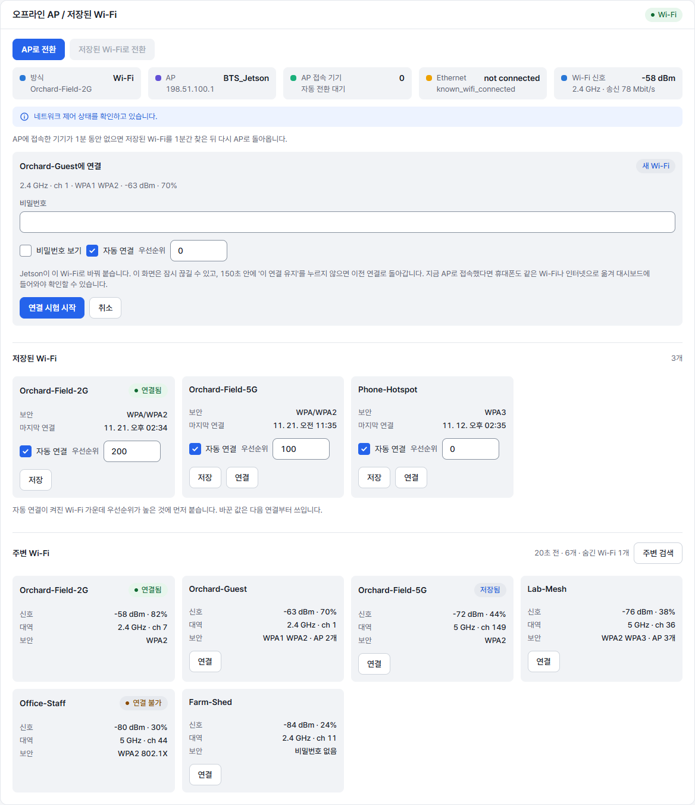
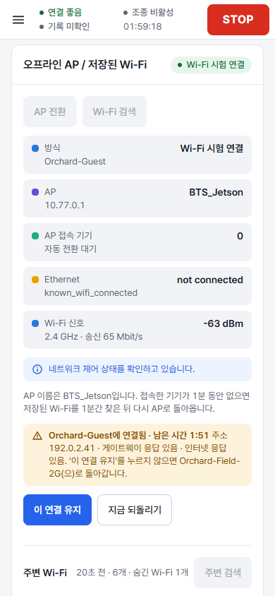

# 메뉴와 페이지 구성 (UI-16, 수정 전 구성으로 되돌림)

- 작성: 2026-11-14 (브랜치 `ui-menu-restore-20261114`, 시작 `a92cfec`).
- 사용자 지시(2026-11-14): "대시보드 메뉴 구성이 수정하기 전 버전이랑 동일해야해." 답 세 가지:
  1. 메뉴는 수정 전과 같은 8개(영문 이름, 같은 순서, 같은 주소). Research(`/research`)는 되살리지 않는다.
  2. 각 페이지의 내용도 수정 전의 페이지와 순서로 돌린다.
  3. 그때 없던 기능(앞바퀴 조향 조종, 자율 시작·정지, 현장 조정 값, 실행기 국소 격자, 조향 가변저항 표시)은 Rover Control 안에 둔다. 메뉴 항목을 더하지 않는다.
- 기준: 수정 전은 `becfc6d`(태그 `main-before-ui-20261112` 뒤에 1차 버그 수정만 들어간 판)의 `static/index.html`이다.
  `tests/test_menu_restore.js`가 메뉴(이름·순서·주소)와 페이지마다의 패널 제목(순서 포함)을 이 판과 견준다(`tests/fixtures/menu_before_redesign_becfc6d.json`).
- 그대로 둔 것: 새 디자인(색·글꼴·부품, 아이콘), 모든 페이지 위의 상태 막대와 STOP, 느린 연결 최적화(필요할 때 받는 라이브러리, 보이는 패널만 스트림,
  상태 묶음, 연결 등급), 조종·STOP 코드(`static/app/10-rover-control.js`, `controlRequest()`, `static/steer/steer-drive.mjs`, `steer-control-rules.js`, `auto-panel.mjs`는 글자 그대로. `auto-panel.mjs`에는 PW-10의 온라인 배율 줄과 주행 뒤 저장 묻기만 더했고 조종·STOP·heartbeat 줄은 그대로).
- 2026-11-13의 화면 6개 구성(UI-06)은 이 문서의 git 이력(`a92cfec`)에 있다. 화면 점검의 그때 기록(`tools/ui_check/accepted/six_screens_20261113.json`)은 2026-11-22에 레포에서 내렸고 커밋 `b6b9bac`까지 이력에 있다.

## 1. 메뉴와 주소

| 메뉴 | 주소 | 페이지 제목 | 패널(수정 전 순서) |
| --- | --- | --- | --- |
| Overview | `/` | UBTS Dashboard | 상태 띠(CPU, 메모리, 외부 IP, Docker), CPU / Memory, Network RX / TX, ROS2 / Rover, Jetson 정보 |
| Connection | `/connection` | 연결 상태 | 상태 띠(LiDAR, 프로토콜, 스캔 수신, 카메라), RPLIDAR 상태 확인, 2D LiDAR 지도, 카메라 실시간 화면, 서비스 연결, ROS2 센서 링크 |
| System | `/system` | 시스템 리소스 | CPU, Memory, Swap, Network, Power, Disk |
| Network | `/network` | 네트워크 상태 | 상태 띠(외부 IP, 내부 주소), 오프라인 AP / 저장된 Wi-Fi, RX / TX, 연결 정보 |
| Docker | `/docker` | 컨테이너 대시보드 | 상태 띠, Container CPU, Container Memory, 컨테이너 목록, 컨테이너 상세(중지·재시작 전 확인 창) |
| Fan Control | `/fan` | Fan Control | 온도, 팬 출력, Fan Temperature |
| Rover Control | `/rover-control` | Rover Control | 2절 |
| Docs | `/docs`, `/docs/<문서>` | 문서 | 문서 목록, 읽기 |

화면 6개 구성의 주소는 별칭으로 남는다. 들어오면 페이지가 주소창을 메뉴의 주소로 바꿔 적고(`history.replaceState`), Rover Control의 한 부분을
가리키던 주소는 그 부분으로 한 번 스크롤한다(`ROUTE_FOCUS`, `static/app/00-config-state.js`). 서버(`APP_ROUTES`, `dashboard_server/app.py`)는 둘 다에 같은 쪽을 준다.

| 옛 주소(화면 6개) | 가는 곳 |
| --- | --- |
| `/drive` | `/rover-control` |
| `/map` | `/rover-control`, 실시간 점유 격자 지도로 스크롤 |
| `/records` | `/rover-control`, 기록 제어로 스크롤 |
| `/tuning` | `/rover-control`, 현장 조정 값을 펼치고 스크롤 |
| `/sensors` | `/connection` |
| `/system/resources`, `/system/network`, `/system/docker`, `/system/fan` | `/system`, `/network`, `/docker`, `/fan` |
| `/research` | `/` (연구 페이지는 없앤 채로 둔다, 결정 나15) |

### 1-1. 일곱 쪽 정리 (2026-11-20)

사용자 요청(2026-11-19, 뜻): 대시보드가 조잡하고 글과 쓰지 않는 기능이 너무 많으니 쓰기 편하게 다시 짜 달라. Rover Control 말고 일곱 쪽을 정리했다.
메뉴(8개), 페이지 묶음, 패널 제목과 그 마크업 순서는 그대로다(`tests/test_menu_restore.js`). 바꾼 것은 세 가지다.

- **보이는 순서**: 그 쪽의 핵심을 위로 올렸다. 마크업은 두고 CSS `order`(`order-first`, `order-last`, `static/styles.css` 끝의 `pages simple 20261120` 묶음)로만 바꿨다.
  Rover Control 의 주행 제어를 좁은 화면에서 앞에 보인 것(2026-11-17)과 같은 방법이다. 키보드 초점은 마크업 순서로 움직인다.
- **접기**: 드물게 쓰는 것은 닫힌 접힘 칸(`details`)에 넣었다. 요소 `id`, 화면 스크립트의 동작, 서버 API 는 그대로다.
- **글**: 페이지 머리의 설명을 한 줄 이름으로 줄이고, 되풀이하는 설명 글을 지웠다.

| 페이지 | 보이는 순서 | 접힌 것 | 그 밖 |
| --- | --- | --- | --- |
| Overview | 상태 띠 → ROS2 / Rover, Jetson 정보 → CPU / Memory, Network RX / TX | 없음 | ROS2 / Rover 줄은 이름과 OK·대기만 보인다(주소와 상태 글은 Connection 의 서비스 연결에 있다) |
| Connection | 상태 띠 → ROS2 센서 링크 → RPLIDAR 상태 확인, 서비스 연결 → 2D LiDAR 지도 → 카메라 실시간 화면 | RPLIDAR '장치 정보'(장치, 고정 ID, 드라이버, 마지막 확인), LiDAR '고급 · 점 수와 다운로드'(점 수, 형식, 현재 지도 다운로드), 카메라 '고급 · 캡처 설정'(해상도, 프레임 수) | 장치 칸의 설명 글 네 줄을 지웠다 |
| System | 상태 띠(CPU, 메모리, 온도, 디스크: 새로 더함) → CPU, Memory → Swap, Network → Power → Disk | CPU '코어별'(통합·코어별 그래프 전환, 코어 막대), Swap·Network·Power 의 '그래프' | 메모리 막대와 한 줄 요약은 숨겼다(같은 값이 그래프 아래에 있다). CPU 그래프 아래는 전체 값만 |
| Network | 오프라인 AP / 저장된 Wi-Fi → 상태 띠(외부 IP, 내부 주소) → RX / TX → 연결 정보 | 없음 | 패널 안 순서: 시험 연결 알림과 '이 연결 유지' → AP 전환·Wi-Fi 검색 → 상태 → 연결 폼 → 저장된 Wi-Fi → 주변 Wi-Fi. 버튼과 요청은 그대로다 |
| Docker | 상태 띠 → 컨테이너 목록 → 컨테이너 상세 → Container CPU, Container Memory | 컨테이너 상세의 '로그' | 휴대폰 폭의 목록 한 줄: 이름 / 상태·CPU·메모리 / 가동 시간(이미지 이름은 상세에 있다) |
| Fan Control | 그대로 | 없음 | 머리 글만 줄였다 |
| Docs | 그대로 | 없음 | 휴대폰 폭에서 목록의 요약 글을 숨겼다(고른 문서의 요약은 읽기 칸 머리에 있다) |

System 의 상태 띠가 늘어 상태 띠는 일곱 개다(`tests/test_ui_frame.js`). 값은 아래 패널과 같은 것을 쓴다(`renderTelemetry`, `renderDisks`).
닫힌 접힘 칸 안의 그래프는 칸을 열 때 그린다(캔버스 크기 감시, `static/app/13-charts-canvas.js`).
화면 점검(`tools/ui_check`)의 받아들인 기록은 이 정리 전의 것이다. 견주면 `fail` 규칙은 모두 지키고, 마우스 화면의 36 px 조작 요소 수(알리기만 하는 수치)가 접힘 칸 머리만큼 늘어난다(`/system` +2, `/docker` +1).
시험: `tests/test_pages_simple.js`(접힘 칸에 든 것과 밖에 남은 것, 보이는 순서의 표시, 네트워크 패널 안 순서, System 상태 띠, 짧은 머리 글).

## 2. Rover Control

### 2-0. 페이지 안 탭 (2026-11-19)

사용자 요청(2026-11-19, 통로 시험 뒤): "지금 로버 조종 창이 너무 난잡해. 글씨도 쓸데없는 안내가 너무 많고", "보정관련된 영역을 좀 분리해서 보여주면 좋겠음
아예 탭을 따로 만들던가", "자율주행 관련 영역을 따로 만들던지 탭을 새로 만들던지". 메뉴(8개)와 페이지 묶음은 그대로다. Rover Control 한 페이지 안에서 상태 띠 아래
탭 줄(`roverTabs`, `role=tablist`)이 보일 부분을 고른다. 부분마다 `data-rover-tab` 에 탭 이름을 적고 스타일이 나머지를 숨긴다(`#roverLayout[data-tab]`).
고른 탭은 이 브라우저에 남는다(`ubts-rover-tab-v1`). 옛 주소 `/map`·`/records`·`/tuning` 은 그 부분의 탭을 연다.

| 탭 | 부분 |
| --- | --- |
| 수동 조종 | LiDAR, 실시간 점유 격자 지도, 카메라, GPS · 로버 위치, IMU, 주행 제어(조향 조종, 거리 이동 앞·뒤) |
| 자율주행 | 자율주행 · 열 따라가기(상태 한 줄, 열 길이, GPS 사용, 속도, 버튼 셋: 준비·자율 주행 시작·멈추기), 주행 감시(타일 일곱, 실행기 국소 격자 그림, 접힌 '자세히'), LiDAR(수동 조종과 같은 그림, 버튼 없이 받음), 기록 데이터(자율주행 기록만) |
| 보정·설정 | 조향 가변저항, 조향 보정(가운데·영점은 보이고 끝 찾기·적용은 접힘), 거리 이동 줄자 보정(지형 고르기), 현장 조정 값(접힘), 연동 상태(접힘) |
| 기록 | 기록 제어(센서 고르기는 접힘), 기록 데이터(수동 주행 기록만) |

2026-11-20 자율주행 탭의 속도 고르기(사용자 요청: "자율주행 속도 설정은 따로 못 하나?"). 열 길이·GPS 옆의 속도 칸(`autoSpeed`)은 실행기 조정 값
`target_speed_m_s` 다(`static/steer/auto-model.mjs` `speedChoice`). 따로 묻지 않고 자율 칸이 읽는 실행기 상태의 `tuning` 묶음에서 읽는다.

- 고를 수 있는 값: 그 키의 범위(`basic[].low`~`high`) 안에서 0.05 m/s 간격. 실행기 규칙(최저 속도 < 목표 ≤ 최고 속도)에 걸리는 값은 빼고 보인다
  (지금 값으로는 0.25~0.50; 0.20 은 범위 안이지만 실행기가 거절한다). 칸에는 실행기의 지금 값이 보이고, 다른 화면이나 현장 조정 값에서 바꾼 값도
  다음 상태 읽기에 따라온다(간격 밖의 값이면 그 값이 선택지로 하나 더 보인다). 범위를 못 읽으면 칸을 끄고 지금 값만 보인다.
- 바꾸면 현장 조정 값과 같은 길로 그 키 하나만 보낸다(`POST /api/executor/params {target_speed_m_s}`). 파일에는 저장하지 않는다(실행기를 다시 켜면
  파일 값으로 돌아간다; 저장은 보정·설정의 현장 조정 값에서). 변경 기록에는 남는다. 거절되면 칸이 실행기 값으로 돌아가고 상태 줄에
  '속도를 바꾸지 못했습니다. (이유)'가 나온다(이유 글은 현장 조정 값의 거절 표).
- 잠금: 실행기는 주행이 열려 있는 동안(ready·armed·running·paused), 브리지가 아직 조종 권한을 쥐고 있는 동안, 차가 움직이는 동안 조정 값을 받지 않는다
  (`tuning.editable`). 칸도 그때 꺼진다. 멈춘 뒤(끝남·멈춤)에는 준비 전에 고를 수 있다.
- 한 줄 주의(`autoSpeedNote`): 고른 값이 과속 한도(최고 속도 + 과속 여유)까지 0.10 m/s 안이면(지금 값으로는 0.45 이상)
  '과속 한도(0.55 m/s)에 가까워 주행 중 잠깐 느려질 때가 있습니다.' 한도 숫자는 실행기 값이고, 못 읽으면 이 줄은 나오지 않는다.

2026-11-20 자율주행 탭의 LiDAR(사용자 요청: "자율주행 시에 라이다 데이터라도 실시간으로 받아오게 하면 좋을 듯", 실시간 점유 격자 지도 자리에).
자율주행 탭에서 실시간 점유 격자 지도를 빼고(수동 조종에는 그대로) 그 자리에 LiDAR 그림을 둔다. 수동 조종의 LiDAR 부분과 같은 요소다
(`rover-lidar-panel`, `data-rover-tab="manual auto"`: 캔버스 하나, 연결 하나, 같은 그리기 코드, 같은 전송 품질 규칙).

- 자율주행 탭에서는 버튼(`roverLidarToggle`)을 숨기고 그림 아래 한 문장(`roverLidarNote`)으로 상태를 알린다. 받는 중, 연결 중, 스캔을 기다리는 중,
  연결하지 못함을 말하고, 그림이 더는 새로 오지 않으면(3초 넘게 소식 없음, 스캔 없는 상태 보고, 연결 끊김) '그림은 마지막으로 받은 스캔입니다.'라고 적는다.
- 켜지는 규칙: 사용자가 끄지 않은 LiDAR 는 예전 규칙 그대로 그림을 따른다(그림이 화면에 보이면 열고, 1초 넘게 안 보이거나 페이지가 가려지면 쉬고,
  다시 보이면 스스로 연다). 그래서 탭을 열면 누르지 않아도 받는다. 폰처럼 그림이 화면 아래에 있으면 그림까지 내렸을 때 받기 시작한다.
- 사용자가 수동 조종(또는 Connection)에서 꺼 둔 LiDAR 는 자율주행 탭을 열 때 탭이 켜고(`syncAutoLidar`), 그 탭이나 Rover Control 을 떠날 때 다시 끈다
  (끄기 전 상태로 되돌림). 탭이 스스로 켠 것만 스스로 끈다. 사용자가 켜 둔 LiDAR 는 탭 규칙이 끄지 않는다.
- 자율주행의 버튼 셋, 연결 신호, 기록은 LiDAR 와 무관하다. LiDAR 브리지가 없어도 준비·시작·멈추기는 그대로 된다.

2026-11-20 주행 감시의 움직이는 그림(사용자 요청: "실행기 국소 격자의 움직임이 너무 끊겨서 보기 안 좋아 … 배경이 움직이는 느낌으로 … 레이싱 게임
미니맵 보는 느낌"). '실행기 국소 격자' 그림은 차를 한자리에 두고 바닥이 흐르는 그림이다(`static/steer/minimap.mjs`, 읽기와 장면은 `static/steer/local-grid.mjs`).

- 차는 캔버스 가로 가운데, 아래에서 5/17(약 29 %) 높이에 고정된 화살표다. 위쪽은 열의 축이다: 격자가 맞춘 중심선의 방향, 없으면 추정기 band 의 방향,
  그것도 없으면 차의 진행 방향. 그림의 축은 0.5 s 시간 상수로 그 축을 따라가고, 화살표는 축과의 방향 차이만큼만 돈다. 횡 오차는 점선 중심선이 차의
  왼쪽이나 오른쪽을 지나는 것으로 보인다. 점선은 추정기 band 의 중심선(횡 오차 타일이 재는 선)이고, band 가 없으면 격자가 맞춘 중심선이다.
- 축척은 고정이다: 앞 12 m, 뒤 5 m, 좌우 5 m 이상(높이 440 px 에서 1 m 가 약 26 px). 자료에 맞춰 다시 맞추지 않는다. 왼쪽 아래에 2 m 눈금이 있고,
  바닥에는 2 m 마다 옅은 가로줄(주행 거리 좌표에 고정)이 있어 격자가 없어도 흐름이 보인다.
- 그리는 것: 점유 셀(밝은 점), 격자가 맞춘 두 나무 줄(실선), 중심선(점선), 지나온 길(차 뒤로 15 m 까지, 멀수록 옅게; 그려진 차보다 앞선 점은 뺀다),
  앞보기 점(작은 점), 차. 실행기 상태에는 앞보기 점의 좌표가 없어서, 상태의 `lookahead_error_deg`(점까지의 각도)와 조정 값(`lookahead_base_m`,
  `lookahead_per_speed_s`, `lookahead_max_m`, `min_speed_m_s`)으로 제어기의 식대로 거리를 다시 계산해 그린다(주행 중에만; 값이 없으면 그리지 않는다).
  실행기가 `single_row_geometry.lookahead` 를 보내면 그 점을 쓴다. 격자가 없는 실행기는 나무 줄과 셀 없이 같은 방식으로 그린다.
- 자세 표본: 자율 칸이 0.5 s 마다 읽는 실행기 상태의 `pose`(run 주행 거리 좌표 x, y, yaw; 서버가 모든 상태 읽기에 넣는다)를 쓴다. 이 그림이 스스로 묻는
  것은 예전과 같은 `?grid=1` 1초에 한 번뿐이다(셀, 선, 길). 자율 칸이 없거나 서버가 `pose` 를 주지 않으면 `?grid=1` 읽기의 자세를 1초 표본으로 쓴다.
- 표본 사이: 새 표본이 오면 그때 그려진 자리에서 새 표본까지 곧게(각도는 가까운 쪽으로) 옮긴다. 걸리는 시간은 두 표본이 도착한 간격의 1.2배(0.1~1.8 s)다.
  그래서 그림은 실제보다 표본 하나쯤(0.5 s 표본이면 약 0.6 s) 늦고, 받은 표본보다 앞서 나가지 않는다. 표본이 늦으면 마지막 표본 자리에서 기다린다.
  2 m 넘게 뛰는 표본(새 run)은 바로 옮긴다. 셀 그림은 새 비트맵이 올 때만 다시 만든다.
- 그리는 때: `requestAnimationFrame` 으로 1초에 30장까지, 주행이 열려 있고(ready·armed·running·paused) 그림 칸이 화면에 있고 페이지가 보일 때만 그린다.
  같은 그림이 될 장면은 그리지 않는다. 주행이 끝나면 마지막 표본 자리에서 멈추고 그 그림을 둔다(예전 규칙). `prefers-reduced-motion` 이면 표본마다 한 번만
  그리고 사이를 잇지 않는다.
- 캔버스는 높이 440 px, 폭 480 px 까지다(넓은 화면에서는 어두운 바탕 가운데에 놓인다).

2026-11-20 기록 재생에서도 같은 그림(사용자 요청: "자율주행에서 실행기 국소 격자 시각화해서 보여주는 거가 녹화된 자율주행 데이터에서도 보이게 해줘").
기록 재생의 '기록된 자율 계산' 그림도 차를 한자리에 두고 바닥이 흐르는 그림이다(`static/steer/recorded-grid.mjs`, 그리기는 `minimap.mjs`).
타일(그 순간의 값)은 그대로 있다.

- 기록에는 실행기의 격자가 없다. 그래서 점유 셀은 재생기가 다시 만든 것이다. 기록된 LiDAR 프레임(1초에 약 2장, 빔 넷 중 하나)을 그 순간의 실행기
  자세(기록된 `/row_executor/state` 의 `pose`, 표본 사이는 곧게 이음)로 놓고 0.1 m 셀로 센다. 놓는 법은 실행기와 같다: 빔 각에 179.08° 를 더한 것이
  진행 방향에서 잰 각이고(뒤집지 않음), LiDAR 는 차 중심에서 앞으로 0.1185 m, 12 m 까지의 반사만, 자세는 프레임을 받은 때보다 0.08 s 앞의 것.
  이 숫자들은 2026-11-20 현장 실행기 설정값이고 기록에는 들어 있지 않다. 설정이 바뀌면 `recorded-grid.mjs` 맨 위의 상수를 같이 고친다.
- 프레임 2장 이상이 맞힌 셀만 그린다(실행기는 제 갱신 3번). 2026-11-20 의 38 m 주행 기록에서 5초 간격 22개 시각으로 재 보니, 다시 만든 셀 수는
  실행기가 그때 센 수의 82~99 %(중앙값 94 %)였고, 나무 줄 가까이 셀들의 가운데 자리는 실행기가 맞춘 줄에서 왼쪽 -7.5~+7.0 cm, 오른쪽 -2.8~+10.5 cm
  안에 있었다(중앙값 +0.9 cm, +2.2 cm). 실행기의 격자 그대로는 아니다.
- 재생 시각 이전의 프레임만 센다. 뒤로 돌리면 그 시각 뒤의 셀은 남지 않는다. 같은 run 의 것, 차에서 19 m 안의 것, 최근 160장까지만 세고,
  프레임은 400장까지만 들고 있다(재생 시각에서 먼 것부터 버린다). 셀은 새 프레임이 들어오거나 창이 1 m 옮겨질 때만 다시 센다.
- 선과 타일은 재생 시각 이전 마지막 상태의 것이다. 차의 자리는 앞뒤 두 표본 사이를 재생 시각에 맞춰 잇는다(`prefers-reduced-motion` 이면 잇지
  않는다). 두 나무 줄 선은 상태의 `grid_centreline`(격자가 맞춘 중심선과 폭)을 좌우로 반 폭씩 옮긴 것이다.
- 시각을 건너뛰면 그 앞 24초의 LiDAR 창(4초짜리)과 그 구간의 실행기 상태(텔레메트리 창 하나)를 새것부터 하나씩 더 받는다. 건너뛴 뒤 0.35초 쉬고
  시작하고, 그림이 화면에 보일 때만 받는다. 처음부터 이어서 재생하면 재생기가 원래 받는 것 말고는 더 받지 않는다. 그래서 건너뛴 직후의 그림은
  이어서 재생해 온 그림보다 셀이 조금 적을 수 있다(60초로 건너뛴 직후 134개, 처음부터 세면 166개였다).
- 실행기 상태가 없는 기록에서는 이 칸이 나오지 않고, 그림 모듈도 받지 않는다.

2026-11-21 기록 재생은 기록 지도를 기다리지 않는다(사용자 보고: "녹화 기록들 재생이 잘 안 됨. 렉이 엄청 걸리고 버퍼링도 많이 걸리고 아예 재생이
안 되기도 함").

- 기록 지도(GPS·IMU·LiDAR 통합 지도)는 그 기록을 처음 재생할 때 Jetson 이 재생 시각까지 만든다. 재생기가 0.25초마다 재생 시각을 보내고 서버는
  거기까지만 계산한다. 2026-11-21 에 재 보니 38 m 주행 기록(117초) 하나를 다 만드는 데 74초가 걸렸다(실시간의 약 1.6배, 다른 일이 없을 때).
- 그 전에는 지도가 재생 시각보다 0.35초 넘게 늦으면 영상과 센서 재생을 멈추고 기다렸다('지도 버퍼링'). 요청 한 번이 0.16초(중앙값) 걸리는 터널
  접속에서는 지도가 늘 그만큼 늦어서 1초에 서너 번씩 멈췄다 이어졌다. 잰 값: 지도가 없던 38 m 기록을 45초 지켜보는 동안 재생은 25.9초만 나갔고
  (0.58배), 그 49 % 동안 영상이 멈춰 있었다. 앞으로 건너뛰면 그 사이를 다 계산할 때까지 멈춰 있었다.
- 또 다른 기록의 지도 작업이 살아 있는 동안(그 기록을 보던 화면이 떠난 뒤 15초까지, 다른 사람이 다른 기록을 보는 동안은 계속) 서버가 지도
  제어를 거절하면 재생기가 스스로 일시정지했다. 잰 값: 한 기록을 보다가 바로 다른 기록을 재생하면 30초 동안 3.4초만 나갔다.
- 지금은 영상과 센서가 그대로 재생되고 지도가 뒤따른다(`syncArchiveMapClock` 은 멈추지 않고 지도가 늦은 초 `mapLagS` 만 적는다, 값은
  `LiveMap.archiveLag`). 지도가 2초 넘게 늦으면 재생 시각 옆에 '지도는 12초 뒤에 따라옵니다'처럼 나온다(몇 분의 1초 늦는 것은 늘 있는 일이라
  적지 않는다). 지도 제어가 거절되면(`MAP_CONTROL_REFUSED` 의 네 가지) 재생은 이어지고 지도 칸에 까닭이 문장으로 남으며, 3초마다 다시 청한다
  (그 밖의 요청 실패는 1초 뒤). 작업 관리에서 멈춘 지도는 재생을 다시 누를 때까지 멈춘 채로 둔다(다시 청하는 요청에는 이어가기 표시가 없어
  서버가 계속 거절한다).
- 지도가 끝까지 만들어진 기록은 저장된 지도를 12초 창으로 받아 그린다. 이때도 창이 늦게 와도 재생은 멈추지 않는다.
- 지도 제어 세대(`mapping_generation`)를 읽는 자리도 고쳤다. 서버는 재생기가 15초 동안 소식이 없으면(일시정지를 15초 넘게 하거나 다른 기록으로
  가면) 그 기록의 지도 작업을 끝내고 세대를 새로 만든 뒤, 새 세대와 '이어가기' 표시가 같이 온 재생만 받는다. 그런데 지도 칸이 이미 있는 기록의
  지도 조회 응답은 창 모양으로 싸여 오고 세대가 그 안의 `seed` 에 들어 있어, 겉에서만 읽던 재생기는 새 세대를 끝내 알지 못했다. 그래서 그런
  기록은 재생을 누를 때마다 거절돼(`mapping_control_revoked_refresh`) 스스로 멈췄고, 대시보드를 다시 켜거나 '새 지도 만들기'를 누르기 전에는
  재생할 수 없었다. 지금은 싸인 응답을 푼 뒤에 세대를 읽고(고른 기록의 응답일 때만), 거절된 재생은 그 조회 뒤 3초 재시도에서 지도를 이어 간다.

2026-11-20 자율주행 기록은 달린 구간마다 하나, 그리고 주행 시간(사용자 요청: "자율주행 중단돼도 해당 지점까지는 녹화되게 해 주고, 다시 출발을 할
수 있는 상황이라도 끊고 다시 녹화되게 해 줘. 대신 다시 출발 기능을 쓴 거라는 걸 추후 알 수 있도록 녹화 데이터를 남기고. 그리고 자율주행 몇 초 동안
했는지 이런 거 보이게 해 줘."). 화면 쪽은 `static/steer/auto-panel.mjs`·`auto-model.mjs`, 서버 쪽은 `dashboard_server/run_recording.py` 다.

- 기록 하나 = 출발(또는 다시 출발)부터 차가 주행을 멈출 때까지의 한 구간. 출발과 다시 출발은 누를 때마다 새 기록(모든 센서, tag `autonomy`)을 켠다.
  못 켜면 출발하지 않는다(예전 규칙). 사람이 직접 켠 모든 센서 기록(tag `manual`)이 돌고 있으면 그 기록을 그대로 쓰고 건드리지 않는다. 이전 구간의
  자율주행 기록이 아직 돌고 있으면(화면을 새로 고친 뒤 등) 그것을 끝내고 새로 켠다.
- 화면이 끄는 때(`recordStopWanted`): 이 화면이 켠 기록이 돌고 있고 run 이 주행 중(`running`)이 아니면 바로 끈다. 일시정지(paused)도 포함이다.
  끝남·멈춤·대기(ended·latched·idle)는 곧바로, armed·paused 는 출발 요청이 아직 가는 중이 아닐 때 끈다: 출발이 받아들여진 뒤 4초
  (`GO_SETTLE_MS`) 안이거나 실행기가 누름을 아직 쥐고 있으면(`operator_link.go_active`) 기다린다. 출발이 거절되거나 기다리는 동안 멈추기를 누르면
  방금 켠 기록을 끈다. 실행기 상태를 모르면 끄지 않는다(서버가 맡는다).
- 서버 지킴이(`RunRecordings`, 대시보드 서버 안의 스레드 하나): tag `autonomy` 로 시작한 기록이 도는 동안만 실행기 상태를 2초마다 본다. 출발한 뒤
  run 이 주행 중이 아닌 채 5초가 지나면, 출발이 오지 않은 채 15초가 지나면, 실행기가 15초 동안 답하지 않으면 서버가 기록을 끈다. 그래서 화면을
  닫거나 새로 고쳐 연결 신호가 끊긴 run 의 기록도 그 지점까지 저장된다. 화면이 이미 껐으면 아무 일도 하지 않는다. 끄기 전에 녹화기 상태를 한 번 보고,
  다른 기록이 돌고 있거나 아무것도 돌지 않으면 손대지 않는다. 직접 켠 기록(tag `manual`)은 보지 않는다. 녹화기가 끄기를 거절하면 10초 뒤 다시 한다.
  서버가 다시 떠도 녹화기가 자율주행 기록을 돌리고 있으면 이어서 지킨다.
- 구간 기록(`<기록 폴더>/<recording_id>/autonomy_segment.json`, 형식 `ubts.autonomy_segment.v1`): 서버가 기록이 시작될 때 쓰고 끝날 때 다시 쓴다
  (임시 파일에 쓰고 이름 바꾸기, UTF-8, LF). 녹화기 스크립트와 녹화기의 파일(`metadata.json` 등)은 바꾸지 않는다. 폴더에 쓸 수 없으면
  `runtime/autonomy_segments/<recording_id>.json` 에 쓴다. 담는 것: run 번호(`run`), 그 run 의 몇 번째 구간(`segment`), 다시 출발로 시작했는지
  (`resumed`), 앞 구간의 기록 id 와 그때 멈춰 있던 이유(`previous`), 열 길이·GPS·목표 속도(`settings`), 시작과 끝의 시각과 상태(`start`, `go`, `end`:
  실행기 코드 `reason`·`detail`, 사람 말 `text`, 누가 껐는지 `stopped_by` = page·server·elsewhere), 이 구간의 주행 시간과 거리
  (`drive_time_s`, `distance_m`), 그때까지 run 전체(`run_drive_time_s`, `run_distance_m`), 시간의 출처(`time_source`). GNSS 좌표는 넣지 않는다.
  출발하지 않고 끝난 기록은 `moved: false`, 끝 글 '출발하지 않음'이다. 구간 번호는 같은 run 의 앞 구간 기록을 찾았을 때만 매긴다(못 찾으면 `null`).
- 기록과 출발 사이의 기다림(`GO_AFTER_RECORD_MS` = 2.5 s, 자리값): 새 기록을 켠 경우 녹화기가 '기록 중'이라고 답한 뒤 2.5초를 기다렸다가 연결 신호와
  출발을 보낸다. 그동안 상태 줄은 '기록을 시작했습니다. 잠시 뒤 출발합니다.' 측정(이 PC 의 SIM, 2026-11-20): 기록을 켠 지 2.1초 뒤 조향 브리지
  프로세스가 0.35초 멈췄고 그때 출발한 run 이 `steering_feedback_stale` 로 끝났다(9번 중 4번). 이미 돌던 기록을 쓰는 경우에는 기다리지 않는다.
- 주행 시간(`runTimes`): 실행기 상태의 `metrics.time_s`(구동 명령이 있는 틱만 센 시간: 서 있는 동안은 세지 않고, 다시 출발해도 이어서 센다)와
  `single_row.distance_m` 을 쓴다. 실행기 값이라 화면을 새로 고쳐도 남는다. 주행 중 상태 줄은 '주행 중 · 12.3 m · 0.38 m/s · 35초'(run 전체),
  주행 감시에 '주행 시간' 타일(다시 출발한 run 은 아래에 '다시 출발 뒤 20초'). 멈춘 뒤에는 이유 문장 뒤에 '1분 45초 동안 43.2 m를 주행했습니다.',
  다시 출발이 있었으면 '모두 1분 45초 동안 43.2 m를 주행했습니다. 다시 출발한 뒤로는 20초 동안 9.8 m를 주행했습니다.' 구간의 값은 서버의 구간
  기록(녹화기 상태 응답의 `autonomy_segment`)에서 온다. `metrics` 를 보내지 않는 실행기는 서버가 잰 출발~멈춤 시각으로 대신한다(`time_source: wall_clock`).
- 기록 데이터 목록(자율주행 탭): 구간 기록이 있는 기록은 첫 줄에 '자율주행 · 2번 구간 · 다시 출발', 다음 줄에 '1분 45초 · 43.2 m · 열 끝 도착'을
  보인다(`/api/recordings` 의 `segment`). 구간 기록이 없는 예전 기록은 예전 줄 그대로다.

2026-11-20 단순화(사용자 요청: "준비 → 열을 잡아서 자율주행 가능한 상태면 자율주행 버튼 활성화, 멈추기 버튼 누르면 멈추는, 최대한 단순한 과정",
"글이 너무 많고 쓸데없는 기능이 너무 많다"). 메뉴 8개와 탭 4개는 그대로다. 없앤 기능은 없고, 드물게 쓰는 것은 닫힌 접힘 상자로 옮겼다(요소 id 는 그대로).

- 자율주행 탭의 버튼은 늘 같은 자리의 셋이다(`static/steer/auto-model.mjs` `autoButtons`, `static/steer/auto-panel.mjs`).
  - **준비**(`autoPrepare`): 주행 중이 아니면 누를 수 있다. 한 번에 필요한 것을 차례로 한다(`prepareSequence`): 실행기 상태를 새로 읽고,
    멈춤(래치)이면 `ack`, 열린 run(ready·armed·paused)이 있으면 `end`, 그다음 `start`(열 길이·GPS)와 `arm`. `end` 뒤 브리지가 아직 Arm 이면
    (`bridge_still_armed`, 차가 서는 동안) `start` 를 0.3초마다 다시 보낸다. 전체 한도 12초. 실패하면 왜인지 상태 줄에 문장으로 보인다
    (예: '준비하지 못했습니다. RTK FIXED 상태가 아니어서 RTK 보정을 쓸 수 없습니다.'). 래치 확인 버튼은 따로 없다.
  - **자율 주행 시작**(`autoPrimary`, 일시정지 뒤에는 '다시 출발'): run 이 armed(또는 paused)이고 실행기 `go_blockers` 가 이 버튼을 누르면 풀리는 것
    (`operator_link_not_fresh`) 말고는 비었을 때만 켜진다. 곧 통로를 잡기 전에는 꺼져 있다. 누르면 모든 센서 기록 시작(못 켜면 출발 안 함) →
    2.5초 기다림(새 기록일 때) → heartbeat → `go`. 기록 버튼은 따로 없다.
  - **멈추기**(`autoStopButton`): 늘 켜져 있다. 다른 STOP 과 같은 길(브리지 stop + run 이 있으면 실행기 stop). 준비 중에 누르면 준비가 거기서 그만두고
    (Arm 을 보내지 않음), 출발 전 기록을 켜거나 기다리는 동안 누르면 go 를 보내지 않고 방금 켠 기록을 끈다.
- 상태 한 줄(`autoStatus`, `statusLine`): 지금 상태와 다음 할 일. '준비를 누르세요.', '통로를 찾고 있습니다.', '센서 입력을 기다리고 있습니다.', '출발할 수 있습니다.',
  '주행 중 · 12.3 m · 0.38 m/s', '열 끝에 도착해 멈췄습니다.', '(이유) 멈췄습니다. 다시 하려면 준비를 누르세요.', '(이유) 잠시 멈췄습니다. 다시 출발을 누르세요.'.
  멈춘 이유는 준비를 다시 누를 때까지 남는다. 실행기가 SHADOW 면 끝에 '연습 모드라서 차는 움직이지 않습니다.'가 붙는다.
  동작이 실패하면 그 문장이 대신 보이고, run 상태나 출발 가능 여부가 바뀌거나 버튼을 다시 누르면 사라진다.
- 열 길이와 GPS 는 run 이 armed·running·paused 인 동안 잠긴다(그 run 의 값). 바꾸려면 멈추기 뒤 준비.
- 주행 감시에 남는 타일: 상태(멈춘 이유), 속도(목표), 횡 오차, 남은 거리(간 거리), 주행 시간, GPS, 기록. '자세히'(`autoMore`, 닫힘)에 모드 칩('연습 모드'/'실제 주행 모드'),
  '이번 주행 끝내기', 나머지 타일(방향 오차, 속도 제한, 단계, 조향 명령/측정, 구동 출력, 조향 모터 PWM), 중심선 대비 오차, 온라인 배율과 run 뒤 저장 묻기,
  실행기 줄(정지 이유, 실행기 코드, 출발 조건과 코드 등), 격자 그림 색 설명이 있다. run 끝의 온라인 배율 알림은 상태 줄에 띄우지 않는다.
- 수동 조종: LiDAR 의 범위·점 수·수신 상태, 카메라의 해상도·프레임 수·수신 상태, IMU 값, 조향 설정(A/D 조향 속도, 조향 각, 놓았을 때, 화면 초기화)은 접혀 있다.
- 줄자 보정의 지형(`steerDistTapeTerrain`)은 수동 조종 거리 이동의 지형(`steerDistTerrain`)과 같은 값이다(한쪽을 바꾸면 다른 쪽도). '줄자 보정 지우기'는 고른 지형에
  간다. 줄자 거리는 그 이동을 계획한 지형의 것이라, 고른 지형이 마지막 이동의 지형과 같을 때만 저장할 수 있다(다르면 버튼이 꺼지고 까닭을 보인다).

- STOP 은 상태 막대·주행 제어·자율 칸·보정·거리 이동에 있고 Esc 도 어느 탭에서나 멈춘다. 조종 활성화를 쥔 채 수동 조종 탭을 떠나면 STOP 을 보낸다(패드가 화면에서 사라지므로).
  조향 보정의 끝 찾기 중에 보정·설정 탭을 떠나도 STOP. 거리 이동 버튼을 누른 채 탭이 바뀌면 놓은 것으로 친다.
- 자율 heartbeat 는 탭과 무관하다(Rover Control 이 열려 있고 브라우저 탭이 보이면 계속). 탭 줄의 자율주행에 run 상태 배지가 뜬다.
- 자율 run 기록(2026-11-20부터 늘 켬, 끄는 칸도 따로 켜는 버튼도 없음): 출발과 다시 출발 바로 전에 모든 센서(GPS 포함, tag `autonomy`)를 새로
  기록하기 시작하고, 시작하지 못하면 출발하지 않는다. 직접 켠 모든 센서 기록이 돌고 있으면 그 기록을 쓰고, 센서가 빠진 기록이면 멈추고 모든 센서로
  다시 시작한다. 이 칸이 시작한 기록은 run 이 주행을 멈추면(일시정지 포함) 바로 끈다: 기록 하나가 달린 구간 하나다(2-0절 '달린 구간마다 하나').
- GPS(2026-11-20부터 두 가지): 'GPS 사용 안 함'(off), 'GPS 사용함'(weak_constraint: 확정된 위치가 열 범위(여유 10 m 또는 정확도의 3배)를
  3번 잇달아 벗어나면 run 을 끝냄(`gnss_geofence`), RTK FIXED 일 때 중심선을 최대 10 cm 보정. 위치가 없으면 GPS 없이 간다).
  준비 때 `gnss_mode` 로 늘 보내고 이 브라우저에 남긴다. 실행기 설정이 허용하지 않으면(`gnss_mode_unsupported`) 그 말을 보이고,
  요청과 run 의 방식이 다르면 주행 감시의 GPS 타일이 알린다.
- 주행 감시 타일(화면 일곱 + '자세히'): 상태·이유, 속도(목표), 횡 오차, 남은 거리(간 거리), 주행 시간, GPS, 기록 / 방향 오차, 속도 제한, 조향 명령/측정(실행기 값, 없으면 브리지 값),
  구동 출력(보드 PWM·상한), 조향 모터 PWM(브리지 `steering.pwm`·`pwm_peak`). 실행기 상태는 자율 칸의 0.5 s 읽기, 브리지 상태는 조향 패널의 읽기를 같이 쓴다(새 요청 없음).
  실행기가 `metrics` 를 보내면 '중심선 대비 오차'(횡 RMS·평균·최대, ±5·10 cm 안 비율, 방향 RMS·최대, 표본; `grid_*` 는 격자 중심선 대비)를 보인다.
- 실행기 국소 격자 그림(`static/steer/local-grid.mjs`, `static/steer/minimap.mjs`): 차를 한자리에 두고 바닥이 흐르는 그림이다(2-0절 '주행 감시의 움직이는
  그림'). 점유 셀, 맞춘 나무 줄, 중심선, 지나온 길(`single_row_geometry.path`, 없으면 격자 읽기마다의 차 위치), 앞보기 점, 차.
  `GET /api/executor/status?grid=1` 을 1초에 한 번, 자율주행 탭이 보일 때만 묻는다.
- 기록 데이터 목록은 탭에 따라 나뉜다(녹화 `tag`: 없으면 수동). 자율주행 기록을 재생하면 기록된 `/row_executor/state` 를 같은 그림으로 그린다
  ('기록된 자율 계산', 서버가 재생 창에 `executor.frames` 를 실어 줄 때). 점유 셀은 기록된 LiDAR 로 다시 만든다(2-0절 '기록 재생에서도 같은 그림').
- 안내 글은 줄였다: 긴 사용법은 이 문서와 `docs/esp_rover_control.md` 에 있다. 짧은 이름, 꼭 필요한 상태, 거절 이유는 화면에 남는다.

아래는 탭 앞(2026-11-17)의 설명이다. 패널 제목의 마크업 순서는 그대로다(`tests/test_menu_restore.js`).

수정 전 순서: 상태 띠(ESP8266, 모드, ROS 2, 기록) → LiDAR(안에 실시간 점유 격자 지도) → 카메라 → GPS · 로버 위치 → IMU → 주행 제어 → 기록 제어 → 연동 상태 → 기록 데이터(안에 기록된 점유 격자 지도, Recorded IMU, 기록된 로버 위치, 기록된 모터 핀 신호).
넓은 화면(900 px 이상)에서는 수정 전처럼 세 칸이다: LiDAR | 카메라 | 주행 제어, 그 아래 기록 제어(셋째 칸), 그 아래 GPS(전체 폭), IMU와 현장 조정 값, 연동 상태, 기록 데이터.
900 px 미만(휴대폰, 태블릿 세로, 휴대폰 가로)에서는 주행 제어 패널을 맨 앞에 보인다(CSS `order`, 2026-11-17). 휴대폰 한 칸에서 주행 제어가 LiDAR·카메라·GPS·IMU 아래 약 4,100 px(5 화면) 밑에 있었기 때문이다.
마크업 순서(패널 제목 순서, `tests/test_menu_restore.js`)는 그대로다. 센서 스트림은 패널이 화면에 들어올 때 열리므로 휴대폰 첫 화면에서는 LiDAR·카메라가 스크롤해 내려갈 때 열린다.
주행 제어 패널 안 순서(조향 차): 조향 조종(`steerDrive`) → 자율 칸(`autoPanel`) → 조향 가변저항 → 조향 보정(접힘) → 거리 이동(접힘).

새 기능이 들어간 곳(`id`는 고정, 다른 작업이 이 이름으로 찾는다):

| 새 기능 | 자리 | id |
| --- | --- | --- |
| 앞바퀴 조향 수동 조종(구동 W/S, 조향 A/D·가운데, 계기) (UI-07) | 주행 제어 패널, 차동 부분(활성화, 속도, 패드. 옛 자율 순항속도 줄은 2026-11-22에 내림) 다음 | `steerDrive` |
| 끌어서 조향 각(왼쪽·오른쪽으로 끄는 동안 그 각, 값 표시, 놓으면 0°) (2026-11-16, ESP32-S3) | 조향 패드 바로 아래, 계기 위 | 막대 `steerDrag`, 값 `steerDragValue` |
| 조향 가변저항(측정 각도·원값·보정·조향 펌웨어 SMOOTH/PULSE·결함) | 주행 제어 패널, 자율 칸 바로 아래 | `steerPotPanel`, 펌웨어 줄 `firmwareText`(`static/steer/steer-sensor.mjs`) |
| 조향 보정(접힌 칸: 지금 보정·가변저항·찾은 끝, 지금 위치를 가운데로 / 왼쪽 끝 찾기 / 오른쪽 끝 찾기 / 찾은 끝 적용(여유) / 기본값으로 되돌리기, 진행·결과, STOP) (2026-11-16, ESP32-S3 `CAL_RUNTIME` 펌웨어) | 주행 제어 패널, 조향 가변저항 바로 아래 | `steerCalPanel`, `static/steer/steer-calibration.mjs`(칸을 처음 열 때 읽음), `POST /api/rover/calibrate` |
| 한 번 눌러 자율 시작, STOP, heartbeat (UI-08) | 주행 제어 패널, 조향 조종 바로 아래 '자율주행 · 열 따라가기'(2026-11-17부터. 그 전에는 패널 맨 아래). 칸 머리에 실행기 모드 칩(연습 모드 / 실제 주행 모드)과 run 상태 칩 | `autoPanel`, 모드 칩 `autoMode` |
| 온라인 배율(LiDAR 속도 ÷ 표 속도, 최근 주행 20 s)과 주행 뒤 전체 배율 저장 묻기 (PW-10) | 자율 칸 안, 버튼·안내 줄 아래(실행기가 보낼 때만, 묻기는 run이 끝난 뒤만) | 줄 `autoScale`, 묻기 `autoScaleOffer`(`autoScaleAccept`, `autoScaleDismiss`) |
| 현장 조정 값(기본·고급·잠금 묶음, 프리셋, 변경 기록) (UI-12) | 주행 제어 다음의 '현장 조정 값' 패널, 접힌 칸 | `tuningPanel`, 접힘 `tuningDetails`, 폼 `tuneForm` |
| 실행기 국소 격자와 열 선·중심선 (UI-09) | LiDAR 패널 안 실시간 점유 격자 지도 바로 아래(격자가 올 때만 보임) | `localGridPanel`, 지도 칸 `liveMapPanel` |

조향·가변저항·자율 칸은 `front_steer` 대시보드(`DASHBOARD_VEHICLE=front_steer`)에서만 보이고, 차동 대시보드에서는 수정 전의 차동 패드가 보인다.
차동으로 뜬 대시보드도 조종 브리지가 `vehicle_profile: front_steer`를 내면(ESP32-S3 브리지) Rover Control의 주행 제어를 조향 패널로 바꾼다(`adoptBridgeVehicle`, `static/app/14-steer.js`).
메뉴와 페이지 묶음은 그대로다.

조향 입력 규칙(ESP32-S3 브리지, 상태 `steer_control.keys: full_limit`, `static/steer/steer-control-rules.js`):

| 입력 | 동작 |
| --- | --- |
| A / D 누름 | 왼쪽 / 오른쪽 끝(±349 mrad = ±20 명령 도)이 목표. 화면 쪽 경사 제한과 정지 중 5° 제한은 쓰지 않는다(펌웨어가 천천히, 약 6 명령 도/s 로 간다) |
| A / D 놓음 | '가운데로'(기본)면 0, '각 유지'면 그대로 |
| C 누름 / 놓음 | 0 / 그대로 0 |
| 막대 끌기 | 끄는 위치의 각(0.5° 단위)이 250 ms 마다 목표가 된다. 브리지는 `ANGLE` 을 0.5 s 이상 띄워 보낸다 |
| 막대 놓음 | 포인터 올림·취소·잡기 잃음, 터치 끝·취소, 창 초점 잃음, 탭 숨김 모두 0° |
| 키와 막대 | 먼저 잡은 쪽이 놓일 때까지 다른 쪽은 무시. W/S 구동은 따로 |
| STOP·Esc | 언제나 이긴다: 조종권을 버리고 키·막대 입력을 모두 지운다 |

조향 각 선택(5/10/15/20°)은 이 브리지에서 숨긴다. 상태 나이 한도는 브리지가 준 `age_limit_ms`(150~500 ms, ESP32 는 300 ms)다.
시험: `tests/test_steer_drag.mjs`(규칙, 가짜 요소로 포인터·터치·창 이벤트, 패널 바꾸기).
현장 조정 값은 모든 대시보드에 있다(실행기가 없으면 그렇게 말한다).

## 3. 한 페이지에 패널이 모여서 지키는 것

Rover Control에 패널이 다시 모였으므로, 느린 연결에서 페이지를 열 때 모든 것을 한꺼번에 받지 않게 했다.

- **스트림은 그 패널이 화면에 있을 때만 연다.** LiDAR·카메라·IMU 소켓은 그림이 화면에 들어올 때 열고, 1초 넘게 화면 밖이면 닫는다(사용자가 멈춘 것으로 치지 않음).
  시작은 관찰기(IntersectionObserver)의 첫 보고를 기다린다. 카메라의 NET-08 규칙을 LiDAR·IMU에 그대로 썼다(`static/app/05-live-lidar-camera.js`).
  GPS 소켓도 GPS 지도 칸이 화면에 있을 때만 연다(`static/gps-map.js`). 지도 라이브러리는 전처럼 그 칸이 가까워질 때 받는다.
- **주기적으로 묻는 것도 보일 때만.** 실시간 점유 격자 지도와 실행기 국소 격자는 지도 칸이 화면에 있을 때만 묻는다(`static/live-map.js`, `static/steer/local-grid.mjs`).
  현장 조정 값과 조향 보정은 접힌 칸을 열었을 때만 묻는다(`static/steer/tuning-page.mjs`, `static/steer/steer-calibration.mjs`). 조향 가변저항 줄은 조향 패널이 받은 상태 답을 같이 쓰고, 그 답이 1초보다 오래됐을 때만 따로 묻는다.
- **모듈도 필요할 때 받는다.** 조정 값 모듈은 접힌 칸을 처음 열 때, 국소 격자 모듈은 지도 칸이 처음 화면에 들어올 때 받는다(`static/app/14-steer.js`).
  모의 서버에서 Rover Control 첫 열기의 정적 파일은 39개로 화면 6개 판(a92cfec)의 주행 화면과 같다(고치기 전 42개, 느린 연결 측정: `docs/slow_link.md` 13절).
- **자율 heartbeat는 스크롤과 무관하다.** 자율 run 중에는 Rover Control이 열려 있고 탭이 보이면 heartbeat가 계속 나간다. 지도를 보려고 스크롤해도 차가 서지 않는다.
  다른 페이지로 가거나 탭을 숨기면 전처럼 멈춘다(차가 실행기 기한 뒤 선다).
- 온라인 배율과 주행 뒤 저장 묻기(PW-10)는 자율 칸이 이미 읽는 실행기 상태에 실려 온다. 새 주기 요청은 없다.
- 상태 요청은 Rover Control만 주행 묶음(`/api/telemetry?bundle=drive`, NET-06)을 쓰고 다른 페이지는 전체를 쓴다.
- Connection 페이지에는 LiDAR 지도와 카메라 보기가 따로 있다(수정 전과 같음). IMU 그림은 Rover Control에만 있어서 IMU 소켓은 Rover Control에서만 연다.

시험: `tests/test_menu_restore.js`(메뉴·페이지 제목·새 기능 자리·별칭), `tests/test_rover_panel_streams.js`(LiDAR·IMU·카메라 소켓과 패널, 주소),
`tests/test_rover_panel_polls.mjs`(지도·국소 격자·조정 값·가변저항의 요청), `tests/test_ui_frame.js`(상태 막대와 STOP, 페이지 머리).
화면 점검(`tools/ui_check`) 받아들인 기록은 이 구성의 80쪽이다. 느린 연결 측정은 `docs/slow_link.md` 13절.

## 4. 화면 그림 (2026-11-22, 모의 자료)

화면 점검 도구의 모의 서버(`tools/ui_check/mock_server.py`)가 내는 예시 자료로 찍었다. 주행 상태, 실행기 격자, 조향 각, 보정 값, 기록 목록, Wi-Fi 이름과 주소는 모두 지어낸 값이고 실제 센서 값이 아니다.

| Rover Control 수동 조종 탭 (노트북 1440 px) | 휴대폰 (390 px) |
|---|---|
|  |  |
| [화면 · 모의 자료] 상태 띠, 탭 네 개, 수동 조종 탭 | [화면 · 모의 자료] 같은 화면, 휴대폰 |

| 자율주행 탭 (노트북, 주행 중) | 자율주행 탭 (휴대폰) |
|---|---|
|  |  |
| [화면 · 모의 자료] 버튼 셋, 주행 감시 타일, 실행기 국소 격자 | [화면 · 모의 자료] 같은 화면, 휴대폰 |

| 조향 패널 (휴대폰) | 보정·설정 탭 | 기록 탭 |
|---|---|---|
|  |  |  |
| [화면 · 모의 자료] 끌어서 조향하는 막대 | [화면 · 모의 자료] 가변저항, 조향 보정, 실행기 조정 값 | [화면 · 모의 자료] 센서 고르기, 수동 주행 기록 목록 |

| 다크 테마 | Wi-Fi 관리 (노트북) | Wi-Fi 시험 연결 (휴대폰) |
|---|---|---|
|  |  |  |
| [화면 · 모의 자료] 사이드바 아래 테마 스위치로 고르고 그 브라우저에 남는다. 사이드바 로고는 팀 로고(라이트·다크 판) | [화면 · 모의 자료] 주변 Wi-Fi에서 고르고 비밀번호 넣기 | [화면 · 모의 자료] 시험 연결 중 남은 시간과 '이 연결 유지' |
