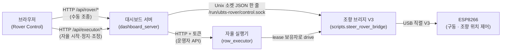
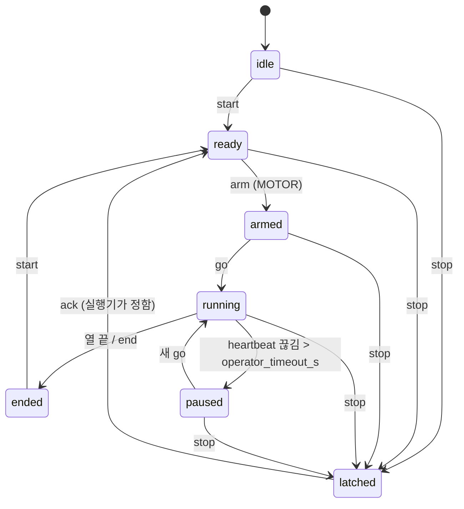

# 조향 차량 대시보드 서버 사양 (D-10)

- 작성: 2026-11-13 (묶음 S4b, 브랜치 `screens-20261113`). 코드보다 먼저 쓴 형식 문서다. 값은 대부분 자리값이다.
- 승인: **사용자 개별 승인 전**(검토 대기). 2026-11-12 "todo 전부 진행" 승인 범위 안에서 쓴 초안이다. 사용자 답이 오면 고치고 이 줄을 바꾼다.
- 근거: 시뮬레이션 레포 `unist_orchard_simulation` main `506eff3`의 `docs/steering/HOST_BRIDGE_V3_KO.md`(호스트 브리지 V3),
  `ESP_PROTOCOL_V3_DRAFT_KO.md`(V3 규격), `DESIGN_v1_KO.md` 4.4·4.5(대시보드·기록), `EXECUTOR_STEER_KO.md`(실행기),
  `tools/row_executor/operator_http.py`(실행기 운영자 HTTP), 조정 쪽 규약 `AUTONOMY_API_CONTRACT_20261113.txt` v0(시작·정지),
  todo 결정 가1·나10·나16·다9. 규약은 개정 1·2(2026-11-13, S1)까지 반영했다.
- 값 표기: `[자리값: 출처]`는 아직 재지 않았거나 사용자가 정하지 않은 값이다. 차량 사양(조향 모터, 가변저항, 벨트)이 오면 바뀐다.
  모든 SIM 수치는 자리값 기반 SIM 결과이고 현장 성능이 아니다.

## 1. 구성



- 수동 조종은 지금처럼 대시보드 → 브리지 한 줄 소켓이다. 바뀌는 것은 요청의 칸뿐이다(3절).
- 자율주행은 실행기가 브리지 lease를 잡고 몬다. 대시보드는 실행기 운영자 HTTP를 대신 부른다(6절). 토큰은 대시보드 서버만 읽고 화면에 내보내지 않는다.
- 차동 시기의 옛 감독기 경로 `/api/autonomy/*`와 섞지 않는다. 새 경로 이름은 `/api/executor/*`다.

## 2. 차량 종류와 확장 지점 (D-12와 같이 본다)

| 환경 변수 | 값 | 기본 | 뜻 |
| --- | --- | --- | --- |
| `DASHBOARD_VEHICLE` | `differential` / `front_steer` | `differential` | 화면이 고르는 조종 패널. 기본은 지금 동작 그대로(차동 패드) |
| `DASHBOARD_MODE` | `live` / `simulation` | `live` | `simulation`일 때만 아래 세 확장 지점을 읽는다. `live`에서는 무시하고 로그에 적는다 |
| `DASHBOARD_PROVIDER` | `패키지.모듈:클래스` | 없음 | 상태 제공자(`TelemetryProvider` 대신). 시뮬레이션 전용 |
| `DASHBOARD_EXTRA_STATIC` | 폴더 경로 | 없음 | `/ext-static/` 아래로 내보내는 추가 정적 폴더. 시뮬레이션 전용 |
| `DASHBOARD_EXTENSION` | `패키지.모듈` | 없음 | 추가 경로 표(`ROUTES`). 시뮬레이션 전용 |
| `UBTS_EXECUTOR_URL` | `http://호스트:포트` | 없음 | 자율 실행기 운영자 HTTP. 없으면 Rover Control의 자율·조정 칸은 "실행기 설정 없음" |
| `UBTS_EXECUTOR_TOKEN_FILE` | 파일 경로 | 없음 | 실행기가 시작할 때 쓰는 토큰 파일(`operator_token.txt`) |

- 화면은 `GET /api/dashboard/config`로 `{runtime_mode, vehicle_kind, executor_configured, extension}`을 받는다. 비밀 값(토큰, 경로)은 넣지 않는다.
- `DASHBOARD_VEHICLE=front_steer`이어도 브리지가 조향 상태를 내지 않으면(지금 Jetson의 V2 브리지) 조향 패널은 "조향 장치 없음"으로 보이고 Arm을 막는다(4절).

## 3. 수동 조종 API (구동과 조향)

경로는 지금 대시보드 경로를 그대로 쓴다. 대시보드는 본문에 `op`와 `owner`(세션 쿠키)만 더해 브리지에 넘긴다. 세션 쿠키와 같은 Origin이 필요하다(지금과 같음).

| 화면 → 대시보드 | 본문 | 브리지 op | 응답 |
| --- | --- | --- | --- |
| `POST /api/rover/arm` | `{"vehicle_profile": "front_steer"}` | `arm` | `{ok, lease, ticket, seq, ticket_ttl_s, status}` |
| `POST /api/rover/command` | `{lease, ticket, seq: 직전+1, deadman: true, throttle, steer_mrad}` | `drive` | `{ok, ticket, seq, status}` |
| `POST /api/rover/keepalive` | `{lease, ticket, seq}` | `keepalive` | 위와 같음. 이동 기한은 늘지 않는다 |
| `POST /api/rover/release` | `{lease, ticket, seq}` | `release` | 위와 같음. throttle 0, 조향 목표 유지, 1.1 s 안에 정지가 안 보이면 정지 |
| `POST /api/rover/stop` | `{"reason": 문자열}` | `stop` | `{ok, state: "stop_requested"}`. lease가 없어도 된다 |
| `GET /api/rover/status` | — | `status` | 브리지 스냅샷(4절) |

- `throttle`: 정수 −100 ~ 100(%). 화면의 속도 상한은 0 ~ 60 % [자리값: DESIGN_v1 4.4]. 구동 duty는 `(|p| × 255 + 50) // 100`, 좌우 같은 값이다.
- `steer_mrad`: 정수, 등가 소프트 한계 안(왼쪽 +, 오른쪽 −). 한계는 상태의 `steer_limit_mrad {left, right}`에서 읽는다 [자리값: 409 mrad = 23.46°, 호스트 프로필 v0].
- `left`/`right`가 들어간 drive는 조향 브리지가 정지하고 `differential_command_rejected`로 거절한다. 옛 차동 화면은 `vehicle_profile`을 보내지 않으므로 Arm도 거절된다(`steer_profile_required`).
- 조향만 바꾸는 입력(throttle 0)도 lease, ticket, seq, `deadman: true`, ARMED가 필요하다.

시간 규칙(화면):

| 항목 | 값 |
| --- | --- |
| 입력 중 명령 주기 | 100 ms [자리값: steer-control-rules.js] |
| 입력 없을 때 keepalive | 500 ms (ticket 수명 1.5 s) |
| 입력 기한(브리지) | 0.75 s. 늘리지 않는다. 화면 신호가 그보다 오래 끊기면 차가 선다 |
| 상태 읽기 | Arm 중 50 ms 주기로 시도하되 한 번에 하나(응답 시간이 사실상 주기). 명령 응답의 `status`도 쓴다. Arm 전 500 ms |
| 상태가 오래됨 | 300 ms 동안 새 상태가 없거나 `steering.age_ms` > 150 ms → 구동 0, 조향 목표 고정. 1 s 계속되면 화면이 STOP [자리값] |
| STOP 재시도 | 응답이 없으면 150 ms 뒤 다시, 최대 3번. 그래도 없으면 "물리 비상정지" 안내 |

조향 입력 규칙(화면, 결정 다9: 기본은 "놓으면 가운데로 복귀"):

| 입력 | 동작 |
| --- | --- |
| 전진 / 후진(W/S, 버튼) | 누르는 동안만 속도 상한으로 간다 |
| 왼쪽 / 오른쪽(A/D, 버튼) | 누르는 동안 고른 각(5 / 10 / 15 / 20°, 소프트 한계 이하)으로 목표가 움직인다. 목표 변화율 상한: 주행 중 20°/s, 정지 중 12°/s [자리값: DESIGN_v1 4.4, MCU rstd] |
| 놓음, 방식 "가운데 복귀"(기본) | 목표가 0으로 돌아온다. 주행 중 20°/s. 정지 중 12°/s이고 한 번에 5°까지 [자리값: R18 결정 3, 열 관리] |
| 놓음, 방식 "각 유지" | 주행 중 목표 유지. 정지 중 바퀴를 그 자리에 둔다(측정각으로 고정, DESIGN_v1 4.4의 끼임 방지) |
| 가운데(C, 버튼) | 누르는 동안(deadman) 가운데로. 정지 중 속도 상한과 한 번 5° |
| Esc, STOP | 언제나. lease 없이도. 화면은 lease를 바로 버린다 |
| 초점 잃음, 화면 숨김 | 누른 입력을 모두 놓는다. 숨김은 STOP |

- 주행 중 = 최근 0.3 s 안에 MCU가 보고한 구동 duty(핀 D8−D5, D3−D0)가 0이 아니었던 경우. 상태가 오래됐으면 정지로 본다.
- 자동 재무장은 없다. 어떤 정지나 거절 뒤에도 Arm을 다시 눌러야 한다.
- 제자리 회전은 없다(조향 차량).

조종 전송 방식: HTTP를 쓴다. 조종 전용 WebSocket(명령·생존 신호·STOP 한 연결)은 묶음 S4a의 NET-05에서 느린 통신 시험대로 HTTP(연결 재사용 뒤)와 숫자로 견준 뒤 정한다. 채택하더라도 HTTP 경로는 예비로 남기고 op·조종권·표·입력 기한 규칙은 이 표 그대로 쓴다.

## 4. 조향 상태

`GET /api/rover/status`는 브리지 `status` op 응답에 `control_page`, `mode`를 더한 것이다. 조향 브리지 V3는 기존 칸 위에 아래를 더한다(HOST_BRIDGE_V3 7절).

| 칸 | 뜻 |
| --- | --- |
| `vehicle_profile` | `"front_steer"`. 이 칸과 `steering` 블록이 있어야 "조향 장치 있음" |
| `steer_limit_mrad` | `{left, right}` 등가 소프트 한계 |
| `requested` | `{throttle, steer_mrad, left, right}` (left/right에는 구동 % — 고정 `motor_pwm.py` 기록용) |
| `outputs` | 핀 값: D8/D5/D3/D0 구동 방향, D1 구동 EN, D2 조향 EN, D6/D7 조향 PWM |
| `firmware`, `protocol`, `boot_id`, `device_id`, `reset_reason`, `hw_profile`, `simulated`, `profile`, `cal_id` | 장치 신원 |
| `steering` | 19칸: `measured_mrad`, `measured_permille`, `raw`, `target_permille`, `cmd_permille`, `pwm`, `mcu_ms`, `seq`, `applied_q`, `age_ms`, `ttl_remaining_ms`, `drive_en`, `steer_en`, `hold_remaining_ms`, `stop_mode`, `faults`, `servo_state`, `saturated`, `calibrated` |
| `steering_host` | 진단: `arm_state`, `stop_state`, `mcu_state`, `stale`, `target_mrad`, `latches`, 링크 계수 등 |

화면 판정:

| 화면 표시 | 조건 |
| --- | --- |
| 조향 장치 없음 | 상태 응답은 오는데 `vehicle_profile != "front_steer"` 또는 `steering`이 없음(V2 브리지) |
| 연결 안 됨 | `ok: false, error: motor_bridge_unavailable`(소켓 없음) 또는 HTTP 실패 |
| 상태 오래됨 | 3절 표 |
| 결함 | `steering.faults`의 MCU 비트(NOCAL, POT_*, POLARITY, DRV_STUCK, SOFTLIMIT, STALL, TRACK, THERMAL, TTL, WATCHDOG, CRC, BOOT)와 호스트 래치. 짧은 한국어 이름표로 |
| 계기 | 목표(화면이 보낸 값), MCU 목표(`target_permille` → mrad), 측정(`measured_mrad`), 오차, 포화, 구동 duty, 입력 기한 남은 시간 |

가변저항 각은 링크 각의 측정값이고 타이어 접지각이 아니다. PWM은 엔코더가 아니다(속도 측정 아님).

## 5. 조향 기록

- 브리지가 `/rover/steering/state`(스키마 `ubts.steer_state.v1`, 상태 줄마다, 20 Hz)와 `/rover/control/requested`, `/rover/control/applied`, `/rover/status`(2 Hz)를 낸다.
- 지금 녹화기(`data_recorder_service.py`, `motor_pwm.py`)는 고치지 않았다. 조향 브리지가 `requested.left/right`에 구동 %를 실어 `motor.jsonl`에 구동 duty가 남는다. 조향 칸은 남지 않는다.
- 남은 일(이 문서 범위 밖): 녹화기에 `/rover/steering/state` 토픽 인자, 사이드카 `steering.jsonl`(스키마 `orchard.steering.timeline.v1`, DESIGN_v1 4.5의 칸), `motor_pwm.py`의 `UBTS_STEER_V3` 허용과 `throttle`·`steer_mrad`. 옛 녹화의 핀 표는 그대로 둔다.
- 대시보드가 새로 남기는 기록은 조정 값 변경 기록 하나다(7절).

## 6. 자율 시작·정지 (실행기 중계)

규약 v0의 실행기 쪽을 대시보드가 대신 부른다. 대시보드는 같은 세션 쿠키·같은 Origin의 POST만 받고, 본문은 4 KiB 이하의 JSON 객체여야 한다. 실행기로는 정해진 칸만 넘긴다.

| 화면 → 대시보드 | 본문(넘기는 칸) | 실행기 | 비고 |
| --- | --- | --- | --- |
| `GET /api/executor/status` | — | `GET /api/status` | 아래 칸만 골라 넘긴다 |
| `POST /api/executor/start` | `{row_len_m: 수 또는 null}` | `POST /api/start` | 새 run |
| `POST /api/executor/arm` | `{}` | `POST /api/arm` | 브리지 권한(MOTOR만) |
| `POST /api/executor/go` | `{session}` | `POST /api/go` | 한 번 눌러 시작 |
| `POST /api/executor/heartbeat` | `{session}` | `POST /api/heartbeat` | 운영자 연결 확인 |
| `POST /api/executor/stop` | `{}` | `POST /api/stop` | 즉시 정지, LATCHED |
| `POST /api/executor/ack` | `{}` | `POST /api/ack` | LATCHED 해제(다시 Arm 안 함) |
| `POST /api/executor/end` | `{}` | `POST /api/end` | run 정상 종료 |
| `GET /api/executor/tuning` | — | `GET /api/status`의 `tuning` | 7절 |
| `POST /api/executor/params` | 기본 묶음 칸, 프리셋, 저장 | `POST /api/params` | 7절 |
| `GET /api/executor/tuning/log` | — | (대시보드 기록) | 7절 |

- `session`: 화면이 열릴 때 만드는 무작위 16진수 24자(규약 개정 2: 4 ~ 64자, 대시보드는 영숫자·`_`·`-`만 받고 나머지는 400).
- 대시보드 → 실행기: `Host`는 실행기 주소 그대로, `Origin: http://<실행기 주소>`, `X-Row-Token: <토큰 파일 내용>`, JSON 본문. 토큰 파일은 바뀌면 다시 읽는다(실행기는 시작할 때마다 새 토큰을 만든다). 제한 시간: heartbeat 0.8 s, stop 2.5 s, 그 밖 2.0 s [자리값].
- 대시보드 응답: 실행기 응답 본문과 상태 코드를 그대로 돌려준다. 응답에 `status`가 있으면(start 응답) 아래와 같은 칸만 남긴다. 실행기에 닿지 못하면 502 `{"ok": false, "error": "executor_unreachable"}`, 설정이 없으면 503 `{"ok": false, "error": "executor_not_configured"}`. 실행기 403(토큰)은 502 `executor_token_rejected`.
- `GET /api/executor/status`는 언제나 200이다: `{ok, configured, reachable, error?, received_at, status: {...}}`. `status`에 넘기는 칸(그 밖은 버린다. GNSS 좌표는 넘기지 않는다):
  `run_state`, `start_mode`, `operator_link {fresh, age_s, timeout_s}`, `stop_reason`, `stop_detail`, `go_ready`, `go_blockers`, `speed {target_mps, limit_mps, limit_reason}`,
  `tuning {preset, revision, editable, not_editable_because, modified, presets, writable, unsaved, basic [{name, value, low, high, unit}], values {basic, advanced, locked}}`(파일 경로·digest는 넘기지 않는다),
  `mode`(SHADOW/MOTOR), `state`, `reason`, `end_reason`, `controller_mode`, `profile`, `vehicle_control`, `lidar_age`, `imu_age`,
  `single_row {phase, lateral_error_m, heading_error_deg, distance_m, speed_m_s, target_speed_m_s, stop_reason, stop_category, confidence.level}`,
  `gnss {state, fix, age_s, h_acc_m, used}`, `bridge_detail {state, latch_reason}`, `lease_lost {where, error, bridge_reason, bridge_latches, steering_fault}`(규약 개정 3, 없으면 칸 없음),
  `online_scale {enabled, run_id, value, window_s, target_s, min_s, frozen, hold, age_s, mismatch, speed_scale, prior_scale, offer {run_id, value, window_s, end_reason, speed_scale_now, speed_scale_new, ok, why_not}}`(규약 개정 6, PW-10: 온라인 배율 = LiDAR 속도 ÷ 표 속도, 최근 주행 20 s. front_steer 실행기만, 없으면 칸 없음. 뜻은 시뮬레이션 레포 `docs/steering/OPERATOR_API_KO.md` 6.1). 화면: Rover Control 자율 칸(`autoPanel`) 안 '온라인 배율' 줄과 run 뒤의 저장 묻기(아래 화면 규칙, `docs/SCREENS_KO.md` 2절).
- `GET /api/executor/status?grid=1`(Rover Control의 실시간 지도 칸이 화면에 있을 때)만 실행기의 국소 격자 `local_grid_map`(스키마 `ubts.row_executor.local_grid.v1`, 시뮬레이션 레포 `docs/steering/LOCAL_GRID_KO.md`)을 더 넘긴다:
  `schema, frame, updates, axis_rad, origin_uv, occupied, encoding, age_s, cell_m, shape, bits(24 KiB 이하), cells(2,000개 이하), truncated, lines {left, right, centre, quality, stamp}, base_pose`.
  run 주행 거리 좌표이고 GNSS가 아니다. 실행기가 내지 않으면 칸이 없고 화면은 그 층을 숨긴다.

상태 전이(실행기가 정한다. 화면은 받은 `run_state`만 보여 준다):



화면 규칙:

| 항목 | 값 |
| --- | --- |
| 주 버튼 | idle·ended "준비"(start, MOTOR면 이어서 arm) → ready "Arm" → armed "자율 주행 시작"(go) → running "주행 중"(꺼짐) → paused "다시 출발"(새 go) → latched "래치 확인"(ack). go 버튼은 `go_ready`일 때만 켜고, 아니면 `go_blockers`를 한국어로 보인다(규약 개정 2) |
| heartbeat | `run_state`가 armed·running·paused이고 상태가 새것인 동안, Rover Control이 열려 있고 탭이 보일 때만(스크롤 위치와 무관) 100 ms마다(규약 개정 1, 늦어도 250 ms). go 전 armed부터 보내므로 go 때 운영자 연결이 이미 새것이다(`operator_link_not_fresh` 막음 없음). 탭을 숨기거나 화면을 떠나면 멈춘다 → 실행기가 `operator_link.timeout_s` 뒤 선다(규약 개정 1: 기본 0.5 s, 범위 0.5 ~ 3.0, 화면에서 못 바꿈. 화면은 상태의 값을 보인다) |
| lease 잃음(규약 개정 3) | Arm 뒤 첫 go 전에 브리지가 lease를 거두면 run은 열린 채 `ready`, `go_blockers`에 `lease_lost`·`arm_first`. 주 버튼은 "Arm 다시 (브리지가 권한을 거둠)", 안내 "브리지가 권한을 거뒀다: Arm을 다시 누른다" |
| 온라인 배율(규약 개정 6, PW-10) | 자율 칸의 '온라인 배율' 줄(`autoScale`): 실행기 상태에 `online_scale`이 있을 때만 보인다. 값(소수 3자리)과 창 길이 `(최근 20/20 s)`, 갱신이 멈췄으면 `멈춤: <까닭>`(LiDAR 스캔 없음, LiDAR 속도 품질 미달(스캔 정합 실패), 주행 중 아님, 구동 상태 없음), 표 ±20 % 어긋남이면 `표 어긋남`. 상태가 1.5 s 넘게 오래되면 숨긴다. 따로 묻지 않고 자율 칸의 상태 읽기(500 ms)에 실려 온다 |
| 주행 뒤 저장 묻기(PW-10) | `online_scale.offer`가 있고 주행 중(armed·running·paused)이 아닐 때 자율 칸에 'run N 끝: 온라인 배율 … 전체 배율(k_field)을 a → b로 저장할까요?'와 '배율 저장'·'저장 안 함'(`autoScaleOffer`). '배율 저장'은 확인 창 뒤 `POST /api/executor/params {online_scale: accept, run_id}`, '저장 안 함'은 dismiss. 받을 수 없는 제안(`ok` false)은 까닭과 '닫기'만. 거절은 실행기 이유를 오류 줄에 보인다. 파일 저장은 현장 조정 값의 '파일에 저장' |
| heartbeat 409 | `session_conflict`: 다른 화면이 출발 권한을 가짐. 화면은 오류 줄에 보인다(자동으로 빼앗지 않는다) |
| 상태 읽기 | Rover Control이 보일 때 500 ms, 숨김이면 멈춤 [자리값] |
| STOP | 주행 패널 STOP, 상태 막대 STOP, Esc(Rover Control): 기존 브리지 stop(한 번) 그대로에 더해, run이 있거나 실행기 상태를 모르면 실행기 stop도 보낸다. 자율 칸에 따로 STOP 버튼을 두지 않는다(같은 패널 위에 STOP이 있다) |
| 실행기 없음 | 설정 없음 → "실행기 설정 없음", 응답 없음 → "실행기 연결 안 됨". 버튼 꺼짐, STOP은 브리지 stop으로 계속 동작 |

정지 이유 이름표(`stop_reason`, `single_row.stop_category`): `ROW_END` 정상 열 끝, `OBSTACLE` 열 안 장애물, `END_STRUCTURE` 열 끝 구조물, `PERCEPTION_OR_LOCALISATION` 센서·위치 추정 부족,
`CONTROL_AUTHORITY` 조향·구동 권한 부족, `OPERATOR_OR_BACKSTOP` 운영자·한도 정지, `OPERATOR_LINK_LOST` 화면 연결 끊김, `SYSTEM_FAULT` 시스템 오류, `UNCLASSIFIED` 분류 안 됨. 모르는 값은 그대로 보인다.
`stop_detail`: `operator_stop` 운영자 STOP(규약 개정 3: STOP으로 끝난 run은 언제나 `OPERATOR_OR_BACKSTOP`·`operator_stop`), `operator_link_lost` 화면 연결 끊김, `row_end` 열 끝, `lease_lost` 브리지가 권한을 거둠. 모르는 값은 그대로 보인다.

## 7. 조정 값 API

실행기의 현장 조정 파일이 기준이다(시뮬레이션 레포 `tools/row_executor/field_tuning.py`, `docs/steering/FIELD_TUNING_KO.md`, `OPERATOR_API_KO.md` 6절). 대시보드는 범위를 따로 두지 않고 실행기 상태의 `tuning` 묶음(이름·값·범위·단위·잠금)을 받아 그린다. 결정 나16대로 기본 묶음만 화면에서 바꾸고 고급·잠금 값은 파일에서 바꾼다. 바꿀 수 있는지는 실행기가 정한다(`tuning.editable`, `not_editable_because`).

묶음 형식(`GET /api/executor/tuning` 응답, 스키마 `ubts.executor_tuning.v1`):

```json
{"ok": true, "schema": "ubts.executor_tuning.v1", "configured": true, "reachable": true,
 "run_state": "idle", "available": true, "applicable": true, "why_not": null,
 "tuning": {"preset": "default", "revision": 0, "modified": false, "presets": ["default", "slow_030", "soft_ground"],
            "writable": false, "unsaved": false},
 "params": [
   {"name": "target_speed_m_s", "group": "basic", "label": "목표 속도", "unit": "m/s",
    "min": 0.2, "max": 0.5, "step": 0.01, "value": 0.4, "editable": true, "editable_when_stopped": true},
   {"name": "speed_table", "group": "advanced", "label": "duty→속도 표", "unit": "[duty %, m/s]",
    "min": null, "max": null, "step": null, "value": [[25.0, 0.239], [80.0, 0.709]], "editable": false, "editable_when_stopped": false}
 ]}
```

| 칸 | 뜻 |
| --- | --- |
| `group` | `basic`(기본, 화면에서 바꿈), `advanced`(고급, 파일만), `locked`(잠금, 파일만·실행기를 다시 시작해야 바뀜) |
| `name`, `value` | 실행기 `tuning.basic`(기본)과 `tuning.values.advanced`·`locked`의 이름과 값 그대로. 실행기가 새 키를 더하면 이름 그대로 보인다 |
| `min`, `max`, `unit` | 기본 묶음은 실행기의 `low`·`high`·`unit`. 고급·잠금의 단위는 이름 끝(`_m_s` → m/s 등)으로 읽는다(실행기 상태가 단위를 주지 않음) |
| `label` | 대시보드의 한국어 이름표(모르는 키는 이름 그대로) |
| `available` | 실행기 상태에 `tuning`이 있음(현장 조정 파일을 읽은 front_steer 실행기) |
| `applicable`, `why_not` | 실행기의 `tuning.editable`과 `not_editable_because`(`tuning_locked_while_running`, `tuning_locked_while_armed`, `tuning_locked_vehicle_moving`) |
| `online_scale_offer` | 상태 `online_scale.offer` 그대로(규약 개정 6, PW-10. 없으면 null). 답 형식을 거를 때 쓴다 |

`POST /api/executor/params` 본문(실행기 형식 그대로, 하나만):

- `{"target_speed_m_s": 0.3, "k_d": 1.2}`: 기본 묶음 키만. 대시보드가 먼저 실행기 범위로 거른다: 모르는 키 400 `unknown_parameter`, 고급·잠금 키 400 `locked_parameter`, 수가 아니거나 범위 밖 400 `out_of_range`(`field`).
- `{"preset": "slow_030"}`: 프리셋 불러오기(혼자만, 아니면 400 `preset_alone`, 목록에 없으면 400 `unknown_preset`).
- `{"save": true}`, `{"save_preset": "이름", "note": "메모"}`: 지금 값을 실행기 파일에 쓴다. 실행기가 `writable`이 아니면 409 `tuning_not_writable`(패키지 기본 파일), 이름은 영문·숫자·`_ - .` 1 ~ 40자이고 `default`가 아니어야 한다(400 `bad_preset_name`).
- 실행기가 바꿀 수 없다고 하면 409와 그 이유(`tuning_locked_while_running` 등). 대시보드 검사를 지나도 실행기가 거절하면(값 사이 규칙 등) 실행기의 400 `invalid_params`와 `problems` 목록을 그대로 돌려준다.
- 성공 응답: `{ok, action(set/load_preset/save/save_preset), changes [{key, old, new}], tuning {preset, revision}}`(파일 경로·digest는 뺀다).
- `{"online_scale": "accept" | "dismiss", "run_id": N}`(규약 개정 6, PW-10): run 뒤 실행기가 낸 온라인 배율 제안의 답. 대시보드가 먼저 상태의 `online_scale.offer`로 거른다: 다른 키·모르는 답·정수가 아닌 `run_id` 400 `online_scale_form`, 제안 없음 409 `no_online_scale_offer`, 다른 run 409 `online_scale_offer_changed`. accept 는 제안이 `ok` 이고(아니면 409 와 그 `why_not`) 조정 값을 바꿀 수 있을 때만(아니면 409 와 그 이유), dismiss 는 언제나. 실행기가 다시 보고 받으면 accept 는 k_field(`speed_scale`)를 제안 값으로 바꾼다(성공 응답의 `action` `online_scale`, dismiss 는 `online_scale_dismiss`). 기록 줄의 `action`도 같고 `target` 은 `run N`.
- 변경 기록: 대시보드가 시도마다 한 줄을 `runtime/executor_tuning_log.jsonl`에 더한다(최근 500줄만 둔다). 줄: `{at, by(세션 앞 8자), action, target(프리셋 이름), changes {이름: [이전, 새 값]}, ok, error, problems(5개까지), revision_before, revision_after}`.
  `GET /api/executor/tuning/log`는 최근 50줄을 새 것부터 준다. 실행기 기록(JSONL)에도 `tuning_change`·`tuning_save` 사건이 남는다.
- 되돌리기는 프리셋 불러오기(`default`는 기본값)와 변경 기록으로 한다. 고급 묶음의 화면 편집은 실행기 쪽에도 없다(FIELD_TUNING_KO.md 6절).
- 차동 실행기의 현장 키 3개(`base_duty_pct` 등)는 이 화면에서 다루지 않는다(실행기 상태에 `tuning`이 없으면 "조정 묶음 없음").

## 8. 오류와 정지 규칙

| 일 | 누가 세우나 | 결과 |
| --- | --- | --- |
| 화면 STOP(상태 막대, 주행 패널, Esc) | 대시보드 → 브리지 `stop` | 구동 정지, lease 끝. 조향은 정지 정책대로(유지 후 해제) |
| 수동 입력 끊김 0.75 s | 브리지 | 구동 정지 |
| 화면 숨김·초점 잃음 | 화면 | 입력 놓음(숨김은 STOP) |
| 상태 1 s 오래됨(Arm 중) | 화면 | STOP |
| 화면 STOP 중 run이 있을 때 | 대시보드 → 실행기 `stop` + 브리지 `stop` | run LATCHED, 구동 정지 |
| heartbeat 끊김 > operator_link.timeout_s(기본 0.5 s) | 실행기 | 구동 0, 조향 유지, run paused(`OPERATOR_LINK_LOST`). 자동 재출발 없음 |
| 센서 오래됨, 장애물, 열 끝 | 실행기 | 실행기 규칙대로 |
| 실행기에 닿지 못함 | 화면 | 버튼 꺼짐. STOP은 브리지 stop으로 계속 |
| 브리지 오류 응답(조종권 잃음) | 화면 | lease를 버리고 STOP을 한 번 보낸다. 자동 재무장 없음 |

- STOP 응답이 없으면 화면은 "물리 비상정지를 쓰세요"를 띄운다. 대시보드 STOP은 물리 전원 차단이 아니다.
- 대시보드 오류 코드는 영어 그대로 보내고, 화면이 한국어 이름표를 붙인다(브리지 코드 표는 HOST_BRIDGE_V3 3절).

## 9. 차동 판과의 공존

**결정(todo 결정 나5, D-14): 차동(좌우 PWM) 전제 자율·관찰 코드는 조향 펌웨어가 차에 올라가 조향 실행기로 바뀔 때까지 둔다.**
까닭: 차에 조향 펌웨어 V3가 올라가기 전까지는 지금 차(차동 펌웨어 V2)로 수동 주행이 되어야 하고, Jetson에 설치된 native 관찰 이미지의 원본이 이 코드다.
바뀌면 태그에 보존한 뒤 내린다. 이 결정은 2026-11-13 묶음 S6에서 다시 확인했다(코드는 그대로 둠).

- 그때까지 그대로 두는 것: 차동 패드와 `left`/`right` 명령, 옛 감독기 `/api/autonomy/*`, 관찰 패널, 현장 준비 점검표. 이력 경로이며 조향 차량(`front_steer`)에서는 쓰지 않는다.
- `DASHBOARD_VEHICLE=differential`(기본)에서 화면과 서버 동작은 이 사양 전과 같다. 새 자율·조정 칸은 실행기 설정이 없으면 "설정 없음"만 보인다.
- `front_steer`에서는 차동 패드와 옛 자율 자리 패널을 숨기고 조향 패널을 보인다. 옛 경로 자체는 남는다.
- 내리는 조건(모두): (1) Jetson에 V3 펌웨어와 조향 브리지(`scripts.steer_rover_bridge`, serial)가 설치되어 상태에 `steering` 블록이 나온다, (2) 사용자가 현장에서 조향 수동 조종을 확인했다, (3) 조향 실행기가 Jetson에 설치되어 자율 시작·정지를 확인했다. 셋이 채워지면 나5에 따라 내린다.
- 내릴 묶음(세 묶음을 같이 내린다): 서버 `dashboard_server/` 의 `autonomy_settings`, `autonomy_observation`, `record_based_autonomy`, `native_autonomy_application`, `native_autonomy_supervisor`, `native_observation_client`, `native_owner_lifecycle`, `field10_shadow`, `field10_shadow_preflight`, `field_preflight`, `encoderless_drive_preview`, `_field10/`;
  화면 `static/field-preparation.js`, `static/native-accepted-map.mjs`, `index.html` 의 옛 자율·관찰 패널; `deploy/native_sensor_stream/`, `deploy/native_sensor_shadow/`, `tools/native_overlay_v2/`, `tools/cartographer_incremental_capture/`, `tools/gnss_receiver_utc/`, `docs/C0_SOURCE_*`.
  `body_feedback` 은 실시간 지도(`source_live_mapping`)도 쓰므로 남긴다. 내리기 전에 import 그래프를 다시 뽑아 끊긴 참조가 없는지 본다.
- 내리는 방법: 태그(예: `archive-differential-<날짜>`)로 보존 → app.py 의 import·경로·`DashboardServer` 인자와 관련 시험을 함께 바꿈 → 전체 시험과 화면 점검 → 설치 묶음. Jetson의 native 관찰 이미지는 그 태그에서 다시 빌드할 수 있어야 한다.

## 10. 미정 값

| 값 | 지금 | 정하는 곳 |
| --- | --- | --- |
| 조향 소프트 한계 | 409 mrad(23.46°) | 차량 사양(가변저항·벨트)과 B2·B3 측정 |
| 정지 중 한 번 조향 | 5° | R18 결정 3, 조향 모터 열 예산(P9) |
| 조향 목표 변화율 | 주행 20°/s, 정지 12°/s | B5 측정 |
| 화면 속도 상한 | 0 ~ 60 % | 현장 확인 |
| 상태 오래됨 판정 | 300 ms, age 150 ms, STOP 1 s | 느린 통신 측정(NET-05) |
| heartbeat 주기 | 100 ms | 규약 개정 1(≤ 250 ms), 느린 통신 측정 |
| operator_timeout_s | 0.5 s(0.5 ~ 3.0) | 규약 개정 1(A17 개정 31), 현장 |
| 조정 값 이름·범위·기본 | 7절 표 | 실행기 S1(PW-07, PC-13, PC-10) |
| 조종 WebSocket 채택 | 미정 | NET-05(S4a) |

## 11. 실행기(S1)에 바라는 것

규약 v0에 없어서 화면이 "값 모름"으로 보이는 것들이다. 대시보드는 없어도 깨지지 않는다.

1. (해결: field_tuning) 조정 값·범위·잠금은 실행기의 `tuning` 묶음을 그대로 쓴다(7절).
2. 고급·잠금 묶음의 단위와 범위도 상태에 있으면 좋다(`field_tuning.describe()`의 표). 지금은 대시보드가 이름 끝에서 단위만 읽는다.
3. GNSS 약한 층(S1b)의 상태를 `gnss {state, fix, age_s, h_acc_m, used}`로. 좌표는 내보내지 않아도 된다.
4. `speed.limit_reason` 값의 목록(화면 이름표용). 화면은 모르는 값을 "기타(값)"로 보인다.
5. heartbeat를 go 전 armed부터 받아 주기(go 때 `operator_link_not_fresh`가 없게). 다른 세션의 heartbeat가 오면 409 `session_conflict`.

## 12. 구현 상태 (2026-11-13, 브랜치 `screens-20261113`)

| 항목 | 구현 | 남은 것 |
| --- | --- | --- |
| 확장 지점(2절, D-12) | `dashboard_server/extensions.py`, `GET /api/dashboard/config`, 화면 표시 `data-vehicle-kind` | 시뮬레이션 쪽 모듈을 이 지점에 꽂기(D-13, 묶음 S5) |
| 조향 호스트 코드(D-11) | `scripts/esp_motor_v3.py` 등 4개와 시험 7개, compose 프로필 `steer`(기록: `STEERING_HOST_PORT_KO.md`) | 실기 ESP·USB·Jetson 확인(사용자) |
| 수동 조향(3·4절, UI-07) | `static/steer/steer-control-rules.js`, `steer-drive.mjs`. `front_steer`에서만 보임. Rover Control의 주행 제어 패널(`docs/SCREENS_KO.md`) | 실기 확인(사용자) |
| 자율 시작·정지(6절, UI-08) | `dashboard_server/executor_proxy.py`, `static/steer/auto-model.mjs`(준비 = start 뒤 새 상태를 읽고 ready면 Arm), `auto-panel.mjs` | 실행기(S1) 실제 연결 확인 |
| 지도의 국소 격자(6절, UI-09) | `GET /api/executor/status?grid=1`, `static/steer/local-grid.mjs`(점유 셀·열 선·중심선·차, 실행기가 낼 때만) | 지도 갱신 지연 측정, 실시간 점유 격자와 겹쳐 그리기 |
| 조정(7절, UI-12) | Rover Control의 접힌 '현장 조정 값' 칸(`/tuning`은 별칭), `dashboard_server/steer_tuning.py`(실행기 field_tuning 묶음), `static/steer/tuning-model.mjs`, `tuning-page.mjs`, 프리셋 불러오기·저장, 변경 기록 | PWM-속도 표 그래프, 고급 묶음 화면 편집(실행기에도 없음) |
| 조향 가변저항(UI-11) | Rover Control 주행 제어 패널의 줄 `static/steer/steer-sensor.mjs`(읽기만, 조향 패널의 상태 답을 같이 씀) | 실기 값 확인 |
| 조향 기록(5절) | 바꾸지 않음 | 녹화기 토픽·사이드카(P9) |
| 조종 WebSocket(3절) | 없음(HTTP) | NET-05(S4a) 측정 뒤 결정 |

모든 확인은 가짜 MCU·가짜 실행기·모의 서버로 했다. 자리값 기반 결과이고 현장 검증이 아니다.

## 13. ESP32-S3 ABS-HOLD 브리지 (2026-11-16)

차의 보드가 ESP32-S3(BTS7960 3개, 펌웨어 `ABS-HOLD-8-REBOUND-LIMITS`)로 바뀌었다. 그 브리지(`scripts/esp32_steer_bridge.py`, `ROVER_ESP_KIND=esp32_abs_hold`,
[`esp_rover_control.md`](esp_rover_control.md) 1절)는 3절의 수동 조종 API 와 조종권 규칙(`SteerControl`)을 그대로 쓴다. 다른 점:

| 항목 | V3(위 절들) | ESP32-S3 ABS-HOLD |
| --- | --- | --- |
| 펌웨어 쪽 조향 | MCU 램프·C 명령·TTL | 절대 목표 `ANGLE`(+ = 오른쪽, 브리지가 부호를 바꿈), 펌웨어가 조용한 펄스로 천천히 맞춤 |
| 소프트 한계 | 호스트 프로필(409 mrad 자리값) | 349 mrad(20 명령 도, 펌웨어 보정 눈금. 실제 바퀴 각도 미검증) |
| 상태의 신원 칸 | `protocol`, `boot_id`, `cal_id`, `hw_profile` 등 | 없음. 대신 `esp_kind: esp32_abs_hold`, `firmware`, `firmware_detail`, `steering.cal`(RIGHT/CENTER/LEFT) |
| 화면 규칙 | 4절·3절 표(경사 제한, 정지 중 5°) | `steer_control.keys: full_limit` → A/D 는 끝까지, 놓으면 0, 끌기 막대([`SCREENS_KO.md`](SCREENS_KO.md) 2절) |
| 상태 나이 | `age_ms` ≤ 150 ms | 10 Hz STATUS 이라 `steering.age_limit_ms` 300 을 내고 화면이 그 값을 쓴다(150~500 ms 로 묶음) |
| 구동 | MCU TTL | 펌웨어에 시간 제한 없음 → 호스트 구동 TTL, STOP 확인·재전송, 0 다시 보내기(`esp_rover_control.md` 1-2절) |
| 결함 이름 | 5.3 MCU 비트와 호스트 래치 | `pot_invalid`, `steer_hold_cancelled`, `steer_stop`, `firmware_mismatch`, `mcu_drive_watchdog` 와 래치 `mcu_reset_detected`, `hardware_fault`, `stop_unconfirmed`, `steering_status_stale` |

- 대시보드는 `DASHBOARD_VEHICLE` 이 없어도 이 브리지가 `vehicle_profile: front_steer` 를 내면 조향 패널을 보인다(텔레메트리의 `services.rover_bridge.vehicle_profile`).
- 실행기(`row_executor`)의 Arm 전 점검(`steer_arm_precheck`: cal_id, V3 칸)은 이 브리지를 아직 모른다. 요청 형식은 같으므로 실행기 쪽 프로필만 더하면 된다(남은 일).
