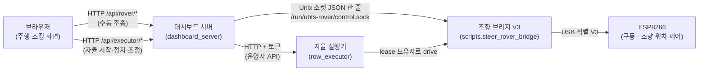
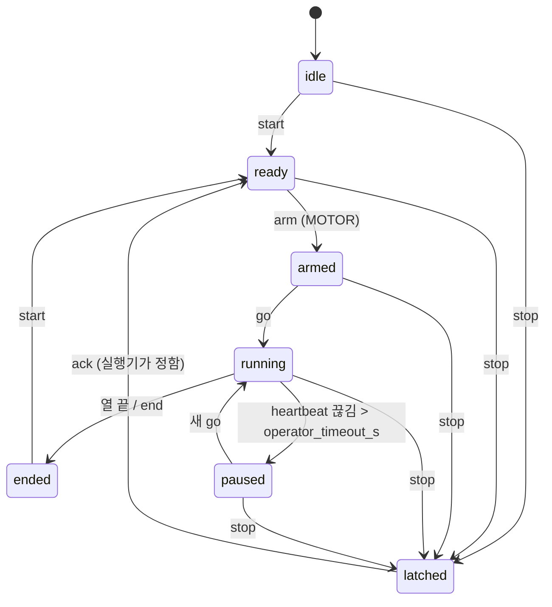

# 조향 차량 대시보드 서버 사양 (D-10)

- 작성: 2026-11-13 (묶음 S4b, 브랜치 `screens-20261113`). 코드보다 먼저 쓴 형식 문서다. 값은 대부분 자리값이다.
- 승인: **사용자 개별 승인 전**(검토 대기). 2026-11-12 "todo 전부 진행" 승인 범위 안에서 쓴 초안이다. 사용자 답이 오면 고치고 이 줄을 바꾼다.
- 근거: 시뮬레이션 레포 `unist_orchard_simulation` main `506eff3`의 `docs/steering/HOST_BRIDGE_V3_KO.md`(호스트 브리지 V3),
  `ESP_PROTOCOL_V3_DRAFT_KO.md`(V3 규격), `DESIGN_v1_KO.md` 4.4·4.5(대시보드·기록), `EXECUTOR_STEER_KO.md`(실행기),
  `tools/row_executor/operator_http.py`(실행기 운영자 HTTP), 조정 쪽 규약 `AUTONOMY_API_CONTRACT_20261113.txt` v0(시작·정지),
  todo 결정 가1·나10·나16·다9.
- 값 표기: `[자리값: 출처]`는 아직 재지 않았거나 사용자가 정하지 않은 값이다. 차량 사양(조향 모터, 가변저항, 벨트)이 오면 바뀐다.
  모든 SIM 수치는 자리값 기반 SIM 결과이고 현장 성능이 아니다.

## 1. 구성



- 수동 조종은 지금처럼 대시보드 → 브리지 한 줄 소켓이다. 바뀌는 것은 요청의 칸뿐이다(3절).
- 자율주행은 실행기가 브리지 lease를 잡고 몬다. 대시보드는 실행기 운영자 HTTP를 대신 부른다(6절). 토큰은 대시보드 서버만 읽고 화면에 내보내지 않는다.
- 차동 시기의 옛 감독기 경로 `/api/autonomy/*`와 섞지 않는다. 새 경로 이름은 `/api/executor/*`다.

## 2. 차량 종류와 확장 지점 (D-12와 같이 본다)

| 환경 변수 | 값 | 기본 | 뜻 |
| --- | --- | --- | --- |
| `DASHBOARD_VEHICLE` | `differential` / `front_steer` | `differential` | 화면이 고르는 조종 패널. 기본은 지금 동작 그대로(차동 패드) |
| `DASHBOARD_MODE` | `live` / `simulation` | `live` | `simulation`일 때만 아래 세 확장 지점을 읽는다. `live`에서는 무시하고 로그에 적는다 |
| `DASHBOARD_PROVIDER` | `패키지.모듈:클래스` | 없음 | 상태 제공자(`TelemetryProvider` 대신). 시뮬레이션 전용 |
| `DASHBOARD_EXTRA_STATIC` | 폴더 경로 | 없음 | `/ext-static/` 아래로 내보내는 추가 정적 폴더. 시뮬레이션 전용 |
| `DASHBOARD_EXTENSION` | `패키지.모듈` | 없음 | 추가 경로 표(`ROUTES`). 시뮬레이션 전용 |
| `UBTS_EXECUTOR_URL` | `http://호스트:포트` | 없음 | 자율 실행기 운영자 HTTP. 없으면 자율·조정 화면은 "실행기 설정 없음" |
| `UBTS_EXECUTOR_TOKEN_FILE` | 파일 경로 | 없음 | 실행기가 시작할 때 쓰는 토큰 파일(`operator_token.txt`) |

- 화면은 `GET /api/dashboard/config`로 `{runtime_mode, vehicle_kind, executor_configured, extension}`을 받는다. 비밀 값(토큰, 경로)은 넣지 않는다.
- `DASHBOARD_VEHICLE=front_steer`이어도 브리지가 조향 상태를 내지 않으면(지금 Jetson의 V2 브리지) 조향 패널은 "조향 장치 없음"으로 보이고 Arm을 막는다(4절).

## 3. 수동 조종 API (구동과 조향)

경로는 지금 대시보드 경로를 그대로 쓴다. 대시보드는 본문에 `op`와 `owner`(세션 쿠키)만 더해 브리지에 넘긴다. 세션 쿠키와 같은 Origin이 필요하다(지금과 같음).

| 화면 → 대시보드 | 본문 | 브리지 op | 응답 |
| --- | --- | --- | --- |
| `POST /api/rover/arm` | `{"vehicle_profile": "front_steer"}` | `arm` | `{ok, lease, ticket, seq, ticket_ttl_s, status}` |
| `POST /api/rover/command` | `{lease, ticket, seq: 직전+1, deadman: true, throttle, steer_mrad}` | `drive` | `{ok, ticket, seq, status}` |
| `POST /api/rover/keepalive` | `{lease, ticket, seq}` | `keepalive` | 위와 같음. 이동 기한은 늘지 않는다 |
| `POST /api/rover/release` | `{lease, ticket, seq}` | `release` | 위와 같음. throttle 0, 조향 목표 유지, 1.1 s 안에 정지가 안 보이면 정지 |
| `POST /api/rover/stop` | `{"reason": 문자열}` | `stop` | `{ok, state: "stop_requested"}`. lease가 없어도 된다 |
| `GET /api/rover/status` | — | `status` | 브리지 스냅샷(4절) |

- `throttle`: 정수 −100 ~ 100(%). 화면의 속도 상한은 0 ~ 60 % [자리값: DESIGN_v1 4.4]. 구동 duty는 `(|p| × 255 + 50) // 100`, 좌우 같은 값이다.
- `steer_mrad`: 정수, 등가 소프트 한계 안(왼쪽 +, 오른쪽 −). 한계는 상태의 `steer_limit_mrad {left, right}`에서 읽는다 [자리값: 409 mrad = 23.46°, 호스트 프로필 v0].
- `left`/`right`가 들어간 drive는 조향 브리지가 정지하고 `differential_command_rejected`로 거절한다. 옛 차동 화면은 `vehicle_profile`을 보내지 않으므로 Arm도 거절된다(`steer_profile_required`).
- 조향만 바꾸는 입력(throttle 0)도 lease, ticket, seq, `deadman: true`, ARMED가 필요하다.

시간 규칙(화면):

| 항목 | 값 |
| --- | --- |
| 입력 중 명령 주기 | 100 ms [자리값: steer-control-rules.js] |
| 입력 없을 때 keepalive | 500 ms (ticket 수명 1.5 s) |
| 입력 기한(브리지) | 0.75 s. 늘리지 않는다. 화면 신호가 그보다 오래 끊기면 차가 선다 |
| 상태 읽기 | Arm 중 50 ms 주기로 시도하되 한 번에 하나(응답 시간이 사실상 주기). 명령 응답의 `status`도 쓴다. Arm 전 500 ms |
| 상태가 오래됨 | 300 ms 동안 새 상태가 없거나 `steering.age_ms` > 150 ms → 구동 0, 조향 목표 고정. 1 s 계속되면 화면이 STOP [자리값] |
| STOP 재시도 | 응답이 없으면 150 ms 뒤 다시, 최대 3번. 그래도 없으면 "물리 비상정지" 안내 |

조향 입력 규칙(화면, 결정 다9: 기본은 "놓으면 가운데로 복귀"):

| 입력 | 동작 |
| --- | --- |
| 전진 / 후진(W/S, 버튼) | 누르는 동안만 속도 상한으로 간다 |
| 왼쪽 / 오른쪽(A/D, 버튼) | 누르는 동안 고른 각(5 / 10 / 15 / 20°, 소프트 한계 이하)으로 목표가 움직인다. 목표 변화율 상한: 주행 중 20°/s, 정지 중 12°/s [자리값: DESIGN_v1 4.4, MCU rstd] |
| 놓음, 방식 "가운데 복귀"(기본) | 목표가 0으로 돌아온다. 주행 중 20°/s. 정지 중 12°/s이고 한 번에 5°까지 [자리값: R18 결정 3, 열 관리] |
| 놓음, 방식 "각 유지" | 주행 중 목표 유지. 정지 중 바퀴를 그 자리에 둔다(측정각으로 고정, DESIGN_v1 4.4의 끼임 방지) |
| 가운데(C, 버튼) | 누르는 동안(deadman) 가운데로. 정지 중 속도 상한과 한 번 5° |
| Esc, STOP | 언제나. lease 없이도. 화면은 lease를 바로 버린다 |
| 초점 잃음, 화면 숨김 | 누른 입력을 모두 놓는다. 숨김은 STOP |

- 주행 중 = 최근 0.3 s 안에 MCU가 보고한 구동 duty(핀 D8−D5, D3−D0)가 0이 아니었던 경우. 상태가 오래됐으면 정지로 본다.
- 자동 재무장은 없다. 어떤 정지나 거절 뒤에도 Arm을 다시 눌러야 한다.
- 제자리 회전은 없다(조향 차량).

조종 전송 방식: HTTP를 쓴다. 조종 전용 WebSocket(명령·생존 신호·STOP 한 연결)은 묶음 S4a의 NET-05에서 느린 통신 시험대로 HTTP(연결 재사용 뒤)와 숫자로 견준 뒤 정한다. 채택하더라도 HTTP 경로는 예비로 남기고 op·조종권·표·입력 기한 규칙은 이 표 그대로 쓴다.

## 4. 조향 상태

`GET /api/rover/status`는 브리지 `status` op 응답에 `control_page`, `mode`를 더한 것이다. 조향 브리지 V3는 기존 칸 위에 아래를 더한다(HOST_BRIDGE_V3 7절).

| 칸 | 뜻 |
| --- | --- |
| `vehicle_profile` | `"front_steer"`. 이 칸과 `steering` 블록이 있어야 "조향 장치 있음" |
| `steer_limit_mrad` | `{left, right}` 등가 소프트 한계 |
| `requested` | `{throttle, steer_mrad, left, right}` (left/right에는 구동 % — 고정 `motor_pwm.py` 기록용) |
| `outputs` | 핀 값: D8/D5/D3/D0 구동 방향, D1 구동 EN, D2 조향 EN, D6/D7 조향 PWM |
| `firmware`, `protocol`, `boot_id`, `device_id`, `reset_reason`, `hw_profile`, `simulated`, `profile`, `cal_id` | 장치 신원 |
| `steering` | 19칸: `measured_mrad`, `measured_permille`, `raw`, `target_permille`, `cmd_permille`, `pwm`, `mcu_ms`, `seq`, `applied_q`, `age_ms`, `ttl_remaining_ms`, `drive_en`, `steer_en`, `hold_remaining_ms`, `stop_mode`, `faults`, `servo_state`, `saturated`, `calibrated` |
| `steering_host` | 진단: `arm_state`, `stop_state`, `mcu_state`, `stale`, `target_mrad`, `latches`, 링크 계수 등 |

화면 판정:

| 화면 표시 | 조건 |
| --- | --- |
| 조향 장치 없음 | 상태 응답은 오는데 `vehicle_profile != "front_steer"` 또는 `steering`이 없음(V2 브리지) |
| 연결 안 됨 | `ok: false, error: motor_bridge_unavailable`(소켓 없음) 또는 HTTP 실패 |
| 상태 오래됨 | 3절 표 |
| 결함 | `steering.faults`의 MCU 비트(NOCAL, POT_*, POLARITY, DRV_STUCK, SOFTLIMIT, STALL, TRACK, THERMAL, TTL, WATCHDOG, CRC, BOOT)와 호스트 래치. 짧은 한국어 이름표로 |
| 계기 | 목표(화면이 보낸 값), MCU 목표(`target_permille` → mrad), 측정(`measured_mrad`), 오차, 포화, 구동 duty, 입력 기한 남은 시간 |

가변저항 각은 링크 각의 측정값이고 타이어 접지각이 아니다. PWM은 엔코더가 아니다(속도 측정 아님).

## 5. 조향 기록

- 브리지가 `/rover/steering/state`(스키마 `ubts.steer_state.v1`, 상태 줄마다, 20 Hz)와 `/rover/control/requested`, `/rover/control/applied`, `/rover/status`(2 Hz)를 낸다.
- 지금 녹화기(`data_recorder_service.py`, `motor_pwm.py`)는 고치지 않았다. 조향 브리지가 `requested.left/right`에 구동 %를 실어 `motor.jsonl`에 구동 duty가 남는다. 조향 칸은 남지 않는다.
- 남은 일(이 문서 범위 밖): 녹화기에 `/rover/steering/state` 토픽 인자, 사이드카 `steering.jsonl`(스키마 `orchard.steering.timeline.v1`, DESIGN_v1 4.5의 칸), `motor_pwm.py`의 `UBTS_STEER_V3` 허용과 `throttle`·`steer_mrad`. 옛 녹화의 핀 표는 그대로 둔다.
- 대시보드가 새로 남기는 기록은 조정 값 변경 기록 하나다(7절).

## 6. 자율 시작·정지 (실행기 중계)

규약 v0의 실행기 쪽을 대시보드가 대신 부른다. 대시보드는 같은 세션 쿠키·같은 Origin의 POST만 받고, 본문은 4 KiB 이하의 JSON 객체여야 한다. 실행기로는 정해진 칸만 넘긴다.

| 화면 → 대시보드 | 본문(넘기는 칸) | 실행기 | 비고 |
| --- | --- | --- | --- |
| `GET /api/executor/status` | — | `GET /api/status` | 아래 칸만 골라 넘긴다 |
| `POST /api/executor/start` | `{row_len_m: 수 또는 null}` | `POST /api/start` | 새 run |
| `POST /api/executor/arm` | `{}` | `POST /api/arm` | 브리지 권한(MOTOR만) |
| `POST /api/executor/go` | `{session}` | `POST /api/go` | 한 번 눌러 시작 |
| `POST /api/executor/heartbeat` | `{session}` | `POST /api/heartbeat` | 운영자 연결 확인 |
| `POST /api/executor/stop` | `{}` | `POST /api/stop` | 즉시 정지, LATCHED |
| `POST /api/executor/ack` | `{}` | `POST /api/ack` | LATCHED 해제(다시 Arm 안 함) |
| `POST /api/executor/end` | `{}` | `POST /api/end` | run 정상 종료 |
| `GET /api/executor/tuning` | — | `GET /api/status`의 `tuning` | 7절 |
| `POST /api/executor/params` | 기본 묶음 칸만 | `POST /api/params` | 7절 |
| `GET /api/executor/tuning/log` | — | (대시보드 기록) | 7절 |

- `session`: 화면이 출발마다 새로 만드는 무작위 16진수 16 ~ 64자. 다른 글자는 대시보드가 400으로 거절한다.
- 대시보드 → 실행기: `Host`는 실행기 주소 그대로, `Origin: http://<실행기 주소>`, `X-Row-Token: <토큰 파일 내용>`, JSON 본문. 토큰 파일은 바뀌면 다시 읽는다(실행기는 시작할 때마다 새 토큰을 만든다). 제한 시간: heartbeat 0.8 s, stop 2.5 s, 그 밖 2.0 s [자리값].
- 대시보드 응답: 실행기 응답 본문과 상태 코드를 그대로 돌려준다. 실행기에 닿지 못하면 502 `{"ok": false, "error": "executor_unreachable"}`, 설정이 없으면 503 `{"ok": false, "error": "executor_not_configured"}`. 실행기 403(토큰)은 502 `executor_token_rejected`.
- `GET /api/executor/status`는 언제나 200이다: `{ok, configured, reachable, error?, received_at, status: {...}}`. `status`에 넘기는 칸(그 밖은 버린다. GNSS 좌표는 넘기지 않는다):
  `run_state`, `start_mode`, `operator_link {fresh, age_s, timeout_s}`, `stop_reason`, `speed {target_mps, limit_mps, limit_reason}`, `tuning {preset, revision, editable}`,
  `mode`(SHADOW/MOTOR), `state`, `reason`, `end_reason`, `controller_mode`, `profile`, `vehicle_control`, `lidar_age`, `imu_age`,
  `single_row {phase, lateral_error_m, heading_error_deg, distance_m, speed_m_s, target_speed_m_s, stop_reason, stop_category, confidence.level}`,
  `gnss {state, fix, age_s, h_acc_m, used}`, `bridge_detail {state, latch_reason}`.

상태 전이(실행기가 정한다. 화면은 받은 `run_state`만 보여 준다):



화면 규칙:

| 항목 | 값 |
| --- | --- |
| 주 버튼 | idle·ended "준비"(start, MOTOR면 이어서 arm) → ready "Arm" → armed "출발"(go) → running "주행 중"(꺼짐) → paused "다시 출발"(새 go) → latched "래치 확인"(ack) |
| heartbeat | go가 받아들여진 뒤부터 `run_state`가 running(또는 go 직후 armed)인 동안, 주행 화면이 보이고 탭이 보일 때만 200 ms마다 [자리값: 규약 ≤ 250 ms]. 탭을 숨기거나 화면을 떠나면 멈춘다 → 실행기가 operator_timeout_s 뒤 선다(규약 v0: 1.0 s, 범위 0.5 ~ 3.0, 화면에서 못 바꿈) |
| heartbeat 409 | 다른 세션이 출발함. heartbeat를 멈추고 "다른 화면이 출발시킴"을 보인다 |
| 상태 읽기 | 주행 화면이 보일 때 500 ms, 숨김이면 멈춤 [자리값] |
| STOP | 자율 패널 STOP = 실행기 stop + 브리지 stop(대시보드 STOP과 같은 함수) 둘 다. 상태 막대 STOP은 기존 브리지 stop이고, run이 있으면 실행기 stop도 보낸다 |
| 실행기 없음 | 설정 없음 → "실행기 설정 없음", 응답 없음 → "실행기 연결 안 됨". 버튼 꺼짐, STOP은 브리지 stop으로 계속 동작 |

정지 이유 이름표(`stop_reason`, `single_row.stop_category`): `ROW_END` 정상 열 끝, `OBSTACLE` 열 안 장애물, `END_STRUCTURE` 열 끝 구조물, `PERCEPTION_OR_LOCALISATION` 센서·위치 추정 부족,
`CONTROL_AUTHORITY` 조향·구동 권한 부족, `OPERATOR_OR_BACKSTOP` 운영자·한도 정지, `OPERATOR_LINK_LOST` 화면 연결 끊김, `SYSTEM_FAULT` 시스템 오류, `UNCLASSIFIED` 분류 안 됨. 모르는 값은 그대로 보인다.

## 7. 조정 값 API

결정 나16: 기본 묶음과 고급 묶음으로 나누고, 안전 한계는 화면에서 못 바꾸게 잠근다. 정지 상태에서만 적용한다.

묶음 형식(`GET /api/executor/tuning` 응답, 스키마 `ubts.executor_tuning.v0`):

```json
{"ok": true, "schema": "ubts.executor_tuning.v0", "configured": true, "reachable": true,
 "run_state": "idle", "applicable": true,
 "tuning": {"preset": "field_default", "revision": 3, "editable": true},
 "params": [
   {"name": "target_speed_m_s", "group": "basic", "label": "목표 속도", "unit": "m/s",
    "min": 0.2, "max": 0.5, "step": 0.05, "default": 0.4, "value": 0.4,
    "source": "자리값: 결정 나10", "editable": true}
 ]}
```

| 칸 | 뜻 |
| --- | --- |
| `group` | `basic`(기본, 화면에서 바꿈), `advanced`(고급, 실행기가 받는다고 알릴 때만 바꿈), `safety`(안전 한계, 언제나 잠금) |
| `min`, `max`, `step` | 화면과 대시보드가 먼저 거르는 범위. 실행기가 최종 판정(범위 밖 400) |
| `value` | 실행기 `GET /api/status`의 `tuning.values`에 있으면 그 값, 없으면 `null`("값 모름") |
| `source` | 값의 출처: `측정`, `자리값: <근거>`, `현장 조정` |
| `editable` | `group`과 실행기의 `tuning.editable`, 정지 상태를 함께 본 결과 |
| `applicable` | `run_state` ∈ {idle, ready, ended}이고 실행기에 닿을 때만 참 |

기본 묶음(이름은 실행기 S1의 PW-07·PC-13 결과에 맞춰 바꾼다):

| 이름 | 이름표 | 단위 | 범위 | 기본 | 출처 |
| --- | --- | --- | --- | --- | --- |
| `speed_table_scale` | 속도 표 배율 | 배 | 0.80 ~ 1.20 | 1.00 | 자리값: PWM-속도 표(PW-07) 대기 |
| `target_speed_m_s` | 목표 속도 | m/s | 0.20 ~ 0.50 | 0.40 | 자리값: 결정 나10 |
| `lookahead_m` | 주시거리 | m | 1.0 ~ 4.0 | 2.0 | 자리값: PREREG_STEER_FOLLOW(2.0 m) |
| `lateral_gain` | 횡 이득 | rad/m | 0.1 ~ 1.5 | 0.4 | 자리값: StraightHold k_d |
| `heading_gain` | 방향 이득 | rad/rad | 0.1 ~ 3.0 | 0.9 | 자리값: StraightHold k_psi, CONTROLLER_OVERRIDE_LIMITS |
| `steer_rate_limit_deg_s` | 조향 속도 제한 | °/s | 4 ~ 30 | 24 | 자리값: config.py(0.8 × B5) |

고급 묶음(보기만, 실행기가 받는다고 알릴 때 바꿈): `steer_rate_limit_standstill_deg_s`(°/s, 4 ~ 20, 12), `min_speed_m_s`(m/s, 0.10 ~ 0.40, 0.20), `approach_speed_m_s`(m/s, 0.10 ~ 0.40, 0.20), `corridor_lost_s`(s, 0.5 ~ 5.0).
안전 한계(잠금): `operator_timeout_s`(s, 1.0, 규약 v0 범위 0.5 ~ 3.0), `max_speed_m_s`(m/s, 0.5), `steer_limit_left_mrad`·`steer_limit_right_mrad`(409), `steer_status_max_age_s`(0.3).

적용:

- `POST /api/executor/params`: 본문은 기본 묶음 이름 → 수. 모르는 이름 400 `unknown_parameter`, 수가 아니거나 범위 밖 400 `out_of_range`(어느 칸인지 `field`), 정지 상태가 아니면 409 `not_stopped`, 잠긴 묶음 400 `locked_parameter`. 통과한 것만 실행기 `POST /api/params`로 넘긴다.
- 변경 기록: 대시보드가 시도마다 한 줄을 `runtime/executor_tuning_log.jsonl`에 더한다(최근 500줄만 둔다). 줄: `{at, by(세션 앞 8자), changes {이름: [이전, 새 값]}, ok, error, revision_before, revision_after}`.
  `GET /api/executor/tuning/log`는 최근 50줄을 새 것부터 준다.
- 되돌리기·내보내기·가져오기(UI-12 완료 기준)는 실행기의 판(revision) 관리가 정해진 뒤 한다. 지금은 기록을 보고 이전 값을 다시 넣는 방식이다.

## 8. 오류와 정지 규칙

| 일 | 누가 세우나 | 결과 |
| --- | --- | --- |
| 화면 STOP(상태 막대, 주행 패널, Esc) | 대시보드 → 브리지 `stop` | 구동 정지, lease 끝. 조향은 정지 정책대로(유지 후 해제) |
| 수동 입력 끊김 0.75 s | 브리지 | 구동 정지 |
| 화면 숨김·초점 잃음 | 화면 | 입력 놓음(숨김은 STOP) |
| 상태 1 s 오래됨(Arm 중) | 화면 | STOP |
| 자율 패널 STOP | 대시보드 → 실행기 `stop` + 브리지 `stop` | run LATCHED, 구동 정지 |
| heartbeat 끊김 > operator_timeout_s | 실행기 | 구동 0, 조향 유지, run paused(`OPERATOR_LINK_LOST`). 자동 재출발 없음 |
| 센서 오래됨, 장애물, 열 끝 | 실행기 | 실행기 규칙대로 |
| 실행기에 닿지 못함 | 화면 | 버튼 꺼짐. STOP은 브리지 stop으로 계속 |
| 브리지 오류 응답(조종권 잃음) | 화면 | lease를 버리고 STOP을 한 번 보낸다. 자동 재무장 없음 |

- STOP 응답이 없으면 화면은 "물리 비상정지를 쓰세요"를 띄운다. 대시보드 STOP은 물리 전원 차단이 아니다.
- 대시보드 오류 코드는 영어 그대로 보내고, 화면이 한국어 이름표를 붙인다(브리지 코드 표는 HOST_BRIDGE_V3 3절).

## 9. 차동 판과의 공존

- D-14 결정 전까지 옛 경로는 그대로 둔다: 차동 패드와 `left`/`right` 명령, 옛 감독기 `/api/autonomy/*`, 관찰 패널, 현장 준비 점검표.
- `DASHBOARD_VEHICLE=differential`(기본)에서 화면과 서버 동작은 이 사양 전과 같다. 새 자율·조정 화면은 실행기 설정이 없으면 "설정 없음"만 보인다.
- `front_steer`에서는 차동 패드와 옛 자율 자리 패널을 숨기고 조향 패널을 보인다. 옛 경로 자체는 남는다.
- 차동 경로를 내리는 조건(모두): (1) Jetson에 V3 펌웨어와 조향 브리지(`scripts.steer_rover_bridge`, serial)가 설치되어 상태에 `steering` 블록이 나온다, (2) 사용자가 현장에서 조향 수동 조종을 확인했다, (3) 조향 실행기가 Jetson에 설치되어 자율 시작·정지를 확인했다, (4) D-14에서 사용자가 내림을 정했다. 내릴 때는 태그로 보존하고 app.py import·경로·시험을 함께 바꾼다.

## 10. 미정 값

| 값 | 지금 | 정하는 곳 |
| --- | --- | --- |
| 조향 소프트 한계 | 409 mrad(23.46°) | 차량 사양(가변저항·벨트)과 B2·B3 측정 |
| 정지 중 한 번 조향 | 5° | R18 결정 3, 조향 모터 열 예산(P9) |
| 조향 목표 변화율 | 주행 20°/s, 정지 12°/s | B5 측정 |
| 화면 속도 상한 | 0 ~ 60 % | 현장 확인 |
| 상태 오래됨 판정 | 300 ms, age 150 ms, STOP 1 s | 느린 통신 측정(NET-05) |
| heartbeat 주기 | 200 ms | 규약 v0(≤ 250 ms), 느린 통신 측정 |
| operator_timeout_s | 1.0 s(0.5 ~ 3.0) | 규약 v0, 현장 |
| 조정 값 이름·범위·기본 | 7절 표 | 실행기 S1(PW-07, PC-13, PC-10) |
| 조종 WebSocket 채택 | 미정 | NET-05(S4a) |

## 11. 실행기(S1)에 바라는 것

규약 v0에 없어서 화면이 "값 모름"으로 보이는 것들이다. 대시보드는 없어도 깨지지 않는다.

1. `GET /api/status`의 `tuning`에 `values {이름: 값}`(지금 적용된 값)과, 바꿀 수 있는 이름 목록 `editable_names`.
2. 묶음별 범위를 실행기가 알리면(`tuning.limits {이름: [min, max]}`) 대시보드는 그 값을 우선한다.
3. GNSS 약한 층(S1b)의 상태를 `gnss {state, fix, age_s, h_acc_m, used}`로. 좌표는 내보내지 않아도 된다.
4. `speed.limit_reason` 값의 목록(화면 이름표용).
