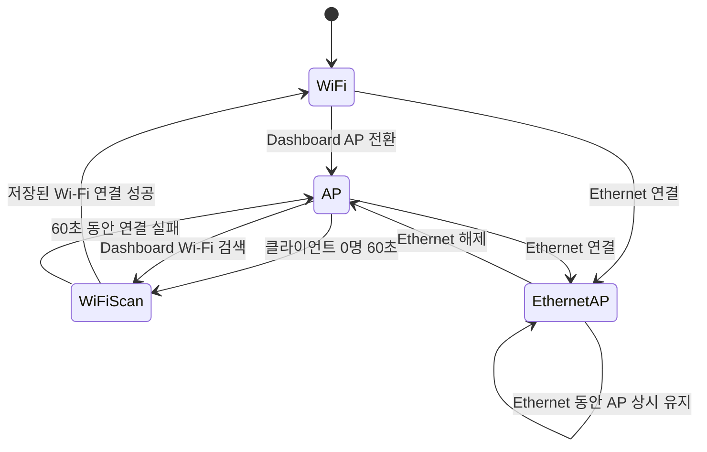

# Jetson 단일 무선랜 Wi-Fi/AP 자동 전환

검증일: 2026-08-27 KST  
대상: NVIDIA Jetson Orin Nano Developer Kit Super (`L4T R36.5.0`)

2026-10-04 변경: AP 대시보드의 권장 주소는 **`http://10.77.0.1`**이다.
nginx가 IP Host를 대시보드로 보내며 기존 도메인 경로도 유지한다.
AP가 활성화된 뒤 `BTS_Jetson`에 연결하고 주소 전체를 입력한다. IP 요청은
DNS를 조회하지 않으므로 다른 인터넷 연결의 DNS/브라우저 Secure DNS와 함께
사용할 수 있다. 클라이언트는 AP의 `10.77.0.0/24` 로컬 경로를 사용하고
기존 인터넷 기본 경로는 유지한다. nginx에는 HTTPS 리다이렉트가 없다.
브라우저의 별도 HTTPS 전용 정책은 서버에서 강제로 해제할 수 없다.

2026-10-04 KST 확인 시 외부 DNS로 도달하는 Cloudflare HTTP 경로는
`301 Location: https://<대시보드 공개 주소>/`를 반환했다(공개 주소는 팀 서버 주소, 설정값). AP DNS 대신 외부 DNS가
선택되면 이 공개 경로를 거치게 된다. IP 직접 접속은 Cloudflare도 거치지 않는다.

설정 배포와 실제 백엔드를 통한 프록시 검증은 별도 기록에 남긴다.
AP 클라이언트에서 새 IP 경로를 직접 확인한 결과는
[`docs/ap_ip_access_20261004.json`](https://github.com/2026-BTS-UNI-Car/unist_orachard_dashboard/blob/archive-before-cleanup-20261113/docs/ap_ip_access_20261004.json)(보존 태그)의 검증 범위를 따른다.

## 운영 결론

Jetson의 단일 Wi-Fi 인터페이스 `wlP1p1s0`를 station과 AP 사이에서 안전하게 전환하는
`ubts-network-mode.service`를 배포했다. AP SSID는 `BTS_Jetson`, 주소는
`10.77.0.1/24`이다. WPA2 암호는 저장소나 Compose 환경변수에 넣지 않고 보드의
root 전용 `/etc/ubts-offline-ap/wpa2.pass`(0600)에 배치한다.

현재 PHY는 AP를 지원하지만 station+AP 동시 운용은 지원하지 않는다. 따라서 무선
uplink만 있는 동안 AP 전환 버튼을 누르면 기존 Wi-Fi와 인터넷이 끊기는 것이 의도된
동작이다. HTTP 응답을 먼저 반환한 뒤 host controller가 전환 요청을 처리하므로 버튼
요청 자체는 유실되지 않는다.



controller는 저장된 NetworkManager Wi-Fi profile만 시도한다. 새 SSID에 임의로
접속하거나 암호를 추측하지 않는다. 전환 실패 시 오류를 status와 systemd journal에
남기고 저장된 Wi-Fi 복구를 먼저 시도한다.

## Dashboard 버튼 계약

| 실제 상태 | `AP 전환` | `Wi-Fi 검색` | 동작 |
|---|---:|---:|---|
| Wi-Fi station 연결 | 활성 | 비활성 | 현재 Wi-Fi를 끊고 AP 시작 |
| AP 활성 | 비활성 | 활성 | AP를 끄고 저장된 Wi-Fi를 최대 60초 검색 |
| 전환 중/연결 끊김 | 비활성 | 비활성 | 중복 명령 차단 |
| Ethernet 연결 + AP | 비활성 | 비활성 | 무선 AP 상시 유지 |

AP/Wi-Fi 버튼은 확인 대화상자와 action별 confirmation token을 거친다. API는 다음과
같다.

```text
GET  /api/network
POST /api/network/mode {"action":"ap","confirm":"disconnect_wifi_and_enable_ap"}
POST /api/network/mode {"action":"wifi","confirm":"leave_ap_and_scan_known_wifi"}
```

Dashboard 컨테이너는 직접 NetworkManager를 조작하지 않는다. host PID/mount/network
namespace의 `/usr/local/sbin/ubts-network-mode`에 제한된 명령(`status`,
`request-ap`, `request-wifi`와 아래 Wi-Fi 관리의 `wifi-*` 여섯 개)만 전달한다.
controller status가 10초 이상 stale이면 전환을 거부한다. 2026-11-16부터 바꾸는
요청(`/api/network/mode`, `/api/network/wifi/*`)은 이 화면의 세션 쿠키와 같은
Origin이 있어야 받는다.

## Wi-Fi 관리 (2026-11-16)

Network 쪽 "오프라인 AP / 저장된 Wi-Fi" 패널 안에서 주변 Wi-Fi 검색 목록(신호 dBm·%,
대역·채널, 보안), 비밀번호로 연결, 자동 연결과 우선순위, 저장된 Wi-Fi의 자동 연결·
우선순위 바꾸기를 한다. 메뉴와 쪽 구성은 그대로다. 화면 모듈
(`static/network/wifi-manager.mjs`)은 Network 쪽을 처음 열 때만 받는다.

```text
GET  /api/network/wifi            저장된 Wi-Fi(10초 캐시)와 마지막 검색 결과. 검색은 하지 않는다
POST /api/network/wifi/scan       주변 검색 (모든 사용자 합쳐 15초에 한 번, 도우미도 10초 캐시)
POST /api/network/wifi/connect    {"ssid"|"uuid", "password"?, "autoconnect", "priority",
                                   "confirm":"connect_with_auto_revert"}
POST /api/network/wifi/confirm    {"txn"}  시험 연결을 유지
POST /api/network/wifi/revert     {"txn"}  시험 연결을 지금 되돌림
POST /api/network/wifi/profile    {"uuid", "autoconnect", "priority"}  (-999 ~ 999)
```

- **시험 연결과 자동 되돌림.** 연결을 바꾸면 controller가 새 연결을 시도하고, 45초 안에
  주소·기본 경로가 없거나 연결이 실패하면 곧바로, 연결된 뒤에는 150초 안에 화면의
  '이 연결 유지'가 오지 않으면 이전 연결(저장 Wi-Fi 프로필 또는 AP)로 되돌린다.
  되돌릴 때 이번에 만든 프로필만 지우고(uuid와 `/run` 경로 확인), 비밀번호를 바꾼
  저장 프로필은 원래 파일로 돌린다. 새 프로필은 시험 동안 메모리 프로필
  (`/run/NetworkManager`)이고 자동 연결이 꺼져 있어 재부팅하면 사라진다. 이전 Wi-Fi로도
  못 붙으면 기존 안전장치(저장된 Wi-Fi 60초 검색 → AP)가 이어 받는다.
- **비밀번호.** 화면 → 대시보드 → 도우미 표준 입력 → root 전용 NetworkManager 파일로만
  간다. 명령행 인자, 로그, 대기 명령 파일, 상태 파일, 응답에 넣지 않는다.
- **막는 때.** Ethernet으로 AP가 유지되는 동안, AP 시작·저장된 Wi-Fi 검색·다른 시험
  연결 중. AP 방식에서는 무선랜이 하나라 주변 검색을 하지 못한다(10분 안의 검색
  결과나 저장된 Wi-Fi로는 연결 시험을 할 수 있다). 새 SSID는 최근 검색 결과에 있는
  것만, 기업용(802.1X)·WEP는 받지 않는다. 숨긴 SSID는 지원하지 않는다.
- **AP에서 다른 Wi-Fi로.** AP가 꺼지므로 휴대폰도 그 Wi-Fi나 인터넷으로 옮겨
  대시보드에 들어와 확인해야 한다. 못 하면 150초 뒤 AP로 돌아온다.
- 설치: 도우미는 `deploy/network_helper_update/README_KO.md`(sudo), 대시보드는
  `deploy/jetson_dashboard/README_KO.md`. 도우미를 먼저 바꾼다.

## 오프라인 주소와 보안 계약

AP의 dnsmasq는 DHCP 주소와 DNS `10.77.0.1`을 주되 default gateway를 배포하지 않는다.
IP forwarding, NAT/masquerade, 방화벽 변경, upstream DNS forwarding도 사용하지 않는다.
따라서 AP 클라이언트는 Jetson 로컬 서비스만 사용할 수 있고, PC처럼 두 번째 uplink가
있는 장치의 기존 인터넷 기본 경로를 빼앗지 않는다.

```text
http://10.77.0.1                -> 10.77.0.1:80 -> dashboard 127.0.0.1:8080
http://<DASHBOARD_HOSTNAME>     -> 10.77.0.1:80 -> dashboard 127.0.0.1:8080
http://<PORTAINER_HOSTNAME>     -> 10.77.0.1:80 -> Portainer 127.0.0.1:9443
ssh <계정>@<SSH_HOSTNAME>       -> 10.77.0.1:22 direct
```

세 이름은 팀 서버 주소(설정값)이고 레포에는 적지 않는다. 보드의 `/etc/ubts-network-mode.conf`에
`UBTS_AP_DASHBOARD_HOSTNAME`, `UBTS_AP_PORTAINER_HOSTNAME`, `UBTS_AP_SSH_HOSTNAME`으로 적는다(없으면
`dashboard.example.invalid`, `docker.example.invalid`, `ssh.example.invalid`). AP의 로컬 DNS가 이 이름들을
`10.77.0.1`로 돌려주고 nginx가 앞의 둘을 받는다. 설치된 AP 설정 파일(`/opt/ubts-offline-ap/`)이 2026-11-22 전 판이면
그 파일에 고정된 이름과 같은 값을 적어야 AP가 켜진다(`deploy/network_helper_update/update_network_helper.py`가 확인한다).

nginx는 AP 주소의 port 80에만 bind한다. 컨테이너는 read-only, no-new-privileges이며
모든 capability를 제거한 뒤 nginx가 port 80 bind와 worker UID 강등에 실제로 필요한
`NET_BIND_SERVICE`, `CHOWN`, `DAC_OVERRIDE`, `SETUID`, `SETGID`만 추가한다. Portainer
upstream은 보드의 `localhost` 인증서를 CA 파일로 고정해 `proxy_ssl_verify on`을
유지한다.

공개 도메인에 HSTS가 캐시된 휴대폰은 HTTP를 HTTPS로 자동 승격할 수 있다. 이 경우
`http://<DASHBOARD_HOSTNAME>`을 명시해도 HSTS가 적용될 수 있으므로
`http://10.77.0.1`로 접속한다. Jetson에서 클라이언트가 사용하는 외부 DNS나
공개 도메인의 HSTS를 강제로 바꿀 수는 없다. AP는 DHCP option 6으로
`10.77.0.1` DNS를 계속 제공하며, 도메인 접속은 그 DNS를 사용하는 경우에만
로컬 대시보드로 연결된다.

## Ethernet 우선 규칙

Ethernet carrier가 실제 NetworkManager `connected` 상태이면 인터넷 경로는 Ethernet이
담당할 수 있으므로 무선랜을 상시 AP로 유지한다. client 0명 타이머를 적용하지 않고 두
수동 버튼을 잠근다. Ethernet이 해제되면 AP의 일반 60초 무클라이언트 주기로 돌아간다.
현재 보드의 `enP8p1s0`은 케이블이 없어 이 분기는 단위 테스트로 검증했으며, 운영 중
케이블을 연결하면 controller가 자동 적용한다.

## 실제 Jetson + Windows Realtek 검증

2026-08-27에 `Realtek 8811CU Wireless LAN 802.11ac USB NIC`를 작업 PC의 두 번째
무선랜으로 사용해 실제 전환을 검증했다.

- 기존 Jetson Wi-Fi(집 공유기 Wi-Fi)와 그 주소, default route를 유지한 채
  controller와 Dashboard를 먼저 배포했다.
- Dashboard AP API 응답 후 `BTS_Jetson`이 2.4 GHz channel 6, WPA2-Personal로 검색됐다.
- Realtek은 DHCP `10.77.0.164/24`, DNS/DHCP server `10.77.0.1`, default gateway 없음으로
  연결됐다. PC의 Intel Wi-Fi 인터넷 default route는 유지됐다.
- 세 도메인은 모두 명시적 DNS 질의에서 `10.77.0.1`을 반환했다.
- Dashboard `/api/health`, Portainer `/api/status`, SSH `<계정>@10.77.0.1`을 실제로
  통과했다.
- AP 상태 API는 client 1명, `can_request_ap=false`, `can_request_wifi=true`를 반환했다.
- Wi-Fi 검색 API 후 약 10초 안에 기존 집 공유기 Wi-Fi와 그 주소로 복귀했다.
- Realtek을 연결하지 않은 자동 시험에서는 AP 시작 약 71초 뒤 별도 명령 없이 저장된
  Wi-Fi와 default route가 복구됐다. 이는 AP 준비 시간과 60초 idle timer를 포함한다.
- Wi-Fi 검색이 60초 동안 실패하면 AP로 복귀하는 분기와 Ethernet 버튼 잠금은 단위
  회귀 테스트로 검증했다.

## 설치·상태 확인

```bash
# 세 이름(팀 서버 주소)은 환경 변수로 준다. 설치 스크립트가 /etc/ubts-network-mode.conf 에 적는다.
sudo env UBTS_AP_DASHBOARD_HOSTNAME=<대시보드 이름> UBTS_AP_PORTAINER_HOSTNAME=<Portainer 이름> \
  UBTS_AP_SSH_HOSTNAME=<SSH 이름> <레포 폴더>/deploy/offline_ap/install-network-mode.sh
sudo systemctl enable --now ubts-network-mode.service

systemctl status ubts-network-mode.service
sudo /usr/local/sbin/ubts-network-mode status --json
curl -s http://127.0.0.1:8080/api/network | python3 -m json.tool
```

서비스를 켜는 것만으로 연결된 Wi-Fi를 끊지 않는다. controller는 station 연결이 정상인
경우 상태만 기록하고 Dashboard AP 요청, 무선 연결 상실, Ethernet 연결 중 하나가
발생할 때만 전환한다.

## GPS 확인

Jetson Orin Nano Developer Kit에는 기본 GNSS/GPS 수신기가 없다. 실제 보드에도
`gpsd`, GNSS ROS topic, GNSS 장치가 없었다. `/dev/pps0`는 `nvpps` ktimer이고
`/dev/ttyUSB0`은 CP2102N USB-UART이므로 내장 GPS의 증거가 아니다. 지도 좌표가
필요하면 USB/UART 또는 M.2 외장 GNSS와 안테나를 추가해야 한다.

## 참고

- [NVIDIA Jetson Orin Nano Developer Kit hardware layout](https://docs.nvidia.com/jetson/orin-nano-devkit/user-guide/hardware_layout.html)
- [NetworkManager settings reference](https://www.networkmanager.dev/docs/api/latest/nm-settings-nmcli.html)
- USB 전용 fail-closed 보조 번들: `deploy/offline_ap/README.md`
