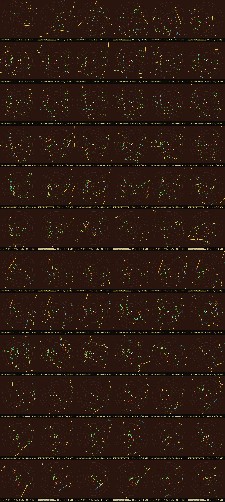

# LiDAR Object Overlay와 Tree-only OOD

Last updated: 2026-07-10
Algorithm: `polar_gap_cluster_wall_context_tree_ood_predictive_tracks_v6`

## 1. 목적

2D LiDAR는 semantic class를 직접 보지 못한다. 작은 원형 cluster가 나무 줄기, 사람 다리, pole, 벽 조각, 잎/가지 중 무엇인지 단일 scan만으로 확정할 수 없다. 따라서 overlay는 **관측 후보**, orchard map은 **시간적으로 확인된 landmark**로 분리한다.

## 2. 화면 모드

Connection, Rover Control, Archive는 같은 perception 설정을 공유한다.

| Perception | LiDAR canvas | Camera canvas |
| --- | --- | --- |
| `2D Objects` | raw/wall/object/track | camera raw만 |
| `Camera` | raw LiDAR만 | TensorRT tree contour |
| `Fusion Trees` | frame-anchored LiDAR tree probability | camera tree contour |

LiDAR 자체 표시 모드:

| Mode | 표시 |
| --- | --- |
| `LiDAR` | raw point |
| `LiDAR+Overlay` | raw point + 선택 overlay |
| `Overlay` | overlay only |

Object 글자는 겹치므로 표시하지 않는다. Probability는 작은 marker의 색상과 제한된 label로 나타낸다.

## 3. 좌표계

Bridge point:

$$
x = r sin(theta),  y = r cos(theta)
$$

`lidar_bridge_xy_v1`에서 `+y`는 전방, `+x`는 우측이다. Connection, Rover Control, Archive 모두 같은 `drawLidarMapOnCanvas` projection을 사용한다. Raw point와 overlay center에 별도 좌우 반전/회전을 적용하지 않는다.

Archive Fusion overlay는 현재 frame의 LiDAR cluster를 anchor로 사용한다. Final world map tree를 현재 pose로 무조건 역투영하면 scan odometry 오차 때문에 raw point에서 떨어질 수 있으므로, final landmark는 frame anchor와 가까울 때 identity/confidence만 보조한다.

## 4. Polar gap clustering

유효한 point를 angle 순서로 정렬한다. 인접 Cartesian gap이 거리 적응 threshold보다 크면 cluster를 나눈다.

$$
d_i = ||p_i - p_(i-1)||_2
$$

$$
tau_i = max(0.16, min(0.62, 0.05 + 0.045 max(r_i, r_(i-1))))
$$

0/360도 경계 cluster는 endpoint gap이 threshold의 1.2배 이내면 병합한다. 최소 3 point 미만의 조각은 object 후보로 만들지 않는다.

## 5. Wall과 fragmented linear context

Cluster covariance의 주축으로 line length와 orthogonal width를 구한다.

$$
Sigma = (1/N) sum_i (p_i - mu)(p_i - mu)^T
$$

긴 선형 cluster는 wall segment로 분류한다. Noise로 끊긴 wall은 방향 차, lateral offset, endpoint gap이 작을 때 다시 합친다.

Wall fit만으로는 작은 끊김이 compact tree처럼 남을 수 있다. 그래서 두 번째 gate가 candidate 주변 raw point를 모아 다시 line fit한다. 주변 문맥이 충분히 길고 얇으면 `embedded_in_linear_structure`로 거부한다. 사용자가 지적한 “확실한 벽을 나무로 표시”하는 경우를 이 gate로 다룬다.

## 6. Tree candidate와 OOD evidence

Candidate에는 다음 field를 남긴다.

```json
{
  "center": {"x_m": 1.2, "y_m": 4.8},
  "radius_m": 0.16,
  "tree_probability": 0.81,
  "ood_score": 0.19,
  "structure_score": 0.74,
  "wall_distance_m": 1.42,
  "nearest_wall_length_m": 3.8,
  "admission": "geometry_candidate",
  "rejection_reasons": []
}
```

주요 거부 이유:

- `near_wall_segment`: candidate projection이 wall 위에 있고 adaptive wall distance 이내
- `embedded_in_linear_structure`: 주변 raw point가 긴 직선 구조
- `rear_operator_exclusion_zone`: 로버 바로 뒤 좁은 near-field

후방 전체를 제거하지 않는다. U-turn 정합에는 rear scan이 필요하므로 `y < -0.35`, `|x| < 1.15`, range < 4.2 m의 사람 standing zone만 odometry에서 제외한다.

## 7. Object tracking

Object track은 이전 center에만 nearest-neighbor matching하지 않는다. 직전 velocity로 다음 center를 예측한다.

$$
p_hat(t + dt) = p(t) + v(t) dt
$$

Matching에는 center distance, radius change, label compatibility, 순간 sensor-relative speed를 사용한다. 초록 trail은 로버가 움직이는 sensor frame 기록이지 world-frame 물체 이동 경로가 아니다. 따라서 짧고 급격한 jump, 과도한 speed, 낮은 confidence track은 그리지 않는다.

Tree overlay의 `confirmed_trees`는 같은 local track이 두 번 이상 관측돼야 한다. 한 scan의 순간 원은 지도 tree가 아니다.

## 8. 지도 admission

각 local candidate를 scan-derived rover pose로 world frame에 옮긴 뒤 공간 병합한다. 일반 LiDAR landmark는 다음 중 하나를 만족해야 한다.

- 8회 이상, time span 2초 이상 반복 관측
- 5회 이상, confidence 0.74 이상
- 짧은 unit fixture에서는 3회 이상, 0.8초 이상, confidence 0.62 이상

그 뒤 landmark 간 최소 간격 0.82 m를 적용한다. 이 때문에 frame candidate 수와 지도 나무 수가 크게 다르다.

## 9. 전체 archive 결과

| 항목 | 값 |
| --- | ---: |
| Frames | 216 |
| Points | 196,280 |
| Raw compact candidates | 4,601 |
| Geometry accepted observations | 3,523 |
| Explicitly rejected | 889 |
| `embedded_in_linear_structure` | 347 |
| `rear_operator_exclusion_zone` | 300 |
| `near_wall_segment` | 242 |
| Mean / p95 | 44.34 / 70.05 ms |

Map 결과:

| Archive | Raw | Map geometry | Wall | Linear | Rear | Final LiDAR landmarks |
| --- | ---: | ---: | ---: | ---: | ---: | ---: |
| `20260708T053333Z_both` | 2,028 | 154 | 95 | 155 | 85 | 9 |
| `20260708T054036Z_both` | 2,573 | 175 | 147 | 192 | 215 | 7 |



## 10. Archive 저장과 캐시

Raw point와 overlay는 분리해 `timeline.json`에 저장한다. 새 algorithm revision은 전체 기록 순서로 한 번 precompute한다.

```bash
docker exec unist-orachard-dashboard \
  python /app/scripts/precompute_archive_lidar_overlays.py \
  --recording-id 20260708T053333Z_both \
  --recording-id 20260708T054036Z_both
```

Segment 조회에서는 최신 v6 overlay를 다시 계산하지 않는다. 연속 tracking ID도 4초 segment 경계에서 초기화되지 않는다.

## 11. 한계

- 2D scan 한 장의 compact geometry는 semantic tree proof가 아니다.
- 사람 exclusion은 이번 두 archive의 operator 위치를 반영한 narrow policy다. 사람이 다른 위치에 있으면 별도 동적 물체 추정이 필요하다.
- Tree radius는 scan cross-section 근사이며 canopy 크기가 아니다.
- Wheel odometry/IMU가 없는 현재 map pose는 research pseudo-odometry다.
- 논문 정확도에는 사람이 표시한 tree position, wall, person GT가 필요하다.

## 12. 관련 코드

- `dashboard_server/lidar_analysis.py`
- `dashboard_server/lidar_odometry.py`
- `dashboard_server/orchard_mapping.py`
- `scripts/evaluate_lidar_tree_ood.py`
- `scripts/precompute_archive_lidar_overlays.py`
