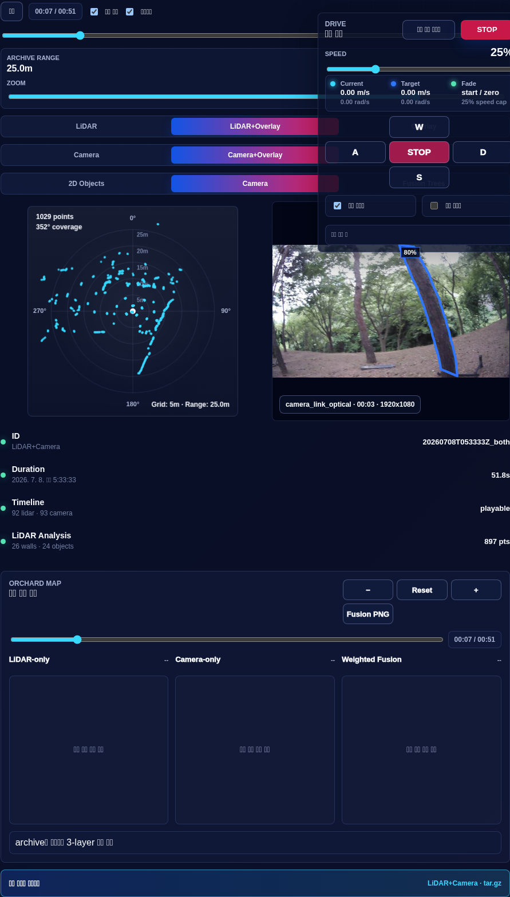

# 과수 밑둥 Segmentation Fine-Tuning 작업 절차

작성일: 2026-07-09

## 1. 현재 상태

현재 camera vision은 local Roboflow cache worker가 `tree-trunk-detection-369pz-vm3hn/2` 모델을 API key 없이 실행한다. 이 모델은 줄기 contour를 꽤 잘 찾지만, 잎/가지 간섭이 심하거나 줄기가 멀고 얇은 frame에서는 놓치는 경우가 있다. 따라서 다음 단계는 현재 모델의 출력을 초벌 라벨로 사용해 사람이 수정하고, 우리 과수원 주행 데이터로 YOLO segmentation 모델을 fine-tuning하는 것이다.

## 2. Archive 재생 속도 개선

Archive 재생 중 AI inference를 매번 실행하면 영상 스트리밍처럼 부드럽게 재생할 수 없다. 해결 방식은 camera overlay를 사전에 계산해 `timeline.json`에 저장하는 것이다.

```bash
cd /home/unist/workspace/unist_orachard_dashboard
export ORCHARD_VISION_AI_URL=http://127.0.0.1:8785/analyze
python3 scripts/precompute_archive_camera_overlays.py \
  --recording-id 20260708T053333Z_both \
  --recording-id 20260708T054036Z_both \
  --checkpoint-every 10
```

검증 결과:

| Archive | Camera frames | Updated | Failed | Elapsed |
| --- | ---: | ---: | ---: | ---: |
| `20260708T053333Z_both` | 93 | 93 | 0 | 52.9 s |
| `20260708T054036Z_both` | 125 | 125 | 0 | 106.7 s |

Precompute 이후 `/timeline` segment 조회는 AI worker를 호출하지 않고 저장된 overlay를 읽는다. 1.2초 구간은 약 0.42-0.74초, 4초 구간은 약 0.70-0.89초 범위로 반환되었다. UI Playwright 검증에서도 archive camera preview와 overlay canvas가 정상 렌더링되었다.



## 3. Fine-tuning 데이터셋 export

현재 AI overlay를 초벌 segmentation label로 내보낸다.

```bash
cd /home/unist/workspace/unist_orachard_dashboard
python3 scripts/export_orchard_finetune_dataset.py \
  --recording-id 20260708T053333Z_both \
  --recording-id 20260708T054036Z_both \
  --output-dir runtime/finetune_exports/orchard_trunk_20260708_prelabels \
  --include-empty \
  --overwrite \
  --min-confidence 0.22
```

출력:

```text
runtime/finetune_exports/orchard_trunk_20260708_prelabels/
  data.yaml
  manifest.json
  images/train/*.jpg
  images/val/*.jpg
  labels/train/*.txt
  labels/val/*.txt
```

검증 결과:

| 항목 | 수 |
| --- | ---: |
| 전체 frame | 218 |
| pre-label이 있는 frame | 131 |
| 빈 hard-negative frame | 87 |
| 압축 파일 | `runtime/finetune_exports/orchard_trunk_20260708_prelabels.tar.gz` |

## 4. 사람이 수정해야 하는 것

수동 작업의 목적은 모델이 놓친 줄기를 추가하고, 잘못 잡은 물체를 제거하는 것이다.

반드시 수정할 항목:

- 빠진 나무 줄기 mask 추가
- 실제 나무가 아닌 벽, 건물 edge, 사람, 의자/테이블 다리, 전봇대/기둥, 플라스틱 edge 삭제
- 여러 갈래로 갈라진 밑둥은 가능한 한 각 줄기 contour를 정확히 따기
- 너무 큰 canopy 영역이 trunk label로 들어간 경우 줄기 영역만 남기기
- 빈 hard-negative frame은 실제 나무 줄기가 없으면 label 파일을 빈 상태로 유지하기

처음 fine-tuning은 class를 하나만 둔다.

```text
0: trunk
```

데이터가 충분히 늘어난 뒤에 아래처럼 class를 분리한다.

```text
0: trunk_base
1: split_stem
2: branch
3: post_pole
4: person
5: wall_edge
```

## 5. 추천 annotation 도구

가장 쉬운 경로는 CVAT이다.

1. `orchard_trunk_20260708_prelabels.tar.gz`를 로컬 PC로 가져온다.
2. CVAT에서 새 project를 만들고 label `trunk`를 추가한다.
3. YOLO segmentation 형식으로 이미지를 import한다.
4. 각 frame의 초벌 polygon을 확인한다.
5. 놓친 줄기를 polygon으로 추가하고 오탐 polygon을 삭제한다.
6. 수정 완료 후 YOLO segmentation 형식으로 export한다.

Roboflow를 사용해도 되지만, 최종 학습/추론은 인터넷 없는 Jetson local runtime을 목표로 한다. Roboflow는 annotation UI나 dataset versioning 용도로만 사용하고, Jetson에는 API key를 넣지 않는다.

## 6. 학습 명령

수정이 끝난 dataset을 Jetson 또는 학습용 GPU PC에 둔다.

```bash
pip install ultralytics
yolo task=segment mode=train \
  model=yolo11n-seg.pt \
  data=/path/to/orchard_trunk_dataset/data.yaml \
  imgsz=640 \
  epochs=100 \
  batch=8 \
  device=0
```

Jetson 배포용 TensorRT engine:

```bash
yolo export \
  model=runs/segment/train/weights/best.pt \
  format=engine \
  half=True \
  imgsz=640 \
  device=0
```

대시보드 worker 전환:

```bash
ORCHARD_VISION_BACKEND=ultralytics
ORCHARD_YOLO_MODEL=/app/runtime/models/best.engine
```

## 7. 수동 작업 체크리스트

- [ ] 두 archive에서 pre-label dataset을 export한다.
- [ ] CVAT/Roboflow/Label Studio 중 하나에서 polygon을 검수한다.
- [ ] 놓친 trunk를 추가하고 false positive를 삭제한다.
- [ ] hard-negative frame을 충분히 유지한다.
- [ ] train/val split이 같은 장소/시간에만 치우치지 않았는지 확인한다.
- [ ] YOLO segmentation 형식으로 export한다.
- [ ] `yolo train`으로 fine-tuning한다.
- [ ] `best.pt`를 archive frame 전체에 다시 적용해 precision/recall을 계산한다.
- [ ] Jetson에서는 TensorRT FP16 engine으로 변환해 local worker에 연결한다.
