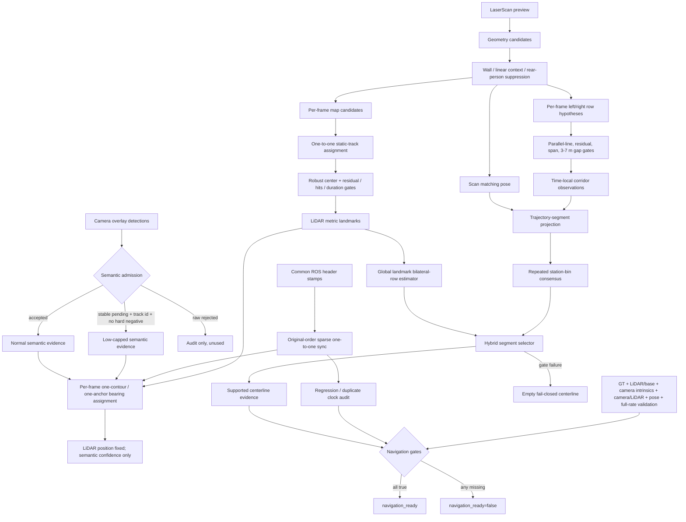

# 2026-07-21 과수원 LiDAR-Camera Fusion v10/r3 평가 기록

작성일: 2026-08-22  
규범 알고리즘: `orchard_metric_anchor_semantic_fusion_local_frenet_v10`  
캐시 리비전: `v10_rep103_robust_tracks_unique_semantics_row_model_native_input_r3`

> 이 평가는 세 archive의 자기일관성, provenance, 동기화와 fail-closed 동작을 검증한 것이다. 사람 기준 trunk/centerline ground truth가 없으므로 precision, recall, 위치 RMSE, 중심선 횡오차나 “정확도 향상”을 주장하지 않는다. `ok=true`도 주행 가능 판정이 아니다.

## 1. 결론

v10은 v9/r3에서 확인된 네 가지 구조적 문제를 수정한다.

1. 서로 다른 센서의 상대 `t_s`를 비교해 카메라가 약 한 preview frame 늦게 붙던 문제를 common ROS header stamp 기반 동기화로 교체했다.
2. 같은 프레임의 여러 LiDAR 후보가 한 landmark track 또는 한 camera contour를 중복 소비하던 경로를 각각 one-to-one assignment로 제한했다.
3. 엄격하게 축약된 global landmark만으로 중심선을 만들던 경로와 별도로, 매 LiDAR frame의 bilateral row를 직접 추정하고 시간·궤적 구간에서 합의하는 local corridor channel을 추가했다.
4. 중심선 evidence와 실제 navigation readiness를 분리하고, 보정·pose·GT·full-rate replay 및 sensor clock integrity가 모두 검증되지 않으면 주행 입력 사용을 금지했다.
5. 새 recording은 source/native camera 추론과 640 px archive/WebSocket preview를 분리한다. 입력 정책 `source_native_preview_decoupled_jpeg_v1`의 mode, requested width, source/inference 크기, JPEG quality까지 검증하고 map cache r3에 집행 결과를 기록한다. 이 provenance가 없는 과거 640 px preview는 native v10으로 재분류하지 않고 fail-closed한다.

최종 평가에서 D1 preview는 33개 LiDAR metric anchor와 4.308 m 길이의
중심선 evidence를 만들었고, D2/D3 preview는 중심선을 빈 배열로
fail-closed했다. Native-input provenance가 없는 기존 640 px archive overlay는
세 기록 모두 semantic evidence에서 제외됐다. Full-rate 5,191 scan의 독립
geometry observability는 D1/D2/D3 각각 22.98%, 0.55%, 30.78%였다. 모든
기록의 `navigation_ready`는 false다. GT 부재 때문에 이 수치는 정확도 비교가
아니라 구현 계약, 관측 가능성 및 fail-closed 동작의 변화로만 해석한다.

## 2. 알고리즘 설계 맵



## 3. v10 핵심 계약

### 3.1 좌표와 metric provenance

- LiDAR 좌표는 REP-103에 맞춰 `+y` 전방, `+x` 좌측이다. 영상 `u`는 우측으로 증가하므로 `u=cx-fx*tan(bearing)`의 부호를 유지한다.
- fusion tree의 `x_m/y_m`는 LiDAR metric anchor 그대로다. Camera는 위치를 평균하거나 이동시키지 않는다.
- camera-only metric promotion은 모든 관측의 intrinsics, extrinsics, coordinate frame과 range provenance가 명시적으로 검증된 경우만 허용한다. 이번 세 archive에서는 promotion이 없어야 한다.

### 3.2 시간 동기화

- 두 stream의 모든 frame에 유효한 ROS header stamp가 있으면 그 공통 시간축을 쓴다.
- 일부 stamp가 없으면 archive 전체가 legacy relative `t_s` compatibility mode로 내려간다. frame별로 두 clock을 섞지 않는다.
- solver는 frame을 stamp 순으로 재정렬하지 않고 archive 원순서를 보존한다. In-gate pair 수를 최대로 한 뒤 총 `abs(dt)`가 최소인 monotonic one-to-one chain을 선택한다.
- Timestamp bucket + Fenwick prefix optimum으로 후보 edge 수를 `E`라 할 때 복잡도는 `O((N+M+E) log M)`이고, full `N x M` DP matrix를 만들지 않는다.
- Header regression/duplicate 수와 최대 역행량을 출력한다. 하나라도 있거나 header integrity를 확인할 수 없으면 navigation gate는 닫힌다.

### 3.3 Landmark 추출

- 같은 timestamp frame의 후보는 서로 다른 track에만 배정된다. 한 frame의 중복 후보로 `hits`를 부풀릴 수 없다.
- Track center는 weighted median에서 시작한 robust reweighting으로 구하고, 관측 residual median/p90/max를 기록한다.
- LiDAR track은 hit 수, 시간 지속성, confidence 및 `spatial_residual_p90 <= 0.58 m`를 통과해야 한다.
- 최종 thinning은 fixed recording count가 아니라 metric spacing만 사용한다. 따라서 출력 개수를 목표값에 맞추는 튜닝은 하지 않는다.

### 3.4 Camera semantic support

- 한 camera contour는 같은 frame에서 최대 한 LiDAR anchor만 support한다.
- `overlay.detections`의 accepted 관측은 정상 semantic evidence다.
- `map_admission=pending`은 `stable=true`, `stable_hits>=3`, 유효 `track_id`, `tree_probability>=0.24`, `ood_score<=0.78`이 모두 필요하다. 품질 weight는 accepted보다 크게 낮고 기존 LiDAR anchor에만 연결된다.
- Wall, fence, post, pole, person/human, building/column/road/furniture 문맥은 pending path에서 차단한다.
- `rejected_detections`는 frame 간 identity가 없고 hard-negative 혼입을 배제할 수 없어 사용하지 않는다. 별도 GT A/B 전에는 metric 생성·이동뿐 아니라 semantic support에도 넣지 않는다.

### 3.5 Time-local bilateral corridor

각 frame에서 wall-suppressed `trunk_like` 또는 `foliage_cluster`만 사용한다. 좌우 각각 최소 3점, 종방향 span 3 m, residual p90 0.45 m, 절대 slope 0.25, 좌우 slope 차 0.16을 넘지 않아야 한다. 양쪽 overlap은 2.8 m 이상이어야 하며 sensor 근처까지 실제 관측되어야 한다.

행 폭은 3--7 m를 유지한다. 별도 raw proxy에서 1.4--2.0 m mode가 관측되어 같은 row를 양쪽 row로 잘못 짝짓는 위험이 있으므로 최소 폭을 낮추지 않았다. Unit test는 1.7 m narrow pair, wall/fence label, 비평행 pair를 모두 빈 결과로 확인한다.

Frame corridor는 world pose로 변환한 뒤 trajectory segment의 station/lateral 좌표로 투영한다. Segment evidence가 되려면 서로 다른 최소 6 frame, 2초, 반복 관측된 2 m station bin 3개, station span 4 m, row-gap MAD 및 lateral residual gate를 통과해야 한다. 조건이 하나라도 부족하면 point는 빈 배열이다.

## 4. 세 archive 평가

평가기는 version-neutral `scripts/evaluate_orchard_fusion.py`에 있고, v10 명시 실행은 다음과 같다. 기존 자동화 호환을 위해 v9 파일은 thin wrapper로 유지한다.

```bash
python scripts/evaluate_orchard_fusion_v10.py \
  --timeline <recording>.timeline.json \
  --output evaluation_<recording>_v10_r3.json
```

### 4.1 Preview archive의 metric-map 자기일관성

| 기록 | preview LiDAR / camera | LiDAR anchor | semantic-supported | header 1:1 match | centerline evidence | navigation |
|---|---:|---:|---:|---:|---|---|
| `081819` | 347 / 350 | 33 | 0 | 341/347, 98.27% | 3점, 4.308 m, gap 3.593 m, confidence 0.727 | false |
| `082224` | 358 / 355 | 28 | 0 | 334/358, 93.30% | empty; clock regression + bilateral evidence 부족 | false |
| `082612` | 217 / 218 | 26 | 0 | 200/217, 92.17% | empty; repeated station-bin 부족 | false |

`semantic-supported=0`은 모델이 나무를 하나도 제안하지 않았다는 뜻이
아니다. 이 archive가 source/native inference의 mode, 실제 입력 크기와 JPEG
quality를 증명하지 못하므로 legacy 640 px overlay를 재사용하지 않은 결과다.
LiDAR anchor 위치는 camera 때문에 이동하지 않았고, camera-only metric
promotion도 0이다.

### 4.2 Full-rate raw LaserScan 관측 가능성

ROS-independent r3 evaluator를 1-frame stride로 5,191개 scan 전체에 적용했다.
매 scan마다 pose와 estimator를 초기화하고 camera gate를 끈 결과이므로 아래
값은 local geometry observability이며 전역 중심선 성공률이나 정확도가 아니다.

| 기록 | 전체 scan | 3--7 m bilateral valid | 비율 | row width 중앙값 |
|---|---:|---:|---:|---:|
| `081819` | 1,928 | 443 | 22.98% | 3.307 m |
| `082224` | 1,996 | 11 | 0.55% | 3.077 m |
| `082612` | 1,267 | 390 | 30.78% | 3.829 m |

D2의 이전 broad-width proxy는 2.55 m 부근을 자주 선택했다. Dashboard와 ROS
runtime을 모두 3--7 m로 통일하면서 이 same-row false-pair mode가 제거됐고,
D2는 억지 중심선 대신 거의 전 구간에서 비었다. 이는 proposal 수 감소가 아니라
의도한 안전 동작이다.

Raw header 기반 one-to-one 50 ms coverage는 D1/D2/D3에서 각각 100.00%,
99.30%, 99.29%다. D2는 bag 원순서에서 LiDAR와 camera header가 각각 3회
역행했으며 최대 역행은 1.102 s와 0.471 s다. 따라서 정렬로 오류를 숨기지
않고 navigation clock gate를 닫는다.

### 4.3 Native vision 입력 정책 선택

Jetson의 동일 TensorRT+CLIP worker에 기록별 24장, 총 72장의 결정적 표본을
넣었다. 640/960/1920 px에서 accepted proposal은 76/85/114개, acceptance가
있는 frame은 34/36/38개였다. 1920 입력의 worker mean/p95는
147.79/222.04 ms이고 640 입력은 124.70/187.71 ms다. 1920의 accepted
proposal 수가 640보다 50% 많아 native 입력을 선택했지만, 사람 GT가 없으므로
precision, recall 또는 정확도 향상을 뜻하지 않는다. Preview 저장은 계속
640 px로 분리한다.

### 4.4 Jetson 처리시간과 runtime 정책

최종 ROS core SHA-256
`d18dbb654651c927944b7a0117a65322cb7f54ce5076817f8791569bee5579ef`를
Jetson Orin Nano의 `network=none`, read-only data, 2 CPU, 1 GiB 제한
container에서 raw scan stride 100으로 측정했다.

| 기록 | 표본 scan | mean | p95 | max | 이론상 단일 worker 처리 용량 |
|---|---:|---:|---:|---:|---:|
| `081819` | 20 | 195.67 ms | 222.11 ms | 243.25 ms | 5.11 Hz |
| `082224` | 20 | 181.66 ms | 218.69 ms | 240.61 ms | 5.50 Hz |
| `082612` | 13 | 180.82 ms | 197.99 ms | 228.36 ms | 5.53 Hz |

이는 10 Hz 입력 주기 100 ms를 만족하지 않는다. Runtime은 한 active scan과
교체 가능한 pending scan 하나만 유지하고, 오래된 pending을 최신 scan으로
합쳐 backlog와 stale steering을 제한한다. 따라서 현재 주장은 “10 Hz 입력을
bounded-load/latest-only로 수용”하는 것이며 “모든 10 Hz scan을 실시간
처리”하는 것이 아니다. Camera 도착 대기는 최초 deadline 240 ms를 연장하지
않고, stale evidence는 0.75 s 후 만료된다.

해석 원칙:

- Landmark 수가 v9/r3보다 적거나 많다는 사실만으로 precision/recall 향상을 뜻하지 않는다.
- `semantic_supported_count`는 camera evidence가 연결된 LiDAR anchor 수이며 정답 tree 수가 아니다.
- Centerline이 생성된 기록도 “주행 가능”을 뜻하지 않는다. Preview pose와 calibration/GT가 검증되지 않았으므로 `navigation_ready=false`다.
- Centerline이 비어 있는 기록은 억지 보간 대신 evidence 부족을 드러낸 정상 fail-closed 결과다.

## 5. 검증과 adversarial invariants

- REP-103 좌우 부호와 LiDAR anchor zero-shift
- 입력 순서 shuffle에도 동일한 static landmark 결과
- 한 frame당 한 track observation, 한 contour당 한 LiDAR anchor
- drifting spatial chain, 비평행 row, 좁은 same-row pair, wall/fence/post 문맥 차단
- Header regression 상황에서도 archive 순서를 보존하고 clock integrity를 false로 보고
- Sparse sync와 dense reference DP의 무작위 소형 입력 objective 일치
- 2,000 LiDAR / 3,000 camera frame synthetic full-rate 크기에서 sparse sync 동작
- Centerline endpoint 보존, station/time diversity와 row-gap/residual fail-closed
- Nominal calibration 또는 pose/GT/full-rate flag 누락 시 navigation 불허

최종 검증 상태:

- ROS Iron clean container: 8 package build 성공, 158 tests, 0 failure/error,
  기존 skip 3개.
- Dashboard Linux: 115 tests 통과, ROS runtime 의존 recorder 3개 skip.
- CameraInfo/provenance 세부 suite: 28 tests와 13 subtests 통과.
- Dashboard Python compile, deploy/smoke/compose YAML parse 및 두 repository의
  `git diff --check` 통과.
- Adversarial test는 1.7 m same-row pair, camera/odom clock regression,
  malformed camera JSON, 10 Hz LiDAR/5 Hz camera 순서, evidence expiry,
  worker coalescing, legacy 640 preview와 stale/mismatched CameraInfo를 포함한다.

Navigation validation은 timeline 내부 boolean만으로 승인되지 않는다. 계약명 `externally_validated_self_attestation`, `sha256:<64 hex>` manifest fingerprint, reviewer, 외부 source가 모두 기록되고 기존 calibration/GT/pose/full-rate flag가 모두 참일 때만 provenance gate를 통과한다. 이 metadata는 서명 검증을 대체하지 않는 최소 fail-closed 계약이며, 향후 signed external manifest 검증으로 교체해야 한다.

## 6. 남은 한계와 다음 실험

1. Dashboard map 평가는 약 2 Hz preview이고, full-rate raw 평가는 LiDAR geometry와 camera timestamp/72-frame vision benchmark까지다. 원본 10 Hz LiDAR와 약 15 Hz camera를 함께 넣은 장시간 end-to-end fusion replay는 아직 필요하다.
2. Scan-matching trajectory는 wheel odometry, IMU, `/tf` 또는 surveyed pose GT와 비교되지 않았다. 현재 centerline 좌표는 이 pose 오차를 포함한다.
3. Nominal camera intrinsics와 미측정 camera-LiDAR extrinsics는 semantic bearing 분석용일 뿐 주행 보정값이 아니다.
4. 사람 라벨 trunk position/identity와 aisle centerline GT를 구축해 tree precision/recall, landmark RMSE, centerline lateral/heading error, coverage/continuity를 보고해야 한다.
5. Raw rejected camera proposal의 ambiguous-only subset은 잠재 recall source지만 fence/post/person hard-negative 위험이 있다. Track identity가 있는 재처리와 GT A/B 전에는 현재의 미사용 정책을 유지한다.
6. 실제 구동 전 shadow mode, 속도 제한, stale-output watchdog, empty-centerline 정지, 장애물 정지와 E-stop을 별도 검증해야 한다.

## 7. 재현성 산출물

원시 archive tar SHA-256은
`ad2822bf80983140d1bc062896fa79ca8f2e70e6922465fac38bbbd13bad5cd7`이며,
513개 payload hash가 제공 manifest와 일치했다. 최종 평가 JSON은 NAS 연구
artifact와 local analysis directory에 보존한다.

| 산출물 | SHA-256 |
|---|---|
| raw geometry D1 r3 | `12aec17abae7e0bd63cde396ed23464b1c94653c2477ff2ad32fa2d4fe23296b` |
| raw geometry D2 r3 | `fdec4c1b2a1f5a0c69cd687d691f28779927d2f10c35ef861cda7d5588f6901d` |
| raw geometry D3 r3 | `c43acb7cc03a963975b3edf84d17a2b3623e3f4cc595ef133253c8e51c51b365` |
| dashboard preview D1/D2/D3 r3 | `2c56ab66...ba1` / `a1dcf6d0...40b` / `9e73606f...d7c` |
| Jetson r3 stride-100 benchmark | `acb3e9d5be3f9db98475703ee570b47f41591b8314544953594df35c25bd3a88` |
| 640/960/1920 vision benchmark | `d32e225a...c104c6` / `d0d12104...d5c70` / `fad12a86...cb57f` |

## 8. 논문 설계와의 연결

- Shalal et al.의 [camera-laser orchard tree detection](https://doi.org/10.1016/j.compag.2015.09.025)은 laser geometry를 camera로 검증하는 구조의 선행 사례다. 이번 구현은 검증되지 않은 camera가 metric 위치를 이동하지 못하게 더 엄격한 provenance 계약을 둔다.
- 2025년 [dense pomegranate orchard의 vision+2D LiDAR fusion](https://doi.org/10.3390/s25175432)은 reverse-ray association과 geometry-constrained row fitting을 결합한다. 이번 one-contour/one-anchor bearing association과 bilateral row gate의 직접 비교 대상으로 삼는다.
- [Rolling 2D LiDAR navigation-line extraction](https://doi.org/10.3390/agronomy15040816)은 trunk feature, motion compensation와 RANSAC row fitting을 함께 검증했다. 본 데이터의 약 40--100 ms scan exposure 때문에 IMU/wheel 기반 deskew가 다음 실험의 핵심이다.
- [LiDAR+IMU orchard row-centreline navigation](https://doi.org/10.1016/j.aiia.2024.12.003)은 mapping pose와 실제 navigation error를 함께 평가한다. 본 연구도 GT/pose가 생긴 뒤 lateral·heading error를 같은 계층의 지표로 보고해야 한다.
- [RGB-D trunk segmentation and in-row localization](https://doi.org/10.1016/j.compag.2024.109454)은 trunk width를 localization weight로 사용한다. 향후 measured depth 또는 LiDAR projection GT가 생기면 현재 semantic-only camera evidence를 width-aware likelihood로 확장할 수 있다.
