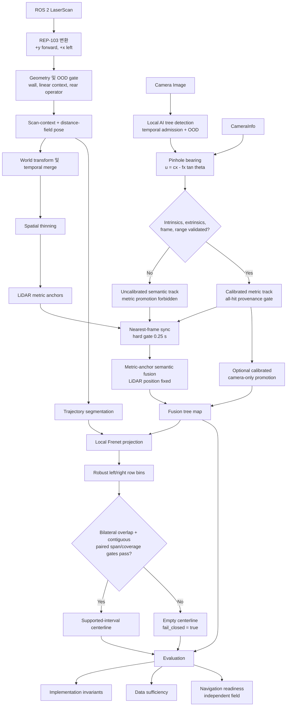

# 2026-07-21 과수원 LiDAR-Camera Fusion v9/r3 평가 기록

작성일: 2026-08-22

규범 알고리즘: `orchard_metric_anchor_semantic_fusion_local_frenet_v9`

규범 캐시 리비전: `v9_rep103_provenance_continuity_readiness_r3`

> **Historical v9/r3 snapshot (non-normative).** 현재 규범 계약은 `orchard_fusion_v10_20260721.md`에 있다. 아래 세 기록에는 사람 기준 정답(ground truth, GT)이 없으므로 정확도, precision, recall, 위치 RMSE 또는 중심선 오차를 주장할 수 없다. 이 문서는 v10 비교를 위한 과거 자기일관성/fail-closed 평가 기록으로만 유지한다.

## 1. 평가 범위와 판정 해석

원본 평가는 다음 세 산출물을 읽기 전용으로 계산한 결과다.

- `evaluation_20260721T081819Z_both_v9_r3.json`
- `evaluation_20260721T082224Z_both_v9_r3.json`
- `evaluation_20260721T082612Z_both_v9_r3.json`

세 파일의 공통 최상위 판정은 다음과 같다.

| 필드 | 세 기록의 값 | 의미 |
| --- | --- | --- |
| `ground_truth_available` | `false` | 사람 라벨 또는 측량 GT가 없다. |
| `evaluation_scope` | `self_consistency_and_fail_closed_invariants_only` | 자기일관성과 안전한 출력 억제만 검사했다. |
| `accuracy_claim_allowed` | `false` | 정확도 주장은 금지된다. |
| `implementation_invariants_ok` | `true` | 정의된 구현 계약은 모두 통과했다. |
| `data_sufficiency_ok` | `true` | 최소 입력 프레임 조건은 충족했다. |
| `navigation_ready` | `false` | 세 기록 모두 주행 입력으로 승인되지 않았다. |
| `ok` | `true` | 구현 invariant와 최소 데이터 조건을 통과했다는 뜻이며, 정확도 또는 주행 준비 완료를 뜻하지 않는다. |

`navigation_ready`는 연구용 평가의 `ok`와 독립된 비차단 보고 필드다. 세 기록 모두 `centerline_not_ready` 때문에 `navigation_ready=false`다.

## 2. v9/r3 규범 계약

1. LiDAR 좌표는 전방 `+y`, 좌측 `+x`다. 영상 좌표 `u`는 오른쪽으로 증가하므로 REP-103 좌측 양의 bearing과 pinhole 투영은 다음 부호를 사용한다.

   \[
   u=c_x-f_x\tan(\theta),\qquad
   \theta=-\operatorname{atan}\left(\frac{u-c_x}{f_x}\right)
   \]

2. nominal 카메라 모델은 1920×1080, `fx=fy=1371.022086`, `cx=960`, `cy=540`, 수평 FOV 약 70°다. 이 값이나 nominal `CameraInfo`의 존재만으로 보정 완료를 주장하지 않는다.
3. 융합 좌표의 metric anchor는 LiDAR다. 카메라는 시간·방향 gate를 통과한 semantic evidence로 confidence를 보강할 수 있지만 LiDAR의 `x/y`를 이동시키지 않는다.
4. camera-only monocular landmark는 비보정 연구 레이어에 남는다. metric 승격에는 검증된 intrinsics, extrinsics, coordinate frame 및 range가 필요하며, 승격할 track의 모든 hit가 동일한 보정 provenance를 가져야 한다.
5. 동기화는 최대 `0.25 s`의 nearest-camera gate를 사용한다. 향후 live 운용 권고치는 `0.12 s`다.
6. 중심선은 전역 단일 축이 아니라 trajectory segment별 local Frenet 좌표계에서 계산한다. 좌우 행이 차량을 감싸고, 길이·중첩·연속 paired evidence gate를 모두 통과한 구간 안에서만 점을 출력한다.
7. 캐시 유효성은 알고리즘 이름만으로 결정하지 않는다. 정확한 r3 revision과 timeline freshness가 모두 필요하다.

## 3. 세 데이터 exact 비교

### 3.1 입력, 실행시간, map layer

| Recording | Duration (s) | Evaluation runtime (s) | LiDAR frames | Camera frames | LiDAR trees | Camera trees | Fusion trees |
| --- | ---: | ---: | ---: | ---: | ---: | ---: | ---: |
| `20260721T081819Z_both` | 195.11 | 106.692 | 347 | 350 | 38 | 1 | 38 |
| `20260721T082224Z_both` | 199.68 | 107.417 | 358 | 355 | 38 | 0 | 38 |
| `20260721T082612Z_both` | 129.22 | 66.703 | 217 | 218 | 30 | 0 | 30 |

### 3.2 융합 provenance와 metric-anchor invariant

| Recording | Metric anchors | Semantic-supported | Camera-only promoted | Max LiDAR anchor shift (m) | Uncalibrated promotions |
| --- | ---: | ---: | ---: | ---: | ---: |
| `20260721T081819Z_both` | 38 | 7 | 0 | 0.0 | 0 |
| `20260721T082224Z_both` | 38 | 0 | 0 | 0.0 | 0 |
| `20260721T082612Z_both` | 30 | 0 | 0 | 0.0 | 0 |

`semantic_supported_count=7`은 첫 기록에서 일곱 LiDAR anchor에 카메라 semantic evidence가 연결됐다는 뜻이다. 검출 정확도 일곱 건을 입증하거나 GT와 일치함을 뜻하지 않는다. 세 기록 모두 LiDAR anchor 이동과 비보정 camera-only 승격은 0이다.

### 3.3 LiDAR-Camera 시간 동기화

모든 기록은 `nearest_camera_frame_with_max_delta_gate`, 최대 허용차 `0.25 s`, live 권고 허용차 `0.12 s`를 사용했다.

| Recording | Matched / LiDAR | Outside gate | Camera unavailable | Match ratio | Nearest Δ mean (s) | Nearest Δ p95 (s) | Nearest Δ max (s) | Matched Δ p95 (s) | Matched Δ max (s) |
| --- | ---: | ---: | ---: | ---: | ---: | ---: | ---: | ---: | ---: |
| `20260721T081819Z_both` | 329 / 347 | 18 | 0 | 0.9481 | 0.061539 | 0.2514 | 0.274 | 0.232 | 0.25 |
| `20260721T082224Z_both` | 347 / 358 | 11 | 0 | 0.9693 | 0.072751 | 0.23815 | 0.33 | 0.218 | 0.246 |
| `20260721T082612Z_both` | 184 / 217 | 33 | 0 | 0.8479 | 0.067696 | 0.283 | 0.317 | 0.23185 | 0.246 |

`nearest` 통계에는 gate 밖의 가장 가까운 frame도 포함되므로 그 p95 또는 max가 `0.25 s`를 넘을 수 있다. 실제 매칭된 frame의 max는 세 기록 모두 gate 이하다.

### 3.4 중심선 및 readiness

| Recording | Centerline state | Segments | Selected segment | Points | Length (m) | Confidence | Data sufficient | Navigation ready | Navigation reason |
| --- | --- | ---: | --- | ---: | ---: | ---: | --- | --- | --- |
| `20260721T081819Z_both` | `low_confidence_fail_closed` | 3 | `null` | 0 | 0.0 | 0.0 | `true` | `false` | `centerline_not_ready` |
| `20260721T082224Z_both` | `low_confidence_fail_closed` | 5 | `null` | 0 | 0.0 | 0.0 | `true` | `false` | `centerline_not_ready` |
| `20260721T082612Z_both` | `low_confidence_fail_closed` | 3 | `null` | 0 | 0.0 | 0.0 | `true` | `false` | `centerline_not_ready` |

모든 segment는 `fail_closed=true`, 출력 길이 0, row gap `null`, confidence 0, selection score 0이다. 아래 값의 `—`는 원 JSON의 `null`이다.

| Recording / segment | Failure state | Path (m) | Projected trees | Straddles | L/R bins | L/R span (m) | Overlap (m) | Bilateral coverage | Paired candidates / contiguous | Paired span (m) / coverage |
| --- | --- | ---: | ---: | --- | --- | --- | ---: | ---: | --- | --- |
| `081819 / 0` | `insufficient_bilateral_occupied_bins` | 7.615 | 13 | `true` | 3 / 2 | 5.0 / 7.5 | 5.0 | 1.0 | 0 / 0 | 0.0 / 0.0 |
| `081819 / 1` | `insufficient_paired_bilateral_bins` | 9.8 | 15 | `true` | 3 / 4 | 5.0 / 7.5 | 5.0 | 1.0 | 1 / 1 | 0.0 / 0.0 |
| `081819 / 2` | `insufficient_bilateral_occupied_bins` | 2.206 | 6 | `true` | 1 / 1 | 0.0 / 0.0 | 0.0 | 0.0 | 0 / 0 | 0.0 / 0.0 |
| `082224 / 0` | `insufficient_bilateral_occupied_bins` | 5.368 | 6 | `true` | 2 / 1 | 2.5 / 0.0 | 0.0 | 0.0 | 0 / 0 | 0.0 / 0.0 |
| `082224 / 1` | `insufficient_tree_rows` | 3.933 | 3 | `false` | — | — | — | — | 0 / 0 | — |
| `082224 / 2` | `insufficient_bilateral_occupied_bins` | 13.669 | 6 | `true` | 4 / 1 | 10.0 / 0.0 | 0.0 | 0.0 | 0 / 0 | 0.0 / 0.0 |
| `082224 / 3` | `insufficient_bilateral_occupied_bins` | 17.622 | 5 | `false` | 4 / 0 | 17.5 / 0.0 | 0.0 | 0.0 | 0 / 0 | 0.0 / 0.0 |
| `082224 / 4` | `insufficient_bilateral_occupied_bins` | 30.029 | 17 | `true` | 7 / 2 | 27.5 / 7.5 | 5.0 | 0.667 | 0 / 0 | 0.0 / 0.0 |
| `082612 / 0` | `insufficient_bilateral_occupied_bins` | 7.755 | 15 | `true` | 4 / 2 | 7.5 / 2.5 | 2.5 | 1.0 | 0 / 0 | 0.0 / 0.0 |
| `082612 / 1` | `insufficient_paired_bilateral_bins` | 19.184 | 13 | `true` | 4 / 4 | 10.0 / 15.0 | 7.5 | 0.75 | 1 / 1 | 0.0 / 0.0 |
| `082612 / 2` | `insufficient_tree_rows` | 2.613 | 2 | `false` | — | — | — | — | 0 / 0 | — |

### 3.5 Scan odometry와 LiDAR OOD 집계

| Recording | Accepted / rejected poses | Turn events | Heading change (deg) | Raw candidates | Geometry candidates | Confirmed landmarks | Wall suppressed | Linear-context suppressed | Rear-operator suppressed |
| --- | ---: | ---: | ---: | ---: | ---: | ---: | ---: | ---: | ---: |
| `20260721T081819Z_both` | 332 / 15 | 1 | 15.0 | 14,458 | 985 | 38 | 647 | 1,290 | 2,321 |
| `20260721T082224Z_both` | 353 / 5 | 12 | -5.0 | 15,076 | 1,165 | 38 | 747 | 4,609 | 906 |
| `20260721T082612Z_both` | 208 / 9 | 1 | -18.0 | 12,911 | 423 | 30 | 626 | 4,269 | 1,184 |

Odometry 알고리즘은 세 기록 모두 `scan_context_distance_field_coarse_to_fine_v1`이다. LiDAR landmark의 temporal admission 정책은 반복 world observation에 confidence와 time-span gate를 적용한다. 이 집계는 필터 단계의 내부 개수이며 precision 또는 recall이 아니다.

세 기록에서 다음 아홉 invariant는 모두 `true`였다.

- v9 알고리즘 및 현재 r3 cache revision
- 모든 LiDAR anchor의 위치 이동 0
- 모든 LiDAR landmark의 metric anchor 보존
- 비보정 camera-only 승격 0
- 동기화 수량 보존
- 중심선 fail-closed
- bilateral gate 일관성
- map readiness 수량 일관성

Readiness 최소 조건은 LiDAR 2 frame, nonempty LiDAR 2 frame, navigation용 centerline point 2개다. 관측 nonempty LiDAR frame은 각각 347, 358, 217로 데이터 최소 조건은 통과했지만, centerline point가 모두 0이므로 주행 조건은 통과하지 못했다.

## 4. v8에서 v9/r3로의 변경점

아래 v8 항목은 폐기된 역사적 동작이며 현재 계약이 아니다.

| 항목 | v8 역사적 방식 | v9/r3 규범 방식 | 효과와 주의점 |
| --- | --- | --- | --- |
| 카메라 투영 | 78° 선형 FOV 근사 | nominal 70° pinhole 및 frame별 `CameraInfo`; REP-103 부호 | nominal 값은 여전히 비보정이며 정확도 근거가 아니다. |
| 좌표 부호 | 영상 좌우와 LiDAR bearing 계약이 명시적으로 고정되지 않음 | `+y` 전방, `+x` 좌측, `u=cx-fx*tan(bearing)` | 좌우 반전 association을 계약·회귀 테스트로 차단한다. |
| 융합 위치 | LiDAR와 monocular camera 좌표의 confidence-weighted 평균 | LiDAR `x/y`를 고정하고 카메라는 semantic confidence만 보강 | 비보정 camera가 metric map을 이동시키지 않는다. |
| Camera-only 승격 | 높은 confidence와 반복 관측 중심 | 검증된 intrinsics·extrinsics·frame·range 및 all-hit provenance 필수 | 보정/비보정 track을 분리하고 혼합 provenance 승격을 거부한다. |
| 시간 동기화 | 명시적 연구 계약이 약함 | nearest-frame `0.25 s` hard gate, live 권고 `0.12 s`, 수량 진단 | gate 밖 frame은 semantic fusion에서 제외한다. |
| 중심선 기준축 | start-to-end 전역 단일 축 | trajectory segment별 local Frenet | 회전·U-turn에서 서로 다른 구간을 한 축으로 섞지 않는다. |
| 중심선 승인 | 좌우 행 추정 후 상대적으로 느슨한 출력 | 좌우 straddle, per-side bins/span, bilateral overlap, contiguous paired run, 실제 span/coverage gate | 근거가 부족하면 빈 중심선을 반환한다. |
| landmark 수 | 고정 recording cap을 사용하던 실험 설정 | spatial spacing만 적용하고 고정 개수 cap 제거 | 데이터 길이에 따른 인위적 잘림을 피하되 GT 평가는 별도 필요하다. |
| 캐시 | 알고리즘 이름 중심의 구형 식별 | algorithm + exact r3 revision + timeline freshness | 같은 v9 이름의 오래된 결과도 revision이 다르면 폐기한다. |
| 상태 판정 | 계산 성공과 연구 준비도의 경계가 불명확 | 구현 invariant, 데이터 충분성, navigation readiness를 분리 | `ok=true`를 주행 승인이나 정확도로 오해하지 않는다. |

## 5. Fail-closed 중심선의 의미

v9/r3의 station bin은 2.5 m다. 유효 segment에는 최소한 다음 조건이 필요하다.

- 좌우 각각 occupied bin 3개 이상, longitudinal span 4 m 이상
- bilateral overlap 4 m 이상, bilateral coverage 0.5 이상
- row gap 3–7 m
- paired bin 2개 이상 및 contiguous paired bin 2개 이상
- 연속 paired key gap 2 이하, paired density 0.5 이상
- paired station span 4 m 이상, 전체 bilateral overlap 대비 paired coverage 0.35 이상
- 최종 confidence 0.45 이상, centerline point 2개 이상 및 row-gap dispersion gate 통과

조건을 하나라도 만족하지 못하면 해당 segment는 `fail_closed=true`와 빈 point 배열을 반환한다. 따라서 이번 세 기록의 중심선 0개는 “행간이 존재하지 않는다”거나 “알고리즘 정확도가 낮다”는 GT 기반 결론이 아니다. 현재 관측만으로 안전하게 지지할 수 있는 연속 양측 evidence가 부족해 경로 출력을 의도적으로 억제했다는 뜻이다. Tree map 계산 성공과 중심선 주행 가능 여부는 별도 상태다.

## 6. 논문용 알고리즘 설계 맵

이 구조는 PointPainting처럼 영상 semantics를 LiDAR geometry와 연결하는 연구 방향을 참고하지만, 현재 구현은 별도 3D detector 성능을 주장하지 않는다. 또한 probabilistic semantic mapping 연구가 강조하는 센서·pose·projection uncertainty는 향후 확률 모델 확장의 근거이며, 현 r3을 그 논문의 완전한 확률 pipeline으로 표현해서는 안 된다.

## 7. Jetson 고립 실행 benchmark

다음 값은 제공된 Jetson isolated benchmark의 운영 성능 계측이다. 검출 정확도 평가는 아니다.

| Metric | Exact result |
| --- | ---: |
| Source frames | 297 |
| Source rate | 13.7 fps |
| Inference/published frames | 152 |
| Inference failures | 0 |
| Dropped frames | 142 |
| Post-warmup inference mean | 139.007 ms |
| Post-warmup inference median | 138.25 ms |
| Post-warmup inference p95 | 177.12 ms |
| RAM mean | 4,611.8 MB |
| Swap mean | 3,737.9 MB |
| GPU utilization mean | 21.93% |
| Temperature mean | 47.68 °C |
| VDD_IN mean | 8,160.8 mW |

`failures=0`은 해당 benchmark에서 inference 예외가 기록되지 않았다는 뜻일 뿐, false positive/negative가 없다는 뜻이 아니다. Source 297개 중 published 152개와 dropped 142개의 합은 294개이므로 나머지 3개를 임의로 분류하지 않는다. 논문 표에 사용하기 전에 warm-up, 종료 경계 및 counter 정의로 이 차이를 재현·설명해야 한다. 13.7 fps 입력에서 drop이 발생했으므로 실시간 주행 전에는 latest-only 처리 정책, 처리 지연 및 end-to-end timestamp age를 함께 측정해야 한다.

## 8. 한계와 다음 검증

현재 한계는 다음과 같다.

- 세 최신 기록 모두 사람 GT가 없다. 나무 검출 precision/recall, landmark 위치 오차, 중심선 횡오차를 계산할 수 없다.
- `CameraInfo`는 nominal 70° 모델이며 독립 검증된 intrinsics가 아니다.
- LiDAR-camera extrinsics가 검증되지 않았다. 따라서 현재 camera-only metric 승격은 0이며 monocular 좌표는 연구 레이어에만 남는다.
- wheel odometry, IMU, `/tf` 기록이 없다. 현재 world pose는 scan-only odometry에 의존한다.
- 세 기록 모두 `navigation_ready=false`이고 중심선 point가 0이다. 주행 제어 입력으로 사용하면 안 된다.
- Jetson benchmark는 처리 안정성과 자원 계측만 제공한다. 정확도, end-to-end latency, 장시간 열 안정성 및 주행 안전성을 입증하지 않는다.

논문 및 실시간 주행 전 다음 검증이 필요하다.

1. Checkerboard 또는 동등한 절차로 intrinsics와 왜곡계수를 측정하고 nominal `CameraInfo`를 교체한다.
2. LiDAR-camera extrinsics와 frame 방향을 독립 표적에서 측정하며, REP-103 좌우 부호 회귀시험을 실제 장착 상태에서 수행한다.
3. 하드웨어 또는 검증 가능한 timestamp 동기화를 적용하고 live `0.12 s` 권고 gate에서 association과 end-to-end age를 측정한다.
4. wheel odometry, IMU, `/tf`를 함께 기록하여 scan-only pose의 drift, 회전 및 U-turn 오차를 독립 비교한다.
5. 측량한 trunk 위치와 사람이 라벨한 영상/중심선 GT를 구축한다. 데이터 분리 후 tree precision/recall, 위치 RMSE, centerline lateral/heading error, coverage와 continuity를 보고한다.
6. 다른 행 간격, 수종, 계절, 조도, 가림, 사람 및 비나무 구조물 조건에서 외부 검증을 수행한다.
7. Jetson의 297-frame counter 차이와 drop 원인을 계측 정의로 재현하고, 장시간 benchmark에서 p50/p95/p99 latency, drop ratio, timestamp age, RAM/swap, 온도, 전력을 함께 보고한다.
8. 실제 구동 전 shadow mode, 속도 제한, 독립 장애물 정지 및 E-stop을 검증한다. `navigation_ready=false` 또는 빈 중심선이면 정지/수동 인계하는 정책을 유지한다.

## 9. 참고문헌

아래 연구는 설계 배경과 비교 축을 제공한다. 외부 논문의 성능 수치를 현재 데이터에 전이하거나 현재 구현의 정확도 근거로 사용하지 않는다.

1. S. Vora, A. H. Lang, B. Helou, O. Beijbom, [“PointPainting: Sequential Fusion for 3D Object Detection,” CVPR 2020](https://openaccess.thecvf.com/content_CVPR_2020/html/Vora_PointPainting_Sequential_Fusion_for_3D_Object_Detection_CVPR_2020_paper.html).
2. J. S. Berrio, M. Shan, S. Worrall, E. Nebot, [“Camera-Lidar Integration: Probabilistic sensor fusion for semantic mapping,” arXiv:2007.05490](https://arxiv.org/abs/2007.05490).
3. Z. Fei, S. Vougioukas, [“Row-sensing templates: A generic 3D sensor-based approach to robot localization with respect to orchard row centerlines,” Journal of Field Robotics 39, 712–738 (2022)](https://doi.org/10.1002/rob.22072).
4. T. Foote, M. Purvis, [REP-103: Standard Units of Measure and Coordinate Conventions](https://www.ros.org/reps/rep-0103.html).
5. ROS 2 `sensor_msgs`, [`CameraInfo` message definition (Iron)](https://docs.ros.org/en/iron/p/sensor_msgs/interfaces/msg/CameraInfo.html).
