# 과수 인식 운영 검증 최종 보고서

> **Historical v8 report (non-normative).** This July 10 snapshot documents the retired weighted-position v8 prototype and its old datasets. Current behavior is defined by `orchard_tree_detection_fusion.md`: v9 keeps LiDAR metric anchors fixed, uses REP-103 left-positive bearings, separates calibrated and uncalibrated camera tracks, and emits a centerline only from sufficiently covered bilateral evidence.

작성일: 2026-07-10

실행 장치: NVIDIA Jetson Orin Nano

당시 평가 리비전: `orchard_trunk_yolo11_trt_clip_ood_v1` / `orchard_three_layer_weighted_centerline_v8`

## 1. 결론

카메라 과수 인식은 더 이상 OpenCV 규칙이나 외부 API를 사용하지 않는다. Jetson에 저장된 `YOLO11n-seg TensorRT FP16` 엔진이 줄기 instance mask를 만들고, 로컬 `CLIP ViT-B/32`가 사람·기둥·전봇대·가구 다리·벽·식생 덩어리와의 open-set 유사도를 계산해 OOD 후보를 거부한다. AI worker가 없으면 UI에 명시적 오류를 표시하는 fail-closed 정책이다.

LiDAR는 매 scan에서 보이는 작은 cluster를 곧바로 나무로 확정하지 않는다. 긴 선분, 벽 인접 조각, 주변 점들과 같은 직선 위에 놓인 조각, 로버 바로 뒤 사람 영역을 먼저 제거하고, world frame에서 반복 관측된 후보만 지도 landmark로 승격한다. 첫 번째 archive 후반의 회전은 기존 frame당 4도 제한을 제거한 360도 scan-context와 distance-field 정합으로 `45.0-51.4초 사이 186도`로 복원했다.

현재 상태는 **운영 가능한 연구 prototype**이다. 다만 사람 손으로 만든 독립 test GT가 없으므로 “나무 판별이 완벽하다”거나 논문용 precision/recall이 확정됐다고 표현할 수는 없다. 실제 주행 제어에 쓰기 전에는 과수원 GT, wheel odometry/IMU, LiDAR-camera extrinsic calibration이 필요하다.

## 2. 평가 범위

모든 AI 추론, 학습, TensorRT export, LiDAR 재분석, 지도 생성은 Jetson에서 수행했다. 로버 구동 명령은 보내지 않았다.

| 입력 | 평가 방식 | Frame |
| --- | --- | ---: |
| `sample_video/IMG_4469.mov` | 2 Hz, 0.25초 offset | 53 |
| `sample_video/IMG_4471.mov` | 2 Hz, 0.25초 offset | 49 |
| `20260708T053333Z_both` camera | 전체 timeline | 93 |
| `20260708T054036Z_both` camera | 전체 timeline | 125 |
| Camera 합계 | 동일 TensorRT+CLIP evaluator | 320 |
| 두 archive LiDAR | 전체 timeline | 216 scans / 196,280 points |

재현 가능한 수치 원본은 `docs/assets/operational_readiness/readiness_summary.json`과 Jetson의 `runtime/analysis/operational_readiness/`에 보존한다.

## 3. 계층형 구조

```text
RGB frame
  -> Grounding DINO tree-trunk proposal       [teacher only]
  -> SAM 2.1 Tiny prompt mask                 [teacher only]
  -> CLIP tree/non-tree semantic audit        [teacher + runtime OOD]
  -> reviewed pseudo-label dataset
  -> YOLO11n-seg student
  -> TensorRT FP16 instance masks             [runtime]
  -> geometry + CLIP OOD gate
  -> two-hit temporal admission
  -> camera landmarks

2D LiDAR scan
  -> polar gap clustering
  -> wall fit and fragment merge
  -> compact candidate geometry score
  -> wall / linear-context / rear-person rejection
  -> predictive local tracks
  -> scan-context + distance-field odometry
  -> repeated world-observation admission
  -> LiDAR landmarks

LiDAR landmarks + camera landmarks
  -> LiDAR-only / Camera-only / Weighted Fusion maps
  -> row split and per-layer centerline
  -> timeline-synchronized rover pose
```

이 구조에서 단일 frame 원은 관측 후보이고, 지도 원은 여러 frame을 통과한 landmark다. 따라서 화면의 파란 원 수와 최종 지도 나무 수가 다른 것이 정상이다.

## 4. 모델 선택과 시행착오

| 단계 | 결과 | 판단 |
| --- | --- | --- |
| OpenCV bark/line heuristic | 실내 가구 다리, 플라스틱 edge, 벽을 나무로 오인 | 폐기, fallback도 금지 |
| 공개 Roboflow trunk model | contour baseline은 좋지만 일부 archive false negative와 CPU 병목 | teacher 비교 기준으로만 유지 |
| AIHub 71697 broad tree masks | canopy/row/full-frame 비율이 높아 줄기 instance를 직접 학습하기 어려움 | 장면 다양성·보조 자료로 사용 |
| archive pseudo-label만 재학습 | 기존 hard frame과 AIHub validation 성능이 함께 악화 | 배포하지 않음 |
| Grounding DINO + SAM2 + CLIP teacher | open-vocabulary proposal, 정밀 mask, semantic negative audit 결합 | 최종 student dataset 생성에 사용 |
| YOLO11n-seg + CLIP OOD | Jetson TensorRT 실시간 후보 생성과 비나무 거부를 동시에 만족 | 현재 운영 경로 |

Teacher dataset은 321개 frame에서 시작했다. CLIP audit 이후 981개 mask를 수용하고 1,535개를 거부했다. 거부 집합에는 건물 기둥 767건, 사람 163건과 식생·가구·pole 후보가 포함됐다. 이 hard negative를 학습·정책 설계에 함께 사용했다.

### 시각 결과

초록 contour는 최종 수용된 tree mask다. 도로·손가락·나무가 없는 구간에서 빈 frame이 남는 것은 정상적인 fail-closed 결과다.

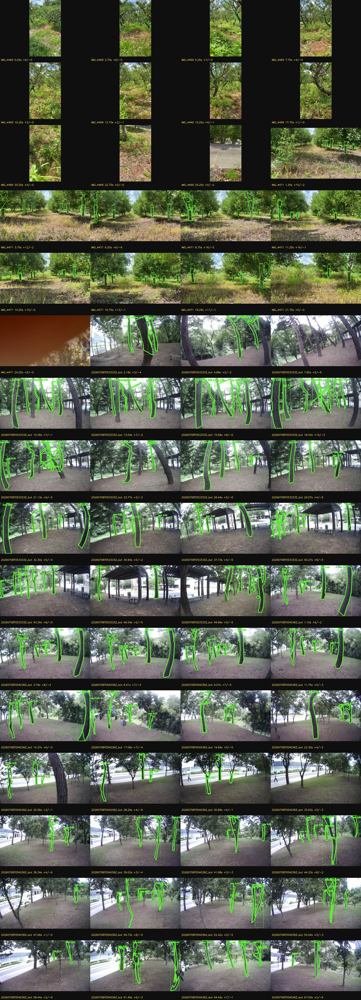

아래 OOD audit에서는 수용 후보와 거부 후보를 함께 확인할 수 있다.

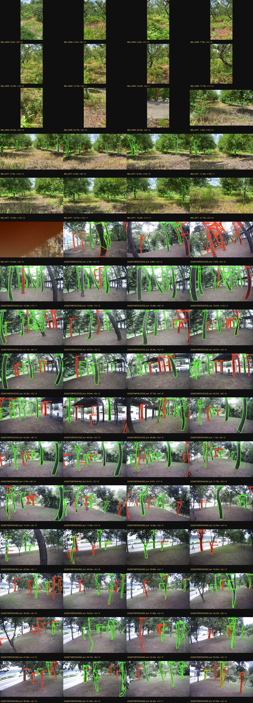

## 5. Camera AI 수식과 정책

Segmentation 모델 confidence를 `p_seg`, CLIP image embedding을 `v`, text embedding을 `t_k`, temperature를 `tau`라고 둔다. 두 tree prompt의 확률 합을 semantic tree support로 사용한다.

$$
p_clip(tree) = sum_{k in tree prompts}
  exp(v^T t_k / tau) / sum_j exp(v^T t_j / tau)
$$

운영 tree probability는 다음 weighted score다.

$$
p_tree = clip(
  0.70 p_seg + 0.30 p_clip(tree)
  + 0.04 I(canopy_support >= 0.12)
  + 0.025 I(h/w >= 1.5),
  0, 0.995)
$$

점수만으로 수용하지 않고 다음 hard gate를 함께 적용한다.

- `h/w < 0.82`: 수직 줄기 형상이 아님
- bbox area가 화면의 20% 초과: 과도하게 큰 region
- bbox bottom이 화면 높이의 32% 위: 지면에서 떠 있는 후보
- `p_clip(tree) < 0.075`: 강한 semantic non-tree
- `p_clip(tree) < 0.24`이면서 `p_seg < 0.58`: 애매한 후보
- 구조물 negative가 가장 강하고 canopy support가 0.06 미만: post/column 거부
- 화면 edge의 semantic support가 낮음: 잘린 플라스틱·벽 edge 거부

수용 detection도 지도에 바로 넣지 않는다. `CameraOverlayStabilizer`가 연속 두 번 매칭된 후보만 `map_admission=accepted`로 바꾼다. 높은 confidence 후보는 화면에 즉시 보일 수 있지만 지도에는 temporal confirmation 전까지 들어가지 않는다.

### Camera 정량 결과

YOLO 학습 validation에서 mask mAP가 가장 높았던 epoch 23의 수치다.

| Metric | Box | Mask |
| --- | ---: | ---: |
| Precision | 0.467 | 0.409 |
| Recall | 0.537 | 0.479 |
| mAP50 | 0.482 | 0.412 |
| mAP50-95 | 0.307 | 0.224 |

Jetson TensorRT+CLIP 전체 평가:

| 항목 | 값 |
| --- | ---: |
| Frames | 320 |
| Raw segmentation candidates | 2,820 |
| Accepted | 1,893 |
| Rejected | 927 |
| Accepted 0개 frame | 22 |
| TensorRT mean / p95 | 87.93 / 282.76 ms |

주요 거부 이유는 CLIP 애매 후보 499건, 낮은 결합 probability 380건, 강한 non-tree 376건, edge 129건, canopy 없는 구조 post 28건이다. 거부 후보의 strongest negative는 건물 기둥 405건, 잎/풀/관목 198건, utility pole 126건, 사람 109건, 가구 다리 85건이었다.

이 수치는 정책이 실제로 후보를 거른 횟수이지 GT precision/recall이 아니다. 논문 정확도는 마지막 절차에 따라 별도 GT로 측정해야 한다.

## 6. LiDAR tree-only 인식

인접 point gap은 거리 증가에 따라 완만하게 넓힌다.

$$
d_i = ||p_i - p_(i-1)||_2
$$

$$
tau_i = max(0.16, min(0.62, 0.05 + 0.045 max(r_i, r_(i-1))))
$$

`d_i > tau_i`에서 cluster를 분할하고 0/360도 경계 cluster를 다시 병합한다. 각 cluster covariance의 고유축으로 길이, 폭, aspect, density를 계산한다. 길고 얇은 cluster는 wall로 분리하고 방향·lateral offset·endpoint gap이 비슷한 조각을 병합한다.

Compact candidate는 다음 세 OOD gate를 통과해야 한다.

1. `near_wall_segment`: wall segment와 projection이 겹치고 adaptive distance 이내면 거부
2. `embedded_in_linear_structure`: candidate 주변 raw point가 긴 직선 문맥을 만들면 거부
3. `rear_operator_exclusion_zone`: 두 archive에서 사람이 서 있던 로버 바로 뒤의 좁은 near-field만 거부

그 뒤 local object track과 반복 world observation을 분리한다. Live overlay의 `confirmed_trees`는 최소 2회 local match가 필요하다. 최종 지도는 일반적으로 5회 이상 또는 충분한 time span과 높은 confidence를 요구한다.

### LiDAR 전체 평가

| 항목 | 값 |
| --- | ---: |
| Scans | 216 |
| Raw compact candidates | 4,601 |
| Geometry accepted observations | 3,523 |
| Explicitly rejected | 889 |
| Linear-context rejection | 347 |
| Rear operator rejection | 300 |
| Near-wall rejection | 242 |
| Mean / p95 processing | 44.34 / 70.05 ms |

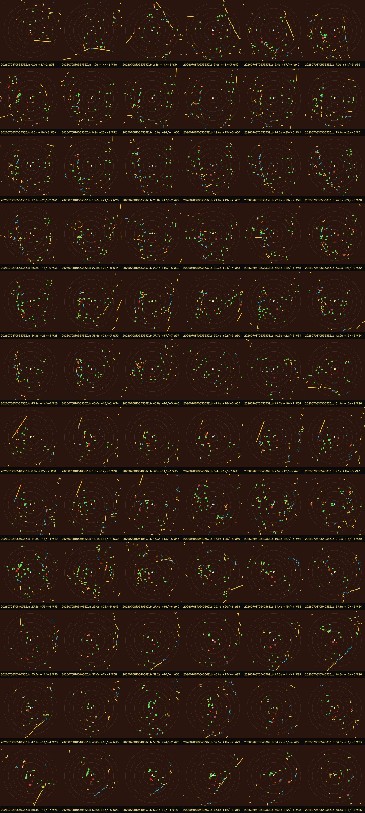

초록 원은 geometry candidate, 빨간 X는 OOD rejection, 청록 선은 wall이다. Frame-level geometry candidate가 수천 개여도 world-frame merge, 반복 관측, 최소 간격 thinning을 통과한 최종 LiDAR landmark는 각각 9개와 7개다.

## 7. Scan matching과 180도 회전

이 archive에는 wheel odometry, IMU, `/tf`가 없어서 2D scan만으로 pseudo-odometry를 계산한다. 기존의 frame당 4도 제한은 U-turn을 놓치므로 제거했다.

1. 0.5 m ring 29개, 2도 sector 180개의 binary scan-context를 만든다.
2. circular shift cosine score 상위 7개를 360도 rotation hypothesis로 사용한다.
3. 이전 scan을 0.07 m resolution Euclidean distance field로 변환한다.
4. 각 회전 hypothesis에서 translation을 0.20 m coarse step으로 찾고, 상위 4개를 0.06 m translation / 1도 rotation으로 refine한다.
5. score 0.43, inlier ratio 0.30, RMSE 0.38 m gate를 통과하지 못한 transform은 누적하지 않는다.
6. 12도 이상 회전은 descriptor/objective margin이 모두 작으면 ambiguous large rotation으로 거부한다.

첫 archive는 92 pose 중 80개 transform을 수용하고 12개를 거부했다. `45.005초 102도`에서 `51.405초 288도`까지 `186도`가 누적돼 사용자가 설명한 후반 U-turn을 복원했다.

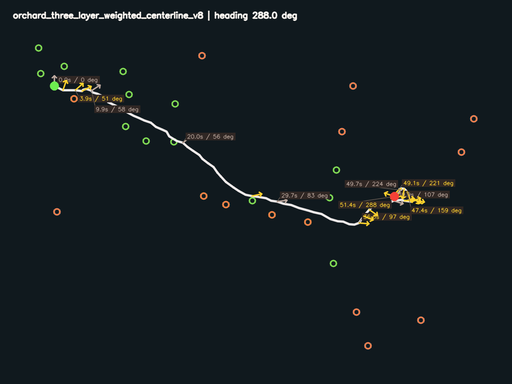

아래 contact sheet는 같은 timestamp의 실제 camera 방향과 추정 heading을 함께 보여준다.

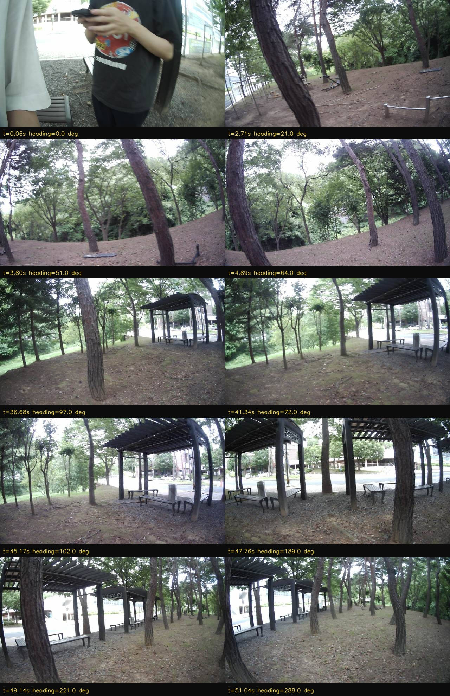

두 번째 archive는 124 pose 중 120개를 수용하고 4개를 거부했으며 최종 누적 heading은 -74도다.

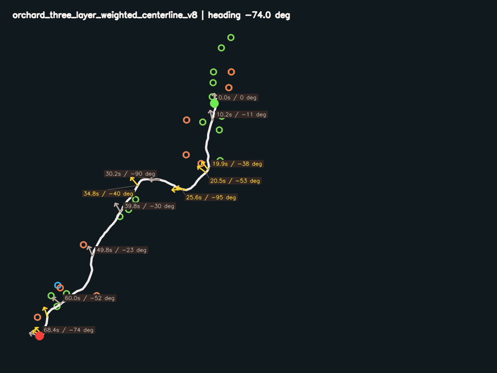

## 8. 세 지도와 행간 중심선

| Layer | Archive 1 | Archive 2 | 의미 |
| --- | ---: | ---: | --- |
| LiDAR-only | 9 | 7 | 반복 확인된 LiDAR landmark |
| Camera-only | 19 | 17 | temporal-confirmed mask의 단안 투영 |
| Weighted Fusion | 14 | 9 | 가까운 두 landmark의 confidence 가중 병합 |

LiDAR와 camera landmark가 gate 이내면 다음처럼 합친다.

$$
w_l = 0.64 C_l,  w_c = 0.36 C_c
$$

$$
p_f = (w_l p_l + w_c p_c) / (w_l + w_c)
$$

Fusion 중심선은 LiDAR 중심선과 camera 중심선을 평균한 선이 아니다. 먼저 tree landmark를 융합한 뒤, fusion tree set에서 좌우 row를 다시 추정한다. 주행축 `a`, 수직축 `n`에 대해 station과 lateral coordinate를 계산한다.

$$
s_i = (p_i - p_0)^T a,  l_i = (p_i - p_0)^T n
$$

각 station bin에서 좌우 confidence-weighted row 위치의 중간을 중심선으로 둔다.

$$
l_center,k = (l_left,k + l_right,k) / 2
$$

카메라 거리는 현재 알려진 수평 FOV 78도와 보이는 줄기 높이 1.35 m 가정으로 근사한다. 따라서 Camera-only와 Fusion의 절대 meter 값은 calibration 전 연구용이며, LiDAR-camera extrinsic 이후에 논문용 metric으로 사용해야 한다.

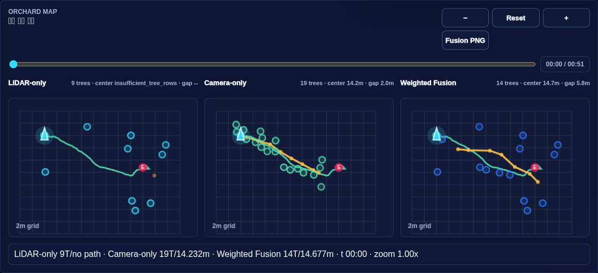

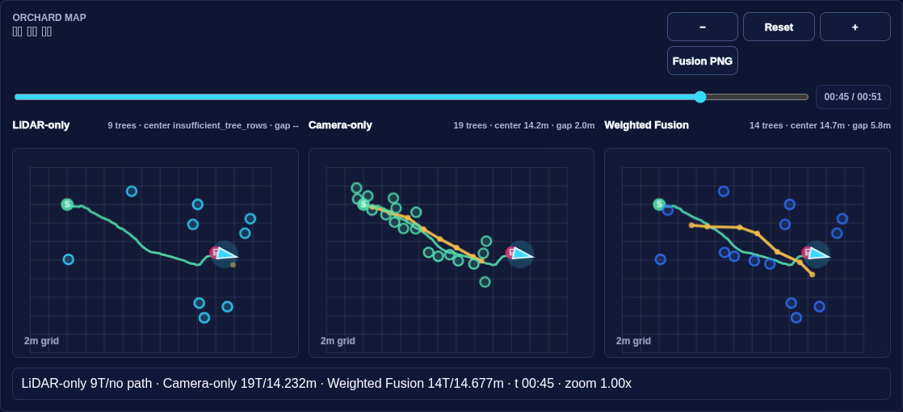

화면 표시는 world 좌표를 start-to-end 축으로 정규화한다. 시작 `S`, 종료 `E`, world point `p`에 대해

$$
\theta_d = \operatorname{atan2}(E_y-S_y, E_x-S_x)
$$

$$
u = \sin\theta_d\Delta x - \cos\theta_d\Delta y,\quad
v = \cos\theta_d\Delta x + \sin\theta_d\Delta y
$$

로 두고 `v` 증가 방향을 canvas 위쪽으로 그린다. Rover world heading $\alpha$는 같은 좌표계에서 $\beta=\theta_d-\alpha$로 변환한다. 따라서 path와 pointer가 서로 다른 회전/반전을 쓰지 않는다. 공개 browser 검증에서 archive 1/2 시작점은 canvas 높이의 79.6%/73.2%, 끝점은 25.9%/14.0%였고 pointer와 투영된 heading vector 오차는 사실상 0 rad였다.

## 9. 재생과 배포 검증

Camera와 LiDAR overlay는 전체 timeline 순서로 미리 계산한다. 4초 segment API는 최신 overlay를 다시 추론하지 않고 반환하며, compact JSON, gzip, 두 archive LRU cache, 다음 두 segment prefetch를 사용한다.

| Archive | 4초 segment warm latency | gzip payload |
| --- | ---: | ---: |
| `20260708T053333Z_both` | 약 105 ms | 약 493 KiB |
| `20260708T054036Z_both` | 약 122 ms | 약 583 KiB |

두 sample video도 `sample_IMG_4469_camera`, `sample_IMG_4471_camera` camera-only archive로 등록했다. 60 fps 원본 MOV와 SHA-256은 그대로 보존하고, UI에는 960 px/30 fps/최대 1.5 Mbps H.264 fast-start proxy를 HTTP Range로 제공한다. AI는 4 Hz preview 205개 전체를 TensorRT+CLIP으로 precompute했으며 실패는 0건이다. Native archive의 4초 overlay payload는 31-32 KiB, warm 응답은 약 17 ms였다. 공개 browser startup은 133-134 ms, 3.2초 동안 3.21초가 진행됐고 video/scrubber 오차는 12-14 ms, seek 오차는 0이었다.

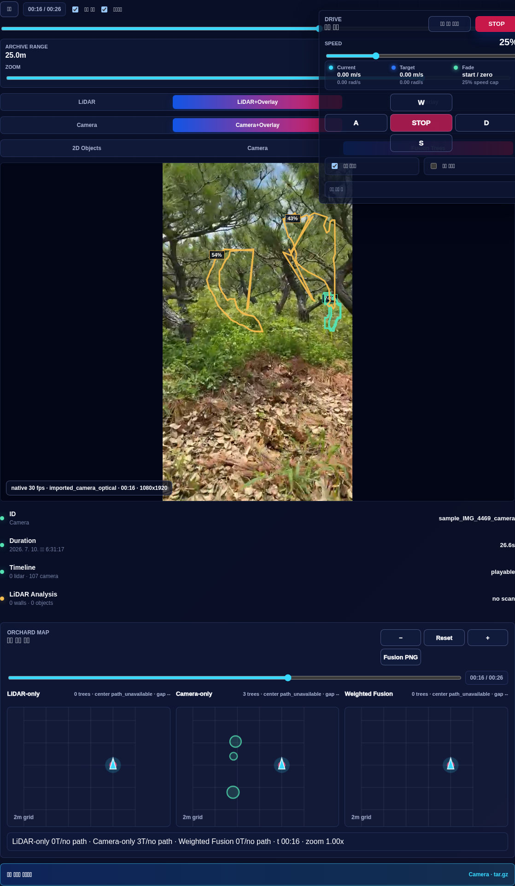

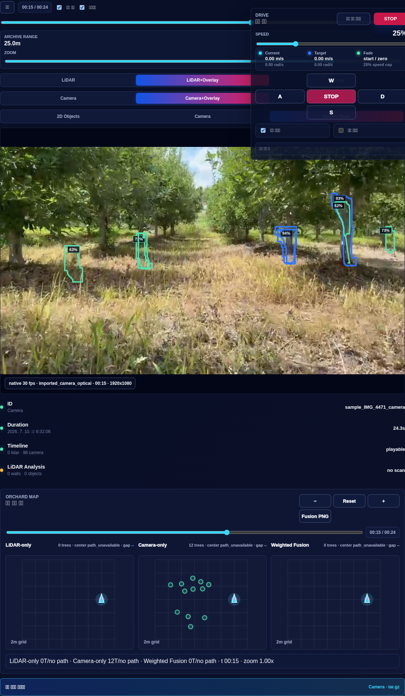

Cloudflare 공개 경로의 archive 1 첫 구간도 약 0.90초에 전달됐다. 실제 브라우저에서는 두 archive 모두 camera image, contour overlay, LiDAR, 세 지도 canvas가 nonblank였고 5.2초 재생 동안 상단/지도 scrubber 오차가 최대 0.04초였다. 1920x1080과 390x844에서 horizontal overflow와 console error는 0이었다.

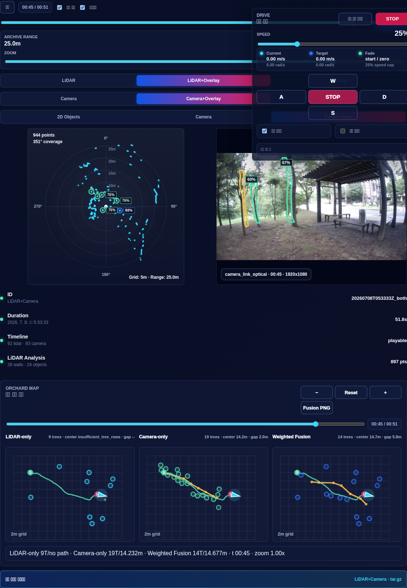

AI worker health의 필수 값:

```json
{
  "ok": true,
  "algorithm": "local_orchard_vision_ai_worker_v4",
  "revision": "orchard_trunk_yolo11_trt_clip_ood_v1",
  "backend": "operational_yolo11_seg_clip_ood",
  "device": "cuda",
  "camera_policy": "AI-only; no OpenCV or remote API fallback"
}
```

## 10. 코드 위치

| 기능 | 파일 |
| --- | --- |
| TensorRT segmentation + CLIP OOD worker | `scripts/vision_ai_service.py` |
| Camera fail-closed client / temporal admission | `dashboard_server/camera_analysis.py` |
| LiDAR wall, linear context, rear OOD, local tracks | `dashboard_server/lidar_analysis.py` |
| 360도 scan-context와 distance-field 정합 | `dashboard_server/lidar_odometry.py` |
| 3-layer map, temporal landmark, centerline | `dashboard_server/orchard_mapping.py` |
| Camera/LiDAR archive precompute | `scripts/precompute_archive_camera_overlays.py`, `scripts/precompute_archive_lidar_overlays.py` |
| Native video-only archive import/stream proxy | `scripts/import_video_archive.py` |
| Reproducible readiness summary | `scripts/build_operational_readiness_summary.py` |

## 11. 다음 수동 작업

### 11.1 논문용 GT

1. `docs/orchard_finetuning_workflow.md` 절차로 현재 contour pre-label을 CVAT에 import한다.
2. sample video와 두 archive에서 장소가 겹치지 않도록 train/validation/test를 나눈다.
3. 놓친 줄기는 추가하고 사람, pavilion post, pole, table/chair leg, wall, plastic edge mask는 삭제한다.
4. 여러 갈래 밑동은 보이는 stem별 polygon을 유지하고 같은 tree root group을 기록한다.
5. 독립 test split에서 mask AP, tree-instance precision/recall, false positive per frame을 계산한다.

### 11.2 Pose와 calibration

1. 다음 기록부터 wheel odometry, IMU, `/tf`를 timeline에 저장한다.
2. AprilTag/checkerboard를 여러 거리·각도에서 camera와 2D LiDAR에 동시에 기록한다.
3. `T_camera_lidar`를 구해 LiDAR candidate를 image plane에 투영한다.
4. Camera-only depth와 fusion match를 현재 단안 근사 대신 calibrated projection으로 교체한다.
5. 실측 tree 위치와 row centerline GT로 lateral error를 비교한다.

## 12. 참고 문헌과 실제 활용

- [Grounding DINO](https://arxiv.org/abs/2303.05499): open-set text-conditioned proposal을 teacher candidate 생성에 사용했다.
- [SAM 2](https://arxiv.org/abs/2408.00714): Grounding DINO box를 정밀 mask로 바꾸고 영상 annotation 초안을 만드는 데 사용했다.
- [CLIP](https://arxiv.org/abs/2103.00020): tree prompt와 non-tree prompt의 normalized embedding similarity를 runtime semantic OOD gate로 사용했다.
- [Scan Context](https://doi.org/10.1109/IROS.2018.8593953): circular sector shift로 큰 회전 hypothesis를 찾는 발상을 2D binary descriptor에 적용했다.
- [Real-Time Correlative Scan Matching](https://april.eecs.umich.edu/pdfs/olson2009icra.pdf): scan 정합을 전역 후보 탐색과 score 기반 품질 판단으로 구성하는 원리를 distance-field search에 반영했다.
- [Ultralytics model export](https://docs.ultralytics.com/modes/export/): YOLO segmentation `.pt`를 Jetson용 TensorRT engine으로 export하는 절차를 사용했다.
- [NVIDIA TensorRT Quick Start](https://docs.nvidia.com/deeplearning/tensorrt/latest/getting-started/quick-start-guide.html): engine을 target GPU에서 build하고 runtime에서 로드하는 배포 구조를 따랐다.

> 이 문서의 candidate count와 OOD rejection count는 운영 파이프라인 감사 수치다. 독립 수동 GT가 없는 상태에서 논문 정확도로 해석하면 안 된다.
