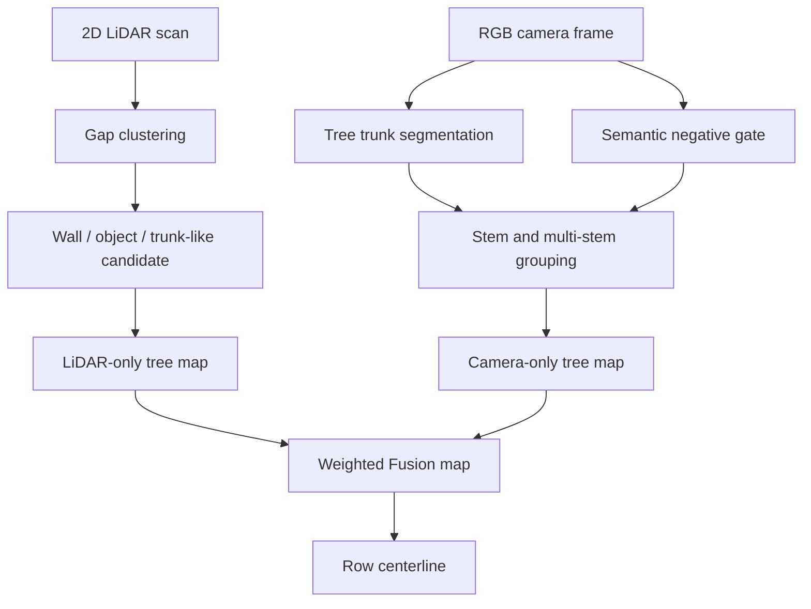
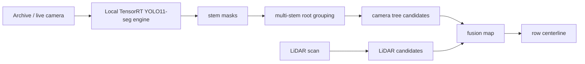

# Vision-LiDAR 과수 밑둥 인식 및 행간 중심선 추정 보고서

작성일: 2026-07-09

## 1. 요약

본 연구의 목표는 과수원 주행 환경에서 2D LiDAR와 RGB camera를 결합해 주변 과수의 밑둥 위치를 인식하고, 과수 사이의 행간 중심선을 안정적으로 추정하는 것이다. LiDAR-only 방식은 조명 변화에 강하지만 벽, 가지, 잎, 여러 갈래로 갈라진 밑둥, 사람과 같은 clutter에 취약할 수 있다. Camera-only 방식은 줄기 외형과 canopy 문맥을 볼 수 있지만 단안 거리 추정과 false positive 문제가 크다. 따라서 최종 구조는 LiDAR-only, Camera-only, Weighted Fusion 세 지도를 동시에 만들고, fusion 지도에서 행간 중심선을 계산하는 방식으로 설계한다.

현재 API 기반 모델 호출은 모델 후보를 빠르게 비교하기 위한 실험용이다. 최종 시스템은 인터넷 없이 Jetson Orin Nano에서 TensorRT engine을 직접 실행하는 offline inference 구조로 전환한다.

## 2. 계층형 인식 구조



계층은 다음 의미를 가진다.

| 계층 | 입력 | 출력 | 역할 |
| --- | --- | --- | --- |
| Frame perception | 단일 LiDAR scan, 단일 camera frame | wall, object, stem mask, trunk candidate | 순간 관측값 |
| Temporal tracking | 연속 frame 후보 | 안정화된 local object/stem track | 흔들림과 순간 noise 억제 |
| Landmark mapping | local 후보 + pose | LiDAR-only, Camera-only tree map | 누적 과수 위치 |
| Fusion mapping | 두 지도 | weighted tree landmark | 센서별 약점 보완 |
| Path abstraction | tree landmark | 행간 중심선 | 주행 제어 목표 |

## 3. LiDAR-only 방법

LiDAR scan point를 angle 순서로 보고, 인접 point 사이 거리로 cluster를 나눈다.

```text
d_i = ||p_i - p_{i-1}||_2
tau_i = max(0.13, 0.045 max(r_i, r_{i-1}))
split if d_i > tau_i
```

각 cluster는 covariance 주축으로 선형성과 compactness를 계산한다.

```text
Sigma = (1/N) sum_i (p_i - mu)(p_i - mu)^T
theta = 0.5 atan2(2 sigma_xy, sigma_xx - sigma_yy)
```

긴 선형 cluster는 wall 후보로 분리하고, 작고 조밀한 cluster는 trunk-like candidate로 둔다. 벽이 scan noise로 여러 조각으로 끊기면 일부 조각이 과수처럼 보이는 문제가 있어 wall proximity suppression을 추가했다.

```text
d_wall = min_j distance(p_candidate, wall_segment_j)
tau_wall = max(0.28, min(0.62, r_candidate + 0.22 + 0.014 range_candidate))
suppress if d_wall <= tau_wall and projection is inside the wall segment
```

이 방식은 벽 오탐을 줄이지만, 실제 과수가 벽이나 긴 구조물 가까이에 붙어 있는 경우 recall이 낮아질 수 있다. 따라서 논문용 수치에서는 wall suppression threshold를 ground truth 기준으로 다시 조정해야 한다.

## 4. Camera-only 방법

현재 OpenCV baseline은 즉시 동작하는 보수적 fallback이다. 그러나 실제 camera overlay 품질을 archive 전체 frame으로 확인한 결과, OpenCV heuristic만으로는 나무와 유사한 수직 물체를 안정적으로 구분하기 어렵다. 따라서 최종 camera perception은 instance segmentation 기반으로 전환한다.

### 공개 모델 평가 결과

`20260708T053333Z_both`, `20260708T054036Z_both` archive camera frame으로 공개 모델을 실제 테스트했다.

| 모델 | 방식 | 결과 요약 | 채택 판단 |
| --- | --- | --- | --- |
| `tree-trunk-detection-369pz-vm3hn/2` | YOLO11 instance segmentation | 218 frame 전체에서 trunk contour mask를 안정적으로 출력. 평균 confidence 0.61-0.65, hosted API 기준 약 408 ms/frame | 1순위 baseline |
| `orchard-trunk-yolov5s/3` | YOLOv5 bbox detection | trunk bbox는 나오지만 mask가 없고 confidence가 낮음. 평균 confidence 약 0.48-0.50 | 보조 후보 |
| `trees-and-trunks/1` | bbox detection | 일부 trunk/tree를 잡지만 bbox만 제공하고 edge false positive가 많음 | 비채택 |
| `object-detection-isoz2/1` | generic segmentation | 샘플 archive에서 유효 tree prediction 없음 | 비채택 |
| SegFormer ADE20K | semantic segmentation | tree/grass/building/wall 같은 장면 영역은 잘 분리하지만 줄기 instance를 직접 따지 못함 | negative semantic gate로 사용 |

YOLO11 trunk segmentation이 가장 좋은 이유는 bbox가 아니라 줄기 contour mask를 제공하기 때문이다. 과수원에서는 밑둥이 여러 갈래로 갈라지거나 기울어진 줄기가 많기 때문에, 단순 bbox보다 mask와 skeleton/axis 정보가 중요하다.

### Multi-stem tree 처리

과수 밑둥이 여러 갈래로 갈라지는 경우를 한 개의 tree root로 세기 위해 camera post-process는 stem instance와 root landmark를 분리한다.

```text
stem_i = {mask_i, bbox_i, bottom_point_i, axis_i, confidence_i}
root group if:
  distance(ground(stem_i), ground(stem_j)) < r_group
  and |bottom_y_i - bottom_y_j| < gamma H
  and axis directions are compatible
```

추천 기본값:

```text
r_group = max(0.35 m, 0.08 * distance_to_tree)
gamma = 0.12
```

지도에는 `tree_root` 하나만 저장하되, 내부에는 `stem_observations[]`를 남긴다. 이렇게 하면 한 과수의 갈라진 줄기를 여러 나무로 중복 count하지 않으면서, 갈라진 밑둥 자체는 segmentation evidence로 활용할 수 있다.

## 5. Weighted Fusion 지도

동일 archive에서 세 개의 지도를 동시에 만든다.

| 지도 | 입력 | 연구적 의미 |
| --- | --- | --- |
| LiDAR-only | LiDAR trunk-like cluster | baseline |
| Camera-only | camera stem/root candidate | LiDAR 오류 보완 evidence |
| Weighted Fusion | LiDAR map + Camera map | 최종 방법 |

LiDAR tree와 camera tree가 world frame에서 가까우면 confidence 기반 평균가중치를 적용한다.

```text
w_l = 0.64 C_lidar
w_c = 0.36 C_camera
p_fusion = (w_l p_lidar + w_c p_camera) / (w_l + w_c)
```

최종 tree probability는 다음 형태로 정리할 수 있다.

```text
P_tree = sigmoid(
  alpha_l C_lidar
  + alpha_c P_camera(tree | ROI)
  + alpha_h log(1 + hits)
  - alpha_w P_wall
  - alpha_n P_negative_semantic
)
```

여기서 `P_negative_semantic`은 wall, floor, table, chair, pole, person 영역과 겹칠 때 증가한다. SegFormer ADE20K는 이 항을 계산하는 보조 모델로 쓸 수 있다.

## 6. 행간 중심선

각 지도 layer는 자기 tree set에서 독립적으로 행간 중심선을 만든다. 주행 방향 단위벡터를 `a`, 수직벡터를 `n`이라고 할 때 tree point를 station/lateral 좌표로 투영한다.

```text
s_i = (p_i - p_0) dot a
l_i = (p_i - p_0) dot n
```

`l_i > 0`은 left row, `l_i < 0`은 right row로 두고, station을 2 m bin으로 나눈다.

```text
l_left,k  = sum(C_i l_i) / sum(C_i)
l_right,k = sum(C_j l_j) / sum(C_j)
l_center,k = (l_left,k + l_right,k) / 2
```

중요한 점은 Fusion 중심선이 LiDAR 중심선과 Camera 중심선을 직접 평균낸 결과가 아니라는 것이다. 먼저 tree landmark를 fusion하고, fusion tree map에서 다시 중심선을 계산한다. 이렇게 해야 camera가 선을 임의로 밀어내는 것이 아니라, camera가 보완한 과수 landmark가 중심선에 반영된다.

## 7. Offline inference 배포 계획

API key는 후보 모델 탐색과 초기 pseudo-label 생성에만 사용한다. 최종 주행 시스템은 외부 인터넷이 없어도 작동해야 하므로 다음 구조로 전환한다.

중요한 제약도 있다. 이번 평가에서 가장 결과가 좋았던 Roboflow Universe 모델 `tree-trunk-detection-369pz-vm3hn/2`는 hosted inference에서는 좋은 baseline이지만, Universe 모델의 native `.pt` 파일을 일반적으로 직접 내려받아 Jetson에 넣는 방식은 지원되지 않는다. 따라서 offline 운영의 현실적인 경로는 두 가지다.

1. Roboflow Inference cache 방식: 개발/실험 환경에서 한 번 model weights를 cache한 뒤 field 장비에는 cache만 배포한다. 이 방식은 Roboflow Inference container 정책과 cache 만료 조건을 확인해야 한다.
2. Ultralytics YOLO segmentation fine-tuning 방식: 우리가 직접 annotation한 orchard dataset으로 `YOLO11n-seg` 또는 `YOLO11s-seg`를 학습하고, `.pt`를 TensorRT `.engine`으로 export해 Jetson에 배포한다.

본 대시보드 구현은 2번을 최종 경로로 채택한다. 이유는 field 주행 장비에 API key와 외부 네트워크 의존성을 두지 않고, 논문 재현성 측면에서도 학습 데이터, class 정의, weight version을 명확히 고정할 수 있기 때문이다.



추천 실행 경로:

1. Roboflow 또는 CVAT에서 `trunk_base`, `split_stem`, `branch`, `canopy`, `post_pole`, `person` class를 annotation한다.
2. SAM 2는 mask 초안 생성용으로만 사용하고, 최종 label은 사람이 확인한다.
3. YOLO11n-seg 또는 YOLO11s-seg를 fine-tuning한다.
4. Jetson Orin Nano에서 TensorRT FP16 engine으로 export한다.
5. Docker image에 `.engine` 파일과 inference worker만 포함해 offline 실행한다.

예상 명령:

```bash
yolo task=segment mode=train model=yolo11n-seg.pt data=orchard.yaml imgsz=640 epochs=100 batch=8 device=0
yolo export model=runs/segment/train/weights/best.pt format=engine half=True imgsz=640 device=0
```

Dashboard 쪽 schema는 현재 `detections[].bbox`, `confidence`, `contour`, `line`, `label`을 유지하므로, OpenCV baseline을 TensorRT worker로 교체해도 UI와 map/fusion 코드는 크게 바꾸지 않아도 된다.

현재 repository에는 이 구조를 위한 local worker가 추가되어 있다.

| 구성 | 파일 | 역할 |
| --- | --- | --- |
| AI worker service | `scripts/vision_ai_service.py` | local YOLO `.pt/.onnx/.engine` 또는 SegFormer local directory를 읽어 camera overlay schema 반환 |
| AI worker image | `Dockerfile.vision_ai` | PyTorch/Ultralytics/Transformers 의존성을 dashboard와 분리 |
| Compose service | `docker-compose.yml`의 `vision-ai-worker` profile | `docker compose --profile vision-ai up -d vision-ai-worker`로 별도 실행 |
| Model preparation | `scripts/prepare_local_vision_models.py` | HF snapshot download, YOLO base 준비, fine-tuned model TensorRT export |
| Dashboard bridge | `dashboard_server/camera_analysis.py` | `ORCHARD_VISION_AI_URL`이 있으면 local worker 우선, 실패 시 OpenCV fallback |

실행 예:

```bash
# 개발 머신 또는 인터넷 가능한 환경에서 모델 파일 준비
source /root/.env
python3 scripts/prepare_local_vision_models.py --download-segformer

# fine-tuning된 YOLO segmentation model이 생긴 뒤 Jetson에서 TensorRT export
python3 scripts/prepare_local_vision_models.py --export-yolo-engine runs/segment/train/weights/best.pt --device 0

# Jetson에서 API key 없이 local worker 실행
export ORCHARD_VISION_AI_URL=http://127.0.0.1:8785/analyze
export ORCHARD_YOLO_MODEL=/app/runtime/models/best.engine
docker compose --profile vision-ai up -d vision-ai-worker dashboard
```

## 8. 남긴 시행착오

처음에는 OpenCV 색상/선분 기반 heuristic으로 camera tree overlay를 만들었다. 그러나 실내 테이블 다리, 벽, 플라스틱 경계, 바닥 사선이 높은 confidence tree로 표시되는 문제가 반복되었다. 이후 orchard scene gate와 canopy support gate를 넣어 오탐을 줄였지만, archive frame을 직접 확인하면 여전히 실제 나무 contour를 안정적으로 따기에는 부족했다.

따라서 결론은 다음과 같다.

1. OpenCV baseline은 emergency fallback과 빠른 archive preview용으로만 유지한다.
2. Camera tree 인식의 주 모델은 orchard-specific instance segmentation으로 교체한다.
3. SegFormer ADE20K는 trunk instance detector가 아니라 negative semantic gate로 사용한다.
4. LiDAR와 camera를 fusion하려면 extrinsic calibration을 반드시 수행해야 한다.

## 9. 다음에 해야 할 일

### 9.1 수동 annotation

이 작업은 사람이 직접 해야 한다. 모델 성능을 논문에 쓸 수 있게 만들려면 ground truth가 필요하다.

진행 방법:

1. 두 archive에서 1초 간격으로 frame을 추출한다.
2. 선명한 frame과 실패 frame을 섞어 최소 300-500장을 만든다.
3. Roboflow 또는 CVAT에 업로드한다.
4. class는 `trunk_base`, `split_stem`, `branch`, `canopy`, `post_pole`, `person`으로 시작한다.
5. 갈라진 밑둥은 각 stem을 mask로 따되, 같은 root에서 나온 경우 metadata나 파일명 메모에 같은 group임을 표시한다.
6. 벽, 테이블 다리, 플라스틱 경계, 기둥, 사람은 hard negative로 충분히 포함한다.
7. train/valid/test를 같은 장소 frame이 한 split에 몰리지 않게 나눈다.

### 9.2 LiDAR-camera calibration

이 작업도 물리 측정이 필요하다.

진행 방법:

1. checkerboard 또는 AprilTag board를 준비한다.
2. camera intrinsic calibration을 먼저 수행한다.
3. LiDAR scan에서 보이는 평면 board edge와 camera image의 tag corner를 동시에 기록한다.
4. 여러 위치와 거리에서 20-30쌍을 모은다.
5. `T_camera_lidar`를 least squares로 추정한다.
6. 추정된 transform으로 LiDAR candidate를 image plane에 project한다.
7. projected ROI 내부 segmentation probability를 fusion confidence에 넣는다.

### 9.3 정량 평가

논문용 표는 다음 지표를 사용한다.

```text
precision = TP / (TP + FP)
recall = TP / (TP + FN)
F1 = 2 precision recall / (precision + recall)
e_pos = ||p_pred - p_gt||_2
e_centerline = lateral_distance(path_pred, path_gt)
```

비교표는 LiDAR-only, Camera-only, Weighted Fusion 세 layer를 반드시 분리한다. 연구 가설은 “LiDAR-only 중심선 오류를 camera evidence가 보완한다”이므로, fusion이 LiDAR-only보다 centerline lateral error를 줄이는지 보여줘야 한다.

## 10. 참고 자료

- TreeScope dataset and paper: https://arxiv.org/abs/2310.02162
- Roboflow Tree Trunk Detection Segmentation: https://universe.roboflow.com/scholar/tree-trunk-detection-369pz-vm3hn
- Roboflow Orchard-trunk-yolov5s: https://universe.roboflow.com/yeah-ty5xb/orchard-trunk-yolov5s
- Roboflow Trees and Trunks: https://universe.roboflow.com/magnus-larsson-czfyf/trees-and-trunks
- SegFormer paper: https://arxiv.org/abs/2105.15203
- NVIDIA SegFormer ADE20K checkpoint: https://huggingface.co/nvidia/segformer-b0-finetuned-ade-512-512
- Ultralytics YOLO11: https://docs.ultralytics.com/models/yolo11/
- Ultralytics Jetson guide: https://docs.ultralytics.com/guides/nvidia-jetson/
- Ultralytics TensorRT export: https://docs.ultralytics.com/integrations/tensorrt/
- Meta SAM 2: https://ai.meta.com/research/sam2/
