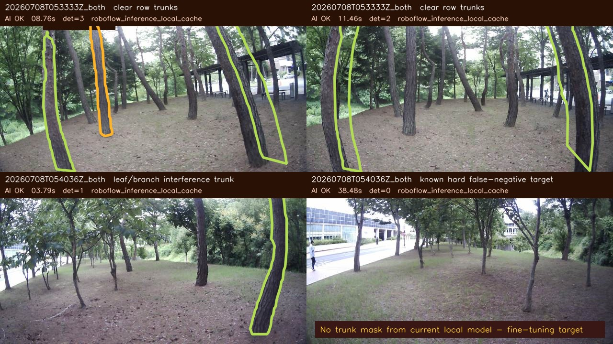

# Orchard Vision AI Local Worker

Last updated: 2026-07-09

이 문서는 camera tree/trunk overlay를 Roboflow API가 아니라 Jetson 내부 local worker로 실행하는 방법을 정리한다. 현재 기준 모델은 Roboflow Universe `tree-trunk-detection-369pz-vm3hn/2`이며, 개발 환경에서 한 번 받은 ONNX artifact를 `runtime/roboflow_cache`에 저장한 뒤 Jetson에는 API key 없이 cache만 배포한다.

## 1. 현재 결론

Camera perception은 AI-only 정책이다. `ORCHARD_VISION_AI_URL`이 없거나 local worker가 실패하면 dashboard는 `Camera AI unavailable` 오류를 표시하고 OpenCV 기반 tree overlay를 사용하지 않는다. 이 정책은 실험 데이터에 heuristic false positive가 조용히 섞이는 것을 막기 위한 fail-closed 설계다.

현재 배포 상태에서 확인한 worker health는 다음 조건을 만족해야 한다.

```json
{
  "ok": true,
  "algorithm": "local_orchard_vision_ai_worker_v3",
  "revision": "roboflow_yolo11n_seg_local_cache_conf020_r2",
  "backend": "roboflow_inference_local_cache",
  "model": "tree-trunk-detection-369pz-vm3hn/2"
}
```

## 2. Offline cache 구조

Roboflow token은 개발 머신의 repo 밖 `.env`에만 둔다. Jetson에는 아래 artifact만 복사한다.

```text
runtime/roboflow_cache/tree-trunk-detection-369pz-vm3hn/2/
  class_names.txt
  environment.json
  model_type.json
  weights.onnx
```

`class_names.txt`에는 현재 `post`, `sprinkler`, `trunk`가 들어간다. Worker는 `trunk`만 positive class로 사용하고 `post`, `sprinkler`, `person`, `wall`, `chair`, `table` 계열은 negative class로 필터링한다.

## 3. Cache 생성

인터넷이 되는 개발 머신에서만 실행한다.

```bash
set -a
. /root/.env
set +a

cd /root/unist_orachard_dashboard
python3 scripts/prepare_roboflow_offline_cache.py \
  --model-id tree-trunk-detection-369pz-vm3hn/2 \
  --cache-dir runtime/roboflow_cache
```

이 스크립트는 Roboflow `/ort` artifact를 받아 `weights.onnx`, `environment.json`, `class_names.txt`, `model_type.json`으로 고정한다. 출력에는 token을 포함하지 않는다.

## 4. Jetson 배포 환경 변수

Jetson의 dashboard `.env`에는 API key를 넣지 않는다. Worker는 local cache만 읽는다.

```bash
ORCHARD_VISION_AI_URL=http://127.0.0.1:8785/analyze
ORCHARD_VISION_BACKEND=roboflow
ORCHARD_ROBOFLOW_MODEL_ID=tree-trunk-detection-369pz-vm3hn/2
MODEL_CACHE_DIR=/app/runtime/roboflow_cache
VISION_AI_BASE_IMAGE=roboflow/roboflow-inference-server-jetson-6.0.0:1.3.2-rc1
VISION_AI_INSTALL_REQUIREMENTS=0
ONNXRUNTIME_EXECUTION_PROVIDERS=CPUExecutionProvider
MODELS_CACHE_AUTH_ENABLED=False
DISK_CACHE_CLEANUP=False
USE_INFERENCE_MODELS=False
ORCHARD_VISION_CONFIDENCE=0.2
ORCHARD_VISION_AI_TIMEOUT_S=6.0
```

중요한 설정은 `USE_INFERENCE_MODELS=False`다. 이 값이 켜져 있으면 Roboflow Inference가 registry/API 경로를 다시 찾으려 하며, API key 없는 offline Jetson에서 모델 로딩이 실패할 수 있다.

## 5. Compose 실행

`vision-ai-worker`는 더 이상 profile 뒤에 숨어 있지 않다. 일반 compose 실행으로 dashboard와 함께 올라와야 한다.

```bash
docker compose up -d --build
```

Jetson에 docker compose plugin이 없고 `docker-compose 1.29.2`를 쓰는 환경에서는 Docker 29와 `ContainerConfig` 충돌이 날 수 있다. 이때 `scripts/jetson_dashboard_remote_restart.sh`는 dashboard 관리 container만 제거하고 재시도한다. Portainer 같은 외부 container는 제거 대상이 아니다.

## 6. 검증 명령

Jetson 내부에서 확인한다.

```bash
curl -fsS http://127.0.0.1:8785/health
curl -fsS http://127.0.0.1:8080/api/health
```

Archive inference도 같은 worker를 사용한다.

```bash
curl -fsS \
  "http://127.0.0.1:8080/api/recordings/20260708T053333Z_both/timeline?start_s=8&duration_s=4" \
  | python3 -m json.tool
```

검증 샘플 이미지는 아래 파일에 저장했다.



요약 JSON:

```text
docs/assets/orchard_perception_models/local_roboflow_worker_archive_verification.json
```

## 7. 현재 한계와 fine-tuning 방향

`tree-trunk-detection-369pz-vm3hn/2`는 현재 공개 후보 중 가장 나은 trunk contour baseline이다. 하지만 모든 frame을 완벽히 잡지는 못한다. 특히 `20260708T054036Z_both`의 약 38.5초 구간처럼 가지/잎 간섭과 거리 변화가 큰 frame에서는 local worker가 `ok=true`여도 detection이 0개일 수 있다.

다음 단계는 이 모델을 그대로 “최종 모델”로 믿는 것이 아니라, 같은 schema와 worker 구조를 유지한 채 우리 orchard dataset으로 fine-tuning하는 것이다.

추천 class:

```text
trunk_base
split_stem
branch
canopy
post_pole
sprinkler
person
wall
```

여러 갈래로 갈라지는 밑둥은 각 stem을 instance mask로 따되, 같은 root에서 나온 경우 `root_group_id`를 후처리로 묶는다. Worker schema는 이미 `root_group_id`, `stem_count`, `contour`, `bbox`, `confidence`를 받을 수 있으므로 대시보드 UI와 fusion map 코드는 유지할 수 있다.

Fine-tuned YOLO segmentation model이 생기면 최종 field runtime은 Roboflow cache 대신 TensorRT engine을 권장한다.

```bash
yolo task=segment mode=train model=yolo11n-seg.pt data=orchard.yaml imgsz=640 epochs=100 batch=8 device=0
yolo export model=runs/segment/train/weights/best.pt format=engine half=True imgsz=640 device=0
```

그 뒤 Jetson `.env`에서 `ORCHARD_VISION_BACKEND=ultralytics`, `ORCHARD_YOLO_MODEL=/app/runtime/models/best.engine`로 전환하면 된다.

